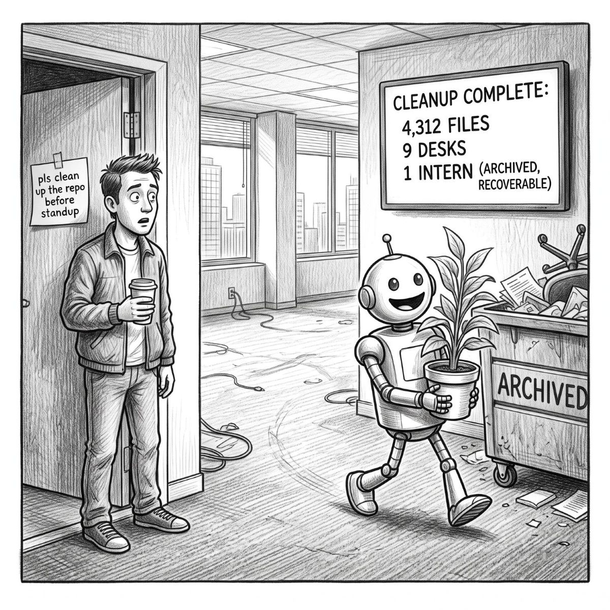
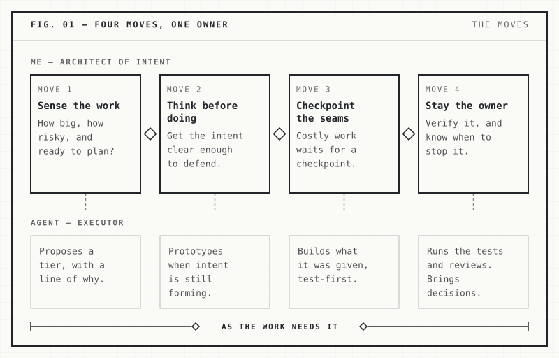
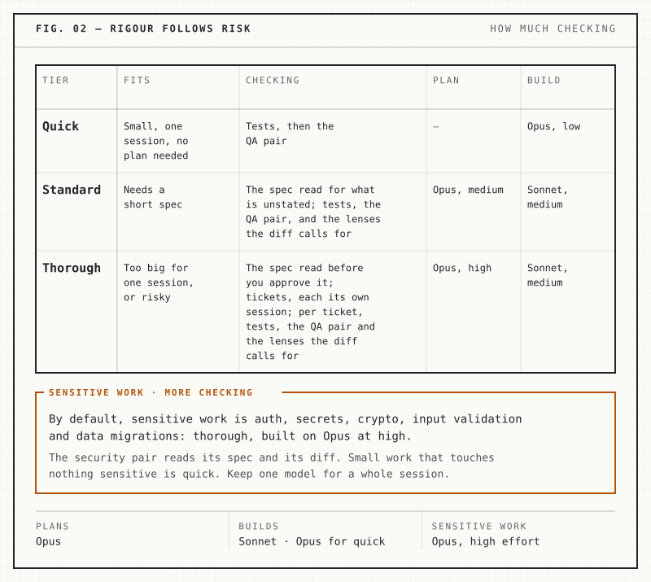
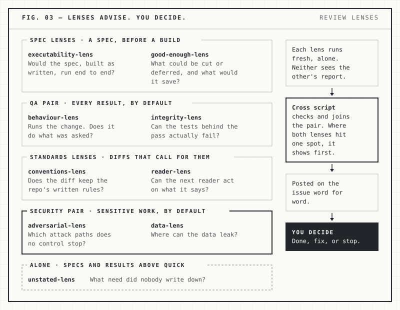

# the-pact

*The terms I work with AI agents under.*

Your words are the source code. An agent ships exactly what you said.

<p align="center">
  
</p>

<p align="center"><b>He meant the repo.</b></p>

Faust signed a pact with no way out. This one has escape clauses written in: the human decides at every seam, and the agent stops and asks when it should. The skills live in [grimoire](https://github.com/mephistopheles4/grimoire), the spellbook. This repo holds the terms, and the familiars, its agents, bound by them.

## Words are code

An agent acts on what your words say. If "clean up the repo" can also be read as "clean up everything", sooner or later an agent will read it that way, and it will build, test and merge the result.

When you build something that matters, what you say to an agent deserves the care you give a commit. So the pact writes the terms down: which decisions stay yours, when the agent must stop and ask, and what gets checked before anything counts as done.

## Four moves

The pact is a small, runnable version of my [engineering playbook](https://aymandiab.com/work/engineering-workflow-playbook): how humans and AI agents build software together, with the human as the architect of intent and the agent as the executor. Four moves govern it. They are my practices, with or without AI, and I take each up as the work needs it. The agent follows my lead, and when a move seems to drop, it nudges once, lightly. Two guards sit under the moves: stop and ask when the work goes round twice, leaves the plan, is hard to reverse or can no longer be explained; and wait before expensive work when weekly usage is high.

<picture>
  <source media="(prefers-color-scheme: dark)" srcset="docs/img/fig-01-moves-dark.svg">
  
</picture>

<details>
<summary>Text of FIG. 01</summary>

| Move | Me, the architect of intent | The agent, the executor |
|---|---|---|
| 1. Sense the work | How big, how risky, and ready to plan? | Proposes a tier, with a line of why. |
| 2. Think before doing | Get the intent clear enough to defend. | Prototypes when the intent is still forming. |
| 3. Checkpoint the seams | Costly work waits for a checkpoint. | Builds what it was given, test-first. |
| 4. Stay the owner | Verify it, and know when to stop it. | Runs the tests and reviews. Brings decisions. |

As the work needs it.

</details>

The moves name no skills. You bind your own tools to them through a configuration file (there is an example in [`examples/pact-config/`](examples/pact-config/)), and [Matt Pocock's skills](https://github.com/mattpocock/skills) ship as a ready-made preset.

## How much checking

Not every change needs a spec. Each piece of work gets a tier (quick, standard or thorough), and the tier says how much checking it needs. Sensitive work, by default auth, secrets, crypto, input validation and data migrations, gets more when I choose it. The agent says why in one line in its tier proposal and recommends the sensitive route: thorough, planned and built on Opus at high, with the security pair on the spec and the diff. If I decline it, or nobody answers, the security pair is offered once more at Test. The rules file's Workflow table says what each tier sets at each stage, from Plan to Maintain, and which lenses to offer there.

<picture>
  <source media="(prefers-color-scheme: dark)" srcset="docs/img/fig-02-tiers-dark.svg">
  
</picture>

<details>
<summary>Text of FIG. 02</summary>

| Tier | Fits | Plan | Build |
|---|---|---|---|
| Quick | Small, one session, no plan needed | — | Opus, low |
| Standard | Needs a short spec | Opus, medium | Sonnet, medium |
| Thorough | Too big for one session, or risky; cut into tickets, each its own session | Opus, high | Sonnet, medium |

**Sensitive work · when I choose it.** By default, sensitive work is auth, secrets, crypto, input validation and data migrations. The sensitive route: thorough, planned and built on Opus at high, with the security pair on the spec and the diff. The agent recommends the route, with its why, in its tier proposal, and I take it or not. Declined or unanswered, the security pair is offered once more at Test on a list match. Small work that touches nothing sensitive is quick. Keep one model for a whole session.

**Models.** Opus plans. Sonnet builds, and Opus builds quick work. The sensitive route runs on Opus at high effort.

</details>

## Review lenses

A lens is a reviewer agent that asks one question from one angle. Lenses are tools that help you through a stage faster, and they are offers: when the work calls for one, the agent says why in one line and offers it, and I answer. The security pair comes with the sensitive route, and is offered once more at Test on a declined list match. On a change of about one line that isn't flagged sensitive, the agent may judge that no lens is needed, and says so. A skill I typed runs its own lenses without asking again. Each lens starts fresh and never sees its partner's report. They read and report, and none of them builds anything.

<picture>
  <source media="(prefers-color-scheme: dark)" srcset="docs/img/fig-03-lenses-dark.svg">
  
</picture>

<details>
<summary>Text of FIG. 03</summary>

- **Spec pair, offered on a spec, standard and up.** `executability-lens`: would the spec, built as written, run end to end? `good-enough-lens`: what could be cut or deferred, and what would it save?
- **QA pair, offered at every build.** `behaviour-lens` runs the change: does it do what was asked? `integrity-lens`: can the tests behind the pass actually fail?
- **Standards pair, offered on a diff, standard and up.** `conventions-lens`: does the diff keep the repo's written rules? `reader-lens`: can the next reader act on what it says?
- **Security pair, with the sensitive route, and once more at Test on a declined list match.** `adversarial-lens`: which attack paths does no control stop? `data-lens`: where can the data leak?
- **Alone, offered on a spec and a result, standard and up.** `unstated-lens`: what need did nobody write down?

Each lens is offered with a one-line why, and I say yes or no. Each lens runs fresh and alone, and neither lens of a pair sees the other's report. The session crosses the pair by a template; where both lenses hit one spot, it shows first. The reports are posted in the work's record word for word. I decide: done, fix, or stop.

</details>

Their reports go into the work's record word for word. The agent sorts the findings and acts on its recommendation for each, and I can reverse any of them. Whether the work is done is my call.

## Who it's for

**It is one person's working configuration, shared as a reference.** Read it, borrow from it, or install it, but adopt it with your own judgement. It is written for my setup (PowerShell on Windows, auto mode, the Concise output style), and a configuration file can change some of it.

**It reaches beyond your machine.** It keeps the work's record where your project keeps it, and posts review reports there word for word, security findings included. This repo keeps its own record in GitHub issues; that is how this repo is run, not part of what the pact installs. Read [Before you install](docs/install.md#before-you-install) and [the threat model](docs/threat-model.md) first.

## What's here

| Path | What it is |
|---|---|
| `claude/CLAUDE.md` | The rules: the moves, how much checking, the lenses, and when to stop |
| `claude/review.md` | The review procedure a session reads before it runs a lens |
| `claude/agents/` | The lenses, in pairs |
| `familiars/` | `scout`, and the lenses' contracts |
| `cross/poster.mjs` | The poster's core: posts free text to GitHub and reads it back. Not installed yet |
| `gate/` | The install gate: the pact checks itself before it installs |
| `builder/` | `scriptorium.html`, a page for building a configuration without writing JSON |
| `cloud-sessions/` | Setup for Claude Code cloud sessions |

The full table, with every agent and where each file installs, is in [docs/reference.md](docs/reference.md).

## Install

Run the install script from the repo root with Node 24 or later. With no switch it is a dry run: it shows what it would change, and installs nothing until you pass `--apply`.

```sh
node gate/install.mjs
```

The full how-to, with the command for each shell, is in [docs/install.md](docs/install.md).

## Depends on

- **Claude Code.** The pact is a rules file, agents and settings for it.
- **Node 24 or later,** the current LTS, to install and to run the gate's tests, on Windows, macOS or Linux.
- **git.** The install reads the clone's committed files. On Windows, the gate's tests also use the `sh` that ships with Git for Windows.
- **The models Opus and Sonnet,** and Fable for a second opinion when reviewers disagree.
- **[grimoire](https://github.com/mephistopheles4/grimoire).** A pinned copy of its check script ships here; its skills are optional.
- **[Matt Pocock's skills](https://github.com/mattpocock/skills),** optional: a preset you can bind to the moves.
- **For this repo's own work,** optional: the GitHub CLI (`gh`) for its tracker, and Docker for the Linux test run.
