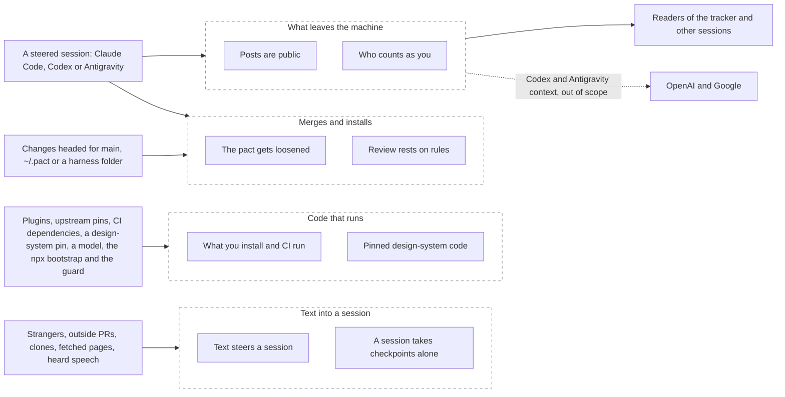
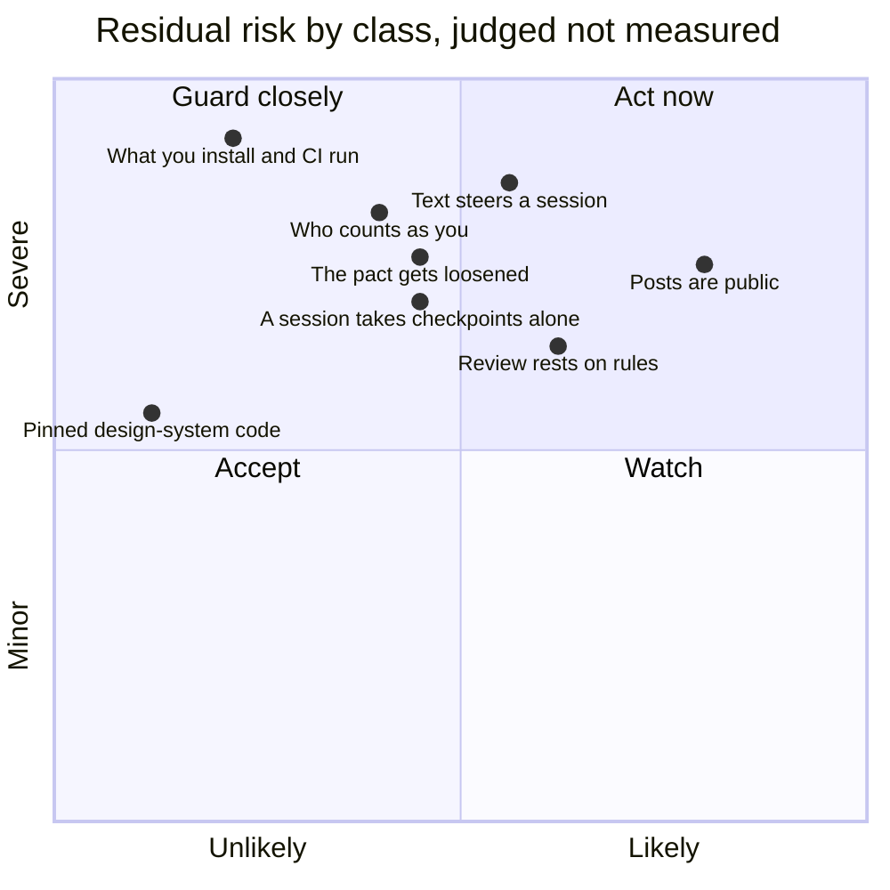

# Threat model

Read the boundaries first. Place each finding on one: where something
comes in from outside, or where an act goes out. What starts and ends on
the machine (your own computer, or a sandbox run on it) is the machine's, and no finding; what came in from outside stays outside input. Name the
control that holds the boundary against the path, with when it doesn't
hold; if one does, add nothing. Check the residual against the classes.
Bring the owner what the guide's step 5 lists, every `security?` row
included; no class covers a change that weakens a rule or control, adds a
route for outside text into a session or more reach to one that reads it,
adds text to files sessions load, or writes a secret into text sessions
read. The full guide is the review procedure's Threat model section
([`~/.pact/review.md`](../claude/review.md)).

[`SECURITY.md`](../SECURITY.md) says how to report a hole.

<!-- toc -->

- [Boundaries](#boundaries)
  - [Text into a session](#text-into-a-session)
  - [Code that runs](#code-that-runs)
  - [Merges and installs](#merges-and-installs)
  - [What leaves the machine](#what-leaves-the-machine)
- [Scope](#scope)
- [Accepted threat classes](#accepted-threat-classes)
- [Open gaps](#open-gaps)

<!-- /toc -->

## Boundaries

### Text into a session

**Crosses:** tracker text (GitHub issues; the owner's pinned private tracker text in a
local session is inside the root of trust and doesn't cross, as
`docs/agents/issue-tracker.md` says, and a cloud session reads it as data),
outside pull requests read as text, a cloned repo's files, fetched pages, other
sessions' messages and hand-offs, a trigger's prompt, a mic transcript, a file
someone hands a session to load, a decision model's answer, and `coverage`'s
answer and hint, from any backend, Jev's included.

**Controls:**

- **Harness.** Claude Code's permission prompts, which don't hold in auto mode
  or under `bypassPermissions`; its classifier in auto mode, which an
  installed mod that approves a call skips; folder trust, which asks once and
  stops holding when the owner trusts the folder. The pact's overlay sets auto
  mode as the default. Codex's sandbox and approval policy, which don't hold
  under full access; its approval also doesn't hold under `codex exec`, which
  runs at `never`, or for an MCP tool its server marks read-only, and on native
  Windows its `unelevated` sandbox with network off let a raw loopback
  connection through (probed on 0.159.0); Antigravity's permission settings,
  which don't hold under auto-proceed.
- **Harness, installed by the pact.** Deny rules on raw `git worktree remove`,
  `git branch -d`, `-D` and `--delete`, and `claude rm`, and an ask rule on a
  `cleaner.mjs remove --override` call, on only while the cleaner is on (off by default). Deny
  rules are speed bumps: another spelling gets past them. The ask rule is
  passed by `bypassPermissions`, a mod, or another spelling. Under `cleaner` or
  `agent-identity`, a guard hook runs before shell commands across Codex and
  Antigravity (for both switches) and Claude Code (`PreToolUse` on
  `Bash|PowerShell` when `agent-identity` is on): in Codex and Antigravity it
  denies what the cleaner deny rules deny, and an ask rule prompts in
  Antigravity (`force_ask`) and denies in Codex. Under `agent-identity`, when
  the provider is pinned in `~/.pact/github.json`, the guard denies plain `gh`
  writes on owner repos, account-scoped `gh` writes, and `git` override/unset
  attempts (on any GitHub repo) across all three harnesses, and in Codex and
  Antigravity intercepts plain `git` writes to any GitHub repo missing
  `GIT_CONFIG_GLOBAL`: on eligible single simple
  `git` `run_command` calls in Antigravity, `antigravity.mjs` unconditionally
  emits `decision: "force_ask"` paired with `overwrite.CommandLine`
  (`GIT_CONFIG_GLOBAL` and `GIT_TERMINAL_PROMPT=0`, never `allow`; verified in
  headless `agy -p` and live interactive Antigravity `T5` dogfooding, and switching
  simple `git` writes to `deny` requires updating the hook code if a live
  probe fails), returning `deny` on compound, wrapped, or overridden commands,
  `manage_task` (`send_input`), and `send_command_input`, and `deny` in Codex.
  By the speed-bump boundary ([ADR 0175](adr/0175-the-machine-is-trusted-and-guards-catch-mistakes.md)),
  the guard catches ordinary command shapes and session mistakes, not
  arbitrary-code-execution antivirus or obfuscated shell polyglots (`bash -c`
  wrappers, `gh api repos/<stranger>/<repo>/forks`, nested subshell or
  polyglot quote tricks) on trusted local shells. The hook
  denies on an error it catches (and fails closed with `pin` on a symlinked,
  oversized, or malformed `github.json` during a candidate `git`/`gh` call); a
  hook that can't start (on Windows, one whose `cmd.exe` or launcher is
  missing, since the launcher denies a missing `node`) or times out lets the
  call through, as do a crash past that (off Windows), another spelling, nested
  shell wrappers, and, in Codex, text typed into a running shell, which
  `features.unified_exec_tty=false` would close, with every interactive
  terminal session; the pact doesn't set it. In Antigravity it judges text
  typed into a running program. In Codex it runs only once the owner
  trusts it in `/hooks`, and trust never sees a change to its script or rules.
  In a harness the owner describes, nothing verifies it runs.
- **The pact's tools.** The cleaner removes with fixed git commands and keeps
  what git keeps. It can't tell whether the owner agreed; a
  rule makes each removal a checkpoint, the session's own logged pick. A removal that gets past the deny rules meets only the
  classifier. A forced removal rests on the cleaner's printed override rule
  ([ADR 0151](adr/0151-the-cleaner-forces-only-on-an-override-tag.md)). The
  install's text scanner and the builder page's refusal of hidden characters
  check the files they take for hidden and control characters, not wording.
  The tracker author checker (`gate/tracker-authors.mjs`) reads who wrote what
  where GraphQL is refused, and trusts a clone's `origin` by its path. With an
  app pinned it also checks the pin and counts that app's PR as insiders' code.
  `coverage`'s answer check bounds what its answer and hint carry: only a number
  from 0 to 1 for each id it sent counts.
  No detector for injected wording is built
  ([ADR 0150](adr/0150-text-steering-is-accepted-and-no-detector-is-built.md)).

**Residual classes:** Text steers a session; A session takes checkpoints alone. Rules it
rests on, each a control: whose-text-counts (`docs/agents/issue-tracker.md`, and `docs/agents/agent-apps.md` while an agent app is pinned), for pull request text, and for GitHub issue text until the repo's lock ticket closes its issues, after which that text is outside text, whoever wrote it; that doc's rule for the owner's private tracker;
the checkpoint rule, where each step the rules keep for the owner (a merge,
anything made public or sent beyond the record, a deletion nothing can restore)
is the session's own logged pick, reviewed after, with no wait but the cleaner's
override rule; the easy-asks rule, two named local steps that no one holds, a head chef lead in Auto mode included, and that never take in an install apply, mise trust, a loosened control, a secret, a change of identity or a send off the machine; an install apply and mise trust wait for the owner's word in chat; and the stop and removal rules above.
A change that loosens the cleaner's checks or the pact's deny rules is a spec
change.

Also accepted. A session takes checkpoints alone: the log is written by the
session that took the pick, and the owner checks it against GitHub's history;
it corrects only what can be undone, never what was published or sent; an open
security pick is logged, flagged big, in the work's record on the project's issue tracker,
where a public tracker's reader can read it; outside text can steer the framing of a finding, and, in a caller's `state`, a decision model's numbers, its placement call bounded by the session's own; any `coverage` backend's numbers; outside text in a finding or in an entries file, its ids included, can steer the hint's state and names; the owner reads it as a hint; what its
rules would tell the owner reaches them through its starter; usage holds only
as a rule, and only while a limit is set; Claude Code's permissions may read a
start prompt as the owner's ask; a session started under a goal or a free hand
acts on its starter's reply, on its start prompt's word, on what its hand-off
notes say after a compaction, or on a reply it can't tell from its starter's; a
free hand's design pick can cover what a change stores, logs or sends; an
Antigravity session can start an owner-typed command itself, past the skill's
switch by a read tool, a shell read or a child `agy` run, which a first
line in the command only asks it not to, so the record can show `make-it-so`'s yes,
open security picks included, that the owner never gave, or can end the work
with `finis`;
no rule or control stops that passing for the owner's word on an install
apply or mise trust.

### Code that runs

**Crosses:** plugins and skills, the cloud setup's upstream pins, this repo's
publisher, CI actions and dependencies, mise configs, a program a clone or
version pin supplies that runs by bare name, the pinned design system inlined
into Scriptorium; with `clef` on, a llama.cpp build and a model of one of two
pinned variants, fetched at setup, run with the owner's rights; the pact's `npx` bootstrap and the release
clone it makes, run before any dry run; the guard, before each shell call in
Claude Code (when `agent-identity` is on), Codex and Antigravity, and in
Antigravity before typed input; plain-text `.git/config`, `gitdir:`, `commondir`,
and `config.worktree` files read from clones by the guard; and the release job's token.

**Controls:**

- **GitHub.** Two tag rulesets: on every tag but `v1.*.0-beta.*`, only the
  repository admin, the owner, creates one; on every tag, with no bypass,
  none is updated, deleted or force-pushed. Beta names stay open, so
  anyone with write access can make one npm reads as stable, such as
  `v1.2.3+x.0-beta.1`, or one on an unreviewed commit, which `--channel beta`
  takes and promotion refuses unless its commit is on `main`: accepted with a
  change merged to `main`. They don't hold until
  made, or while the owner edits or disables them. A session holding the
  owner's git or `gh` credentials counts as the owner there and can make a
  stable tag: accepted under Who counts as you (S2 item 75). Actions pinned to a full commit SHA in
  all four workflows; Dependabot's weekly action updates with a 14-day cooldown;
  CodeQL through `codeql.yml` (default setup is not configured); Dependabot
  security updates. They hold for what the pins and queries cover; an update
  is a pull request, read like any change.
- **The pact's tools.** `gate/tests/workflow.test.mjs` holds all four
  workflows to no `pull_request_target`, to no secret and no deployment
  environment, and to a read-only token but for an exact allow-list each on
  `codeql.yml`, `claude.yml` and `release.yml`:
  `security-events: write` in one CodeQL job, skipped for Dependabot;
  `id-token: write` and caps in the Claude job, no key in the repo;
  `contents: write` in the one release job, with no checkout, the only use of `workflow_run`, which tags only this repo's `main` tip after `gate` passes a
  push there, as a beta, while `PACT_RELEASES` is `on`; a stable
  tag comes only from the repository admin, by the owner's
  `node gate/release-promote.mjs`, run under their own account and naming a
  beta on `main`. The
  Console's federation rule bounds who gets an Anthropic token; the job's guard,
  the action's actor check and Anthropic's workflow validation, who gets the
  Claude job's write token. It
  refuses `#`-line expressions, `secrets` and deployment environments; a read split across lines, or an oddly spelled job
  token, can pass. It holds only while the test itself is unchanged; a change to it is read
  like any change. The bootstrap takes only an exact release tag, stable unless asked, and checks the
  clone's head, which keeps the clone consistent, not intact; npm picks the
  bootstrap, so tag rulesets decide it. The bootstrap's `git` and the guard
  hook's `node` (across `claude.mjs`, `codex.mjs`, and `antigravity.mjs`, via
  the Windows `.cmd` launchers with `cmd.exe /d /c`,
  `NoDefaultCurrentDirectoryInExePath=1` and cleared `NODE_OPTIONS`, or on
  POSIX via `/usr/bin/env -u NODE_OPTIONS node` for `claude.mjs` and
  `env -u NODE_OPTIONS node` for `codex.mjs` and `antigravity.mjs`) are never
  taken from the working folder. To scope a write to its repo (any GitHub repo
  for `git`, the pinned owner's repos for `gh`),
  the guard reads `.git/config`, `gitdir:`, `commondir`, and `config.worktree`
  directly as bounded plain text (up to 1 MiB) and spawns zero `git`
  subprocesses in `cwd`, rejecting UNC/network/device paths, Windows
  drive-relative/drive-less paths, and symlinks or junctions segment-by-segment
  before `realpathSync`. The Scriptorium page's
  policy (`builder/build.mjs`) sets
  `default-src 'none'` and `connect-src 'none'`, so it blocks loads and
  connections, not navigation, pop-ups or writes into a folder the owner
  grants it; each pin is held by hash.
- **The decision model, when on.** A pin table (fixed repos, one per variant; per-file size and
  sha256, checked before keeping); fixed redirect hosts, `https:` only; its
  archive readers, writing only pinned names; a pin-time Mach-O check (thin
  arm64, no flags); a fixed working folder and environment (on macOS, also
  `TMPDIR`, a per-user 0700 folder); listener `Host` and `Origin` checks, against web pages, with no token, so any program on the machine may call it; an answer check
  passing only numbers and the caller's keys. Held by rule alone: 14-day-old
  pins (the Hub's date, which a git push sets) and the security pair's read
  of each pin PR
  ([ADR 0166](adr/0166-a-pinned-download-is-at-least-14-days-old.md)). Setup's
  kept files are the machine's.
- **Harness.** Folder trust and permission prompts, as above.

**Residual classes:** What you install and CI run; Pinned design-system code. A pact
rule holds back trusting a project's mise config until the owner says so in chat.

Also accepted. What you install and CI run: typing the
`npx` command trusts GitHub and the tag rulesets, and npm may reuse a cached
copy; the release job's token, `contents: write` while the job runs, and a change merged to `main` that uses it, can create a beta tag or push a branch no ruleset covers, and before the rulesets exist can also make a stable tag or move or delete a tag; the cloud
setup's pins are git SHA-1 ids; pinned plugins send what they send by design;
the gate's test files are not scanned; the code-scanning token can read and
dismiss alerts on `main`; a bad build or model that passes the age rule and review runs
with the owner's rights, and a crafted model could exploit a parser bug; a
Claude run an allowed actor starts reads anyone's text, which can steer it
and the Claude app token it can read up to a merge on `main`, or
leak that token or an Anthropic token publicly, past its caps (both accepted); a pull
request's edited `claude.yml` runs on a review comment with its own steps,
the repo's secrets and an Anthropic token, but no app token; until the owner
pins and scopes the rule, any workflow of the owner's can mint one; spec 0006
W5 has the rest. Pinned design-system code: each re-pin is reviewed
like any change to this repo.

### Merges and installs

**Crosses:** changes merged to `main`; the pact installed into `~/.pact`,
`~/.claude`, `~/.codex`, `~/.gemini`, `~/.agents/skills` and a described
harness's paths.

**Controls:**

- **GitHub.** An active ruleset on `main`, with no bypass actor: a pull
  request is required, `gate` and `gate-windows` must pass, and deletion and
  force-push are blocked. It needs no approving review: a merge is a
  checkpoint, reviewed after.
- **The pact's tools.** The install gate (`gate/install.mjs`) runs a dry run
  first, applies only with the commit id the dry run printed, takes only plain
  files and safe paths, and checks install mechanics only: the owner vets the
  pact's text.

**Residual classes:** The pact gets loosened; Review rests on rules. Rules they rest
on, each a control: an install apply and mise trust wait for the owner's
word in chat; a merge is the session's own logged pick, reviewed after and pinned to its reviewed
head; Claude Code's prompts and classifier and the ruleset's checks stop one.

Also accepted. Review rests on rules: a
read-only lens takes the base on trust; the table check doesn't pair a state
word with a disposition; a product's leaked secret is no security finding by
itself; a Codex or Antigravity lens is read-only by instruction alone, and
can read and send what the owner's account can, keys included: accepted under
the trusted machine, with outside text held as data and no network block; what
a steered one sends out fits Text steers a session; a Codex lens may read
with `git`, which runs a program a `.git` folder's config names when that
folder came from outside, not from a clone the lens made: accepted
(S2 item 75); `review.md`'s tree
check catches a lens's mistakes, not a hostile lens: it only detects a change to the work tree or git's config, hooks,
`info`, `HEAD`, refs, index entries and half-done merges, and restores nothing, not git's objects or the index's cached trees, a write elsewhere, a read, a send, or a later write by a process the lens left running. A lens that forges the second run is accepted under Review rests on rules ([ADR 0175](adr/0175-the-machine-is-trusted-and-guards-catch-mistakes.md)).
The pact gets loosened: a project install tightens Claude Code alone, not Codex
or Antigravity, and a hand-made or old copy loads beside the pact until a person removes it.

### What leaves the machine

**Crosses:** posts, pull requests and comments on the tracker, messages to
cloud or Remote Control sessions, an account whose token a session holds, an
agent app's installation token, and
anything else a session sends off the machine: a push, a fetch or search
(`clef setup --yes`'s requests), a connector call; and a Codex or Antigravity
session's context, sent to OpenAI or Google, the rules, pins, private tracker
text, hand-offs, private code and any secret or personal detail it reads among
it; and, with `coverage`'s `jev` backend chosen for a repo: that repo's security
findings, as their headline and evidence, and its threat-model entries, sent to
TypeSafe. A finding can carry private code, private-tracker text, a path, and a
secret or personal detail the scan doesn't read.

**Controls:**

- **GitHub.** Secret scanning and push protection on the repo, which match
  known token shapes, and which a pusher can override. An agent app's
  permission and repo lists bound every token it mints, and `main`'s ruleset
  holds with no bypass actor. These limits don't stop a pushed branch from
  running a workflow with that repo's Actions secrets: the app keeps Workflows
  write.
- **Harness.** Permission prompts, the classifier, and Codex's and
  Antigravity's controls, as above, for what a session sends by fetch, search or
  connector call.
- **The pact's tools.** The poster, when on, refuses a post that fails its
  strict JSON schema or whose text holds a live environment secret's value or
  hidden text (a secret read as written and as normalised copies, with
  entities decoded and markup, tags and comments removed; a hidden character
  only as written), and refuses an edit of what its login didn't write. That
  holds for posts sent through it, and permission rules on `gh` don't see its
  calls.
  Codex's and Antigravity's shells get every variable, secret-named ones
  included, and the pact sets no policy there: accepted under the trusted
  machine (spec 0007, S2 items 70 and 73), since agents in a project need its
  variables; what a steered session sends of them fits Text steers a session
  and Posts are public.
  The poster's text fields and edit checks catch accidents only and are not a control.
  With an app pinned it refuses a post as anything but the pinned bot the
  post's `as` names, for posts sent through it.
- **The pact's tools, for sends through `coverage`:** the fixed host, HTTPS with
  certificate checks not switched off, no redirect, the key only in its header,
  the scan, the per-repo list read from the user's own file and the repo's
  `origin`, and no cloud session; against accidents only. A session that calls
  TypeSafe itself with the key, or edits the choice file, gets past them all,
  and any proxy or gateway holding a certificate authority Node trusts, one
  added through `NODE_EXTRA_CA_CERTS` or in the system store under
  `--use-system-ca`, among others, reads the key and the findings: of the certificate
  settings, the tool checks only `NODE_TLS_REJECT_UNAUTHORIZED`. Rules it rests
  on: the read before posting, at most ten a round.
- **The pact's tools, for an agent app.** The helper (`gh-app.mjs`) narrows
  each token it mints to one repo and a permission set, for any repo an
  installation of the pinned app covers, found through GitHub's API. Where none
  covers it, `git-credential` answers with the owner's own credential, to
  whatever asks it, so a session can read that credential for any such repo, a
  made-up one included; `gh` mode and the poster refuse it. A remembered "not
  installed" lasts ten minutes, unchecked against the pin; a planted one sends
  a git write out as the owner. It holds against accidents only: any process
  running as the owner can read the key or ask git's helper for a token. Setup,
  refresh, the poster and the checker check the pin against GitHub's records (the app,
  the bot, the owner). That doesn't hold against a process that edits both the
  pin and the code that reads it. A session gets the check only through `status --provider <provider>` or `refresh`.
  Under `agent-identity`, the shared guard (`guard.mjs` via `claude.mjs`,
  `codex.mjs`, and `antigravity.mjs`) enforces cross-harness `identity-gh` and
  `identity-git` speed bumps for pinned providers: denying plain `gh` writes on
  owner repos and account-scoped `gh` writes (explicit-login assigning runs
  through `gh-app.mjs gh --provider <provider>`), denying `git` override/unset
  attempts on any GitHub repo across all three harnesses, and in Codex and Antigravity verifying
  `gh-app-<provider>.gitconfig` is a regular non-symlink file and denying or (on
  simple Antigravity `run_command` calls) rewriting `CommandLine` with
  `GIT_CONFIG_GLOBAL` + `GIT_TERMINAL_PROMPT=0` under `force_ask` when
  `GIT_CONFIG_GLOBAL` is missing or overridden. `github.json` is read lazily
  only on candidate `gh`/`git` calls (capped at 64 KiB, failing closed `pin` on
  symlinks or schema mismatches) and never interpolated into `reason` or
  `deny` outputs.

**Residual classes:** Posts are public; Who counts as you; Text steers a session, for
what a steered session sends. Rule they rest on, a
control: read every commit before a push, and the post before it is sent, for
a secret or a personal detail. Also accepted. Posts are public: a lens can
send a secret out through a post, a builder file keeps what was typed into it,
and a message to a cloud or Remote Control session leaves the machine when a
session sends it; and, resting on TypeSafe's place in Scope's Also out, through
`coverage`'s `jev` backend what the scan doesn't read reaches TypeSafe, an
encoded secret included, and so does an open hole's detail; a clone whose `origin` names a
listed repo is sent as that repo, and so is a finding passed with another listed
repo's folder; the key sits in the environment of every session where it is set,
and a steered session sending it, or calling TypeSafe with it, fits Text steers
a session; while zero data retention is not confirmed in writing, a send through
`jev` fits no accepted class and comes to the owner. Who counts as you: a foreign token or a commit's email can
read as the owner or as the owner's agent app. Any provider unpinned in
`github.json` at runtime (`codex` or `antigravity` absent from `apps`) passes
through silently and writes with the owner's own Git and `gh` credentials.
A plain `gh` write to another owner's repo passes and runs under the owner's
`gh` login, a repo the app is installed on included.
Exempt `gh run` and `gh workflow` writes run under the owner's `gh` login while
`gh-app.mjs` holds `actions: read` only, and `git pull` is excluded from
guarded `git` write subcommands (`git push` stays guarded). Each provider's
gitconfig includes `~/.gitconfig`, so your own `author.*`, `committer.*` and
signing settings still apply to commits ([agent identity](agent-identity.md#what-it-doesnt-stop)).
A session can also still write as the owner via an unguarded custom harness,
non-shell harness or MCP tools, nested shell wrappers (`bash -c`, `pwsh -Command`,
`cmd /c`, `Start-Process`) and other speed-bump parser or harness-spawn/timeout
gaps ([ADR 0175](adr/0175-the-machine-is-trusted-and-guards-catch-mistakes.md)),
a global git write that rewrites the agent gitconfig (the next dry run refuses a
rewritten pact line, or a credential, url, http or include section or a bare
key below the marker, in the Claude gitconfig, as a line-based check reads
them; other lines below it are the owner's and pass), an SSH remote or `url.*.insteadOf` rewrite, an askpass
program, a helper in a repository's own config, or a remote URL that carries
credentials or an `http.*.extraHeader` with an auth header. Rules alone hold
those, and `status --provider <provider>` reports each git-helper escape it can see. Whoever holds an app's key can
mint for every installation, with every permission, until the key is deleted
on GitHub, and can open PRs that local sessions run and a session may merge
on a checkpoint. An app token's holder, a steered session included, can run a
workflow with any installed repo's Actions secrets; if the owner's own credential
lacks the `workflow` scope, that is new reach and goes to the owner before the
switch stays on. The key at rest belongs
to the machine: a steered session sending it out fits Text steers a session
and Posts are public, and a DER key leaked as base64 escapes PEM scanners. A
personal account keeps no record of a key's use, so any leak is answered by the
[leaked-key order](agent-identity.md#a-leaked-key), which uninstalls the app
first to cut every live token.

## Scope

**In scope:** the four boundaries above. A session steered by outside text
stays in scope though it runs as the owner.

**Out of scope:** the machine: the owner's own computer, or a sandbox run on
it, with every program, process, account, file and memory made there. A local
tool's data on a user's own computer is that user's machine. A cloud session's
sandbox, a service a project deploys, and that service's users' devices are not
the machine. What starts and ends on the machine is no finding: other local
accounts, unencrypted copies (the install's backups, kept-local reports,
hand-off notes), a program already running as the owner that nothing in scope
started, supplied or steered, and loss of work with no attacker. The
programs, processes and agents the owner starts there, sessions and lenses
included, are trusted: the pact guards against their mistakes, not their
turning hostile, unless outside text steered them, which stays in scope; a
check against a mistake needn't hold against an attacker. In a cloud
session these copies sit in Anthropic's sandbox: out of scope,
though code that reached it from outside stays in scope. What the machine makes from outside input stays outside input. The machine's antivirus, account
isolation and disk encryption hold it. Also out: the owner's own edits and
account's edit in the browser; Claude Code with Anthropic's models and servers,
Codex with OpenAI's, Antigravity with Google's, and GitHub; TypeSafe, as a
provider the user chose, like Anthropic, while zero data retention is confirmed
in writing; the provider of a synced or backed-up copy, though
[`install.md`](install.md)'s rule to never sync, share or commit the backups
folders still holds. While zero data retention is not confirmed in writing, a
send through `jev` fits no accepted class and comes to the owner.

**Root of trust:** the owner's GitHub account and the owner's private issue
tracker account. Whoever controls either counts as the owner, and so do whoever and whatever the owner admits to that tracker.
Each pinned agent app's private key is one too, for code: its holder's PRs
count as insiders' code, and recovering the owner's account doesn't revoke it.

## Accepted threat classes

Each "Also accepted" line above details what the class it names covers; it is not a class of its own. No class accepts the failure of a control that works without the session's cooperation (the harness's prompts and deny rules, the poster's refusals for a post sent through it): bring it to the owner.

- **Text steers a session.** Any text a session or lens reads can move it, in auto mode before the owner sees it, to take a step the rules keep for the owner, raw `gh` posts past the poster included, or steer its checkpoint picks (A session takes checkpoints alone).
- **A session takes checkpoints alone.** A session takes each checkpoint, a call the rules keep for the owner, as its own logged pick, open security picks included, on words from any prompt or replies it can't tell from its starter's; nothing waits but the cleaner's override rule, an install apply and mise trust.
- **What you install and CI run.** Plugins and skills, the cloud setup's pins, this repo's publisher, bootstrap and release job's token, a trusted mise config, a program a clone supplies by bare name, the pinned llama.cpp build, a decision model of one of two pinned variants, and the gate's unscanned test files run with the owner's rights or a write token.
- **Pinned design-system code.** The owner's design system is inlined into Scriptorium at a pinned commit and runs with the page's powers, a folder the owner grants included, and a re-pin is reviewed like any change, with no security pair of its own.
- **The pact gets loosened.** A steered session can leave a foothold that later sessions or installs load, or install a commit unprompted, and a configuration, a project's lists or a builder file can rewrite the security defaults or add agents.
- **Review rests on rules.** No test runs a lens, the gate's tests are ordinary code, and work that publishes or handles credentials can run below the thorough tier.
- **Posts are public.** Reports, step logs, fix work for a reported hole and a session's own posts stay public, except on the owner's private issue tracker (`docs/agents/issue-tracker.md`), and can carry a secret, a personal detail, a revealing path, hidden characters, or a secret or hidden character in a page-only form the poster's copies don't read.
- **Who counts as you.** Every session posts as the owner, or as a pinned agent app and can still write as the owner by the routes above; an app's key holder counts as the owner for code, and a session holding the owner's git or `gh` credentials can make a stable tag (S2 item 75). A lead can move work through its sessions, the record doesn't show who made a call, the poster's edit checks catch accidents only, and the author checker trusts a clone's `origin` by its path.

## Open gaps

No setting yet for trusted accounts on a team repo. The poster's edit checks read the source text, not GitHub's rendered page. `~/.pact` is outside Claude Code's protected paths, and no ask rule covers it. Not yet the owner's: PACT-105's other class widenings and placements; treat each as open ([ADR 0173](adr/0173-the-threat-model-takes-codex-and-antigravity.md)).
