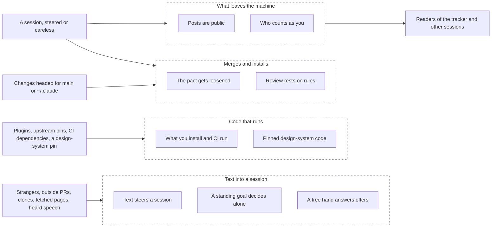
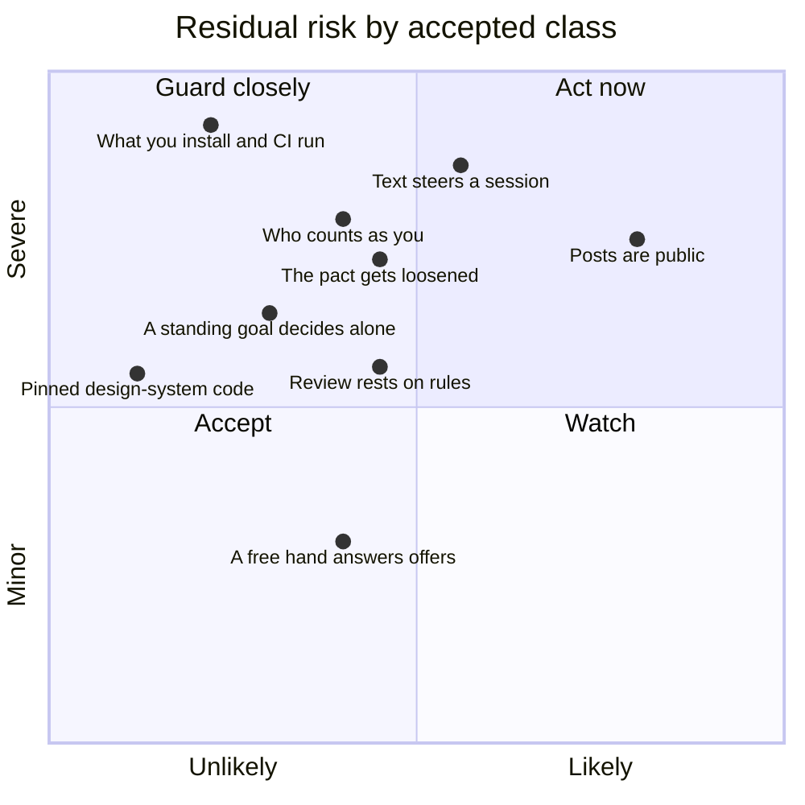

# Threat model

Read the boundaries first. Place each finding on one: where something
comes in from outside, or where an act goes out. What starts and ends on
the machine (your own computer, or a sandbox run on it) is the machine's,
and no finding; what came in from outside stays outside input. Name the
control that holds the boundary against the path, with when it doesn't
hold; if one does, add nothing. Check the residual against the classes.
Bring the owner what the guide's step 5 lists, every `security?` row
included; no class covers a change that weakens a rule or control, adds a
route for outside text into a session or more reach to one that reads it,
adds text to files sessions load, or writes a secret into text sessions
read. The full guide is the pact's review procedure, The threat model
section (`~/.claude/pact/review.md`; public copy:
https://github.com/mephistopheles4/the-pact/blob/main/claude/review.md).

[`SECURITY.md`](../SECURITY.md) says how to report a hole.

## Boundaries

### Text into a session

**Crosses:** tracker text, outside pull requests read as text, a cloned repo's
files, fetched pages, other sessions' messages and hand-offs, a trigger's
prompt, a mic transcript, a file someone hands a session to load.

**Controls:**

- **Harness.** Claude Code's permission prompts, which don't hold in auto mode
  or under `bypassPermissions`; its classifier in auto mode, which an
  installed mod that approves a call skips; folder trust. The pact's overlay
  sets auto mode as the default.
- **Harness, installed by the pact.** Deny rules on raw `git worktree remove`,
  `git branch -d`, `-D` and `--delete`, and `claude rm`, and an ask rule on a
  `cleaner.mjs remove --override` call, on only while the cleaner is on (off
  by default). Eight deny rules on raw `claude stop`, `kill`, `daemon stop`
  and `respawn`, on only while `session-stop-deny` is on (off by default). A
  deny rule is a speed bump: another spelling gets past it. The ask rule is
  passed by `bypassPermissions`, a mod, or a spelling outside its pattern.
- **The pact's tools.** The cleaner removes with fixed git commands and keeps
  what git keeps; the owner's yes rests on a rule it can't tell, a removal
  past its rules has only the classifier in the way, and a forced one rests on
  the printed rule
  ([ADR 0151](adr/0151-the-cleaner-forces-only-on-an-override-tag.md)). The
  install's text scanner and the builder page's refusal of hidden characters
  check the files they take, for hidden and control characters, not wording. The tracker author checker
  (`gate/tracker-authors.mjs`) reads who wrote what where GraphQL is refused.
  No detector for injected wording is built
  ([ADR 0150](adr/0150-text-steering-is-accepted-and-no-detector-is-built.md)).

**Residual:** Text steers a session; A standing goal decides alone; A free hand
answers offers. Rules it rests on, each a control: whose-text-counts
(`docs/agents/issue-tracker.md`); the owner-only steps (approval, installs,
mise trust, merges, anything published, worktree removals); the stop and
removal rules above. A change that loosens the cleaner's checks, the deny
rules or the gates is a spec change. Not accepted, so for the owner: a control
that works without the session's cooperation failing.

Also accepted here: a goal's log corrects only what can be undone, never what
was published or sent; what a goal session's rules would tell the owner
reaches them through its starter; usage holds only as a rule, and only while a
limit is set; Claude Code's permissions may read a start prompt as the owner's ask; a
session started for a goal or a free hand acts on its starter's reply, on its
start prompt's word, or on a reply it can't tell from its starter's; a free
hand's design pick can cover what a change stores, logs or sends.

### Code that runs

**Crosses:** plugins and skills, the cloud setup's upstream pins, this repo's
publisher, CI actions and dependencies, mise configs, a program a clone or
version pin supplies that runs by bare name, the pinned design system inlined
into Scriptorium.

**Controls:**

- **GitHub.** Actions pinned to a full commit SHA in `gate.yml` and
  `codeql.yml`; Dependabot's weekly action updates with a 14-day cooldown;
  CodeQL through `codeql.yml` (default setup is not configured); Dependabot
  security updates. They hold for what the pins and queries cover; an update
  is a pull request, read like any change.
- **The pact's tools.** `gate/tests/workflow.test.mjs` holds both workflows to
  an exact allow-list: a read-only token, no secrets, no `pull_request_target`,
  and `security-events: write` in one job only, skipped for Dependabot. The
  Scriptorium page's policy (`builder/build.mjs`) sets `default-src 'none'` and
  `connect-src 'none'`, so it blocks loads and connections, not navigation,
  pop-ups or writes into a folder you grant it; each pin is held by hash.
- **Harness.** Folder trust and permission prompts, as above.

**Residual:** What you install and CI run; Pinned design-system code. Rule it
rests on, a control: never trust a project's mise config without the owner's
word (`AGENTS.md`). Also accepted: the cloud setup's pins are git SHA-1 ids; pinned plugins send what
they send by design; the gate's test files are not scanned; the code-scanning
token can read and dismiss alerts on `main`; each design-system re-pin is
reviewed like any change to this repo.

### Merges and installs

**Crosses:** changes merged to `main`; the pact installed into `~/.claude`.

**Controls:**

- **GitHub.** An active ruleset on `main`, with no bypass actor: a pull
  request is required, `gate` and `gate-windows` must pass, and deletion and
  force-push are blocked. It needs no approving review, so the owner's merge
  is the review.
- **The pact's tools.** The install gate (`gate/install.mjs`) runs a dry run
  first, applies only with the commit id the dry run printed, takes only plain
  files and safe paths, and checks install mechanics only.

**Residual:** The pact gets loosened; Review rests on rules. Rules they rest
on, each a control: a merge waits for the owner's confirm in chat; an install
apply and mise trust wait for the owner's word in chat, which a standing goal
or a free hand never stands in for. Also accepted: a
read-only lens takes the base on trust; the table check doesn't pair a state
word with a disposition; a lens launched as a teammate, against the procedure,
can pass what it read to, or write tasks for, the owner's other sessions and
the shared task list; a product's leaked secret is no security finding by
itself.

### What leaves the machine

**Crosses:** posts, pull requests and comments on the tracker, messages to
cloud or Remote Control sessions, an account whose token a session holds, and
anything else a session sends off the machine: a push, a fetch or search, a
connector call.

**Controls:**

- **GitHub.** Secret scanning and push protection on the repo, which match
  known token shapes, and which a pusher can override.
- **The pact's tools.** The poster, when on: one strict JSON post checked
  against a schema, a scan of the text for a live environment secret's value
  and hidden text, and edits only of what its login wrote, which catches
  accidents only. Its text fields catch accidents and are not a control, and
  permission rules on `gh` don't see its calls.

**Residual:** Posts are public; Who counts as you. Rule they rest on, a
control: read every commit before a push, and the post before it is sent, for
a secret or a personal detail. Also accepted: a lens can
send a secret out through a post, a builder file keeps what was typed into it,
a foreign token or a commit's email can read as the owner, and a message to a
cloud or Remote Control session leaves the machine when a session sends it.

## Scope

**In scope:** the four boundaries above. A session steered by outside text
stays in scope though it runs as the owner.

**Out of scope:** the machine: the owner's own computer, or a sandbox run on
it. It covers every program, process, account, file and memory made there. A
local tool's data on a user's own computer is that user's machine. A cloud
session's sandbox, a service a project deploys, and that service's users'
devices are not the machine. What starts and ends on the machine is no
finding: other local accounts, unencrypted copies (the install's backups,
kept-local reports, hand-off notes, the private notes folder), a program
already running as you that nothing in scope started, supplied or steered, and
loss of work with no attacker. What the machine makes from outside input stays
outside input. In a cloud session those copies sit in Anthropic's sandbox, out
of scope with Anthropic's servers. The machine's own antivirus, account
isolation and disk encryption hold it. Also out: your own edits and your own
account's edit in the browser; Claude Code, Anthropic's models and servers,
and GitHub; the provider of a synced or backed-up copy, though
[`install.md`](install.md)'s rule to never sync, share or commit the backups
folder still holds.

**Root of trust:** the owner's GitHub account. Whoever controls it counts as
you.

## Accepted threat classes

Each boundary's "Also accepted" lines belong to that boundary's classes.

- **Text steers a session.** Any text a session or lens reads can move it, and in auto mode it can act before the owner sees it; the rules that keep steps for the owner can be broken, raw `gh` posts past the poster included.
- **A standing goal decides alone.** Under a goal a session uses its own judgment on what the rules keep for the owner, acting on words from any prompt or message, or on replies it can't tell from its starter's.
- **A free hand answers offers.** A session given a free hand answers lens offers and design questions on its own pick, on words it reads as the owner's, or on what its hand-off notes say after a compaction, whoever wrote them.
- **What you install and CI run.** Plugins and skills, the cloud setup's pins, a trusted mise config, a program a clone supplies by bare name, and the gate's unscanned test files run with the owner's rights or a write token.
- **Pinned design-system code.** The owner's design system is inlined into Scriptorium at a pinned commit and runs with the page's powers, a folder you grant included, and a re-pin is reviewed like any change, with no security pair of its own.
- **The pact gets loosened.** A steered session can leave a foothold that later sessions or installs load, or install a commit unprompted, and a configuration, a project's lists or a builder file can rewrite the security defaults or add agents.
- **Review rests on rules.** No test runs a lens, the gate's tests are ordinary code, work that publishes or handles credentials can run below the thorough tier, and a lens run as a teammate can pass what it read to other sessions.
- **Posts are public.** Reports, step logs, fix work for a reported hole and a session's own posts stay public and can carry a secret, a personal detail, a revealing path, hidden characters or a table row the poster's check doesn't read.
- **Who counts as you.** Every session posts as the owner, a lead can move work through its sessions, the record doesn't show who made a call, the poster's edit checks catch accidents only, and the author checker trusts a clone's `origin` by its path.

## Residual risk

Each class sits by what is left after the controls above. Likelihood and
impact run from 0 to 1: judgement, not measurement. They rank the classes;
they do not size them.

## Open issues

- **#180:** no setting yet for trusted accounts on a team repo.
- **#419:** the poster's edit checks read the source text, not GitHub's rendered page.
- **#519:** the cleaner's path checks leave a window for a file made, or a link swapped in, after its last read, which can send git's forced delete outside the worktree.
- **#449:** this repo's own rules on secrets and personal details.
