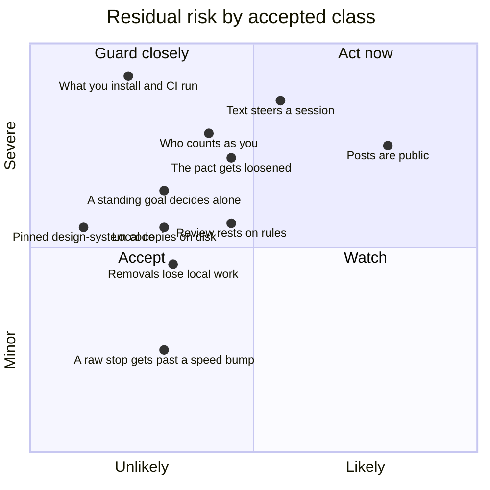
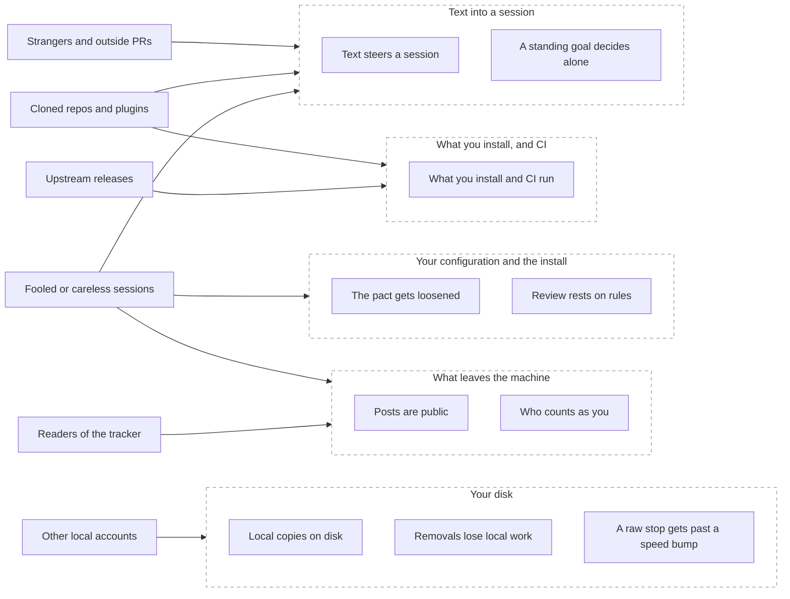

# Threat model

What the pact accepts, and what is still open. Read it before you install the
pact, and before you change it. [`SECURITY.md`](../SECURITY.md) says how to
report a hole.

## Residual risk at a glance

The chart places each class by what is left after today's guards. L and I are
likelihood and impact, from 0 to 1: judgement, not measurement. They rank
the classes; they do not size them. The open issues below are not drawn.

| Class | L | I |
| --- | --- | --- |
| Text steers a session | 0.56 | 0.86 |
| Who counts as you | 0.40 | 0.78 |
| Posts are public | 0.80 | 0.75 |
| What you install and CI run | 0.22 | 0.92 |
| The pact gets loosened | 0.45 | 0.72 |
| Review rests on rules | 0.45 | 0.56 |
| Local copies on disk | 0.30 | 0.55 |
| Removals lose local work | 0.32 | 0.46 |
| A raw stop gets past a speed bump | 0.30 | 0.25 |
| A standing goal decides alone | 0.30 | 0.64 |
| Pinned design-system code | 0.12 | 0.55 |

## Scope

**In scope:** anything that crosses a real boundary into or out of a pact
session: a stranger's text on the tracker, an outside pull request, a cloned
repo's files, a plugin or skill you install, upstream releases the cloud setup
fetches and runs, text a session or a lens reads (another session's messages
included), what a session posts or sends off the machine, a file someone hands you to load, an account whose token a session
holds, other local accounts, this repo's publisher and its CI. A session,
fooled or careless, stays in scope though it runs as you. So does loss of your
work with no attacker.

**Inlined design-system code:** Scriptorium (`builder/scriptorium.html`)
carries the aviation design system's CSS and behaviours inline, pinned by hash
in `builder/build.mjs`. That code runs with the page's powers, including a
folder you grant it to save into; the page's policy blocks loads and
connections, but not navigation, pop-ups or writes into that folder. Review of
each pin is its control: a pin is reviewed like any change to this repo.

**Out of scope:** a program already running on your machine as you, that
nothing in scope started, supplied or steered, and your own edits and your own
account's edit in the browser. Claude Code, Anthropic's models and
servers, GitHub, and the safety of your machine and accounts are out too. Your
GitHub account is the root of trust: whoever controls it counts as you.

## Boundaries

Each box is a boundary a class crosses; the arrows say who reaches it.

## Accepted threat classes

- **Text steers a session.** Text a session or a lens reads can move it, from a stranger, an outside pull request, a cloned repo's instructions or skills, a fetched page, a command sent in as a prompt or an unattended trigger, and in auto mode it can act before you see it, an archive that loses untracked files or a container a session builds wrongly for outsiders' code included.
- **Who counts as you.** Every session posts as you, a lead can move work through its sessions, the record doesn't show who made a call, the poster's edit checks catch only accidents, a foreign token or a commit's email can read as you, and the author checker trusts a clone's `origin` by its path.
- **Posts are public.** Reports, step logs, fix work for a reported hole and a session's own posts stay public, and can carry a secret, a personal detail, a revealing path or hidden characters, or a table row the poster's check doesn't read; a lens can send a secret out, and a builder file keeps what was typed into it.
- **What you install and CI run.** The publisher, plugins and skills, the cloud setup's pins (git's SHA-1 ids included) and what pinned plugins send by design, a trusted mise config, the gate's unscanned test files and the code-scanning token run with your rights or a write token.
- **The pact gets loosened.** A fooled session can leave a foothold that later sessions or installs load, or install a commit unprompted, and a configuration, a project's lists or a shared builder file can rewrite the security defaults or add agents.
- **Review rests on rules.** No test runs a lens, the gate's tests are ordinary test code, work that publishes or handles credentials can run below the thorough tier, a product's leaked secret is no security finding by itself, a read-only lens takes the base on trust, a lens launched as a teammate, against the procedure, can pass what it read to, or write tasks for, your other sessions and the shared task list, and from there it leaves the machine only when a session posts or sends it, a message to your cloud or Remote Control sessions included, and the table check doesn't pair a state word with a disposition.
- **Local copies on disk.** A builder page, kept-local reports, the install's backups and a session's hand-off notes with their `.turn` files and the shared task list's files sit unencrypted until deleted, in reach of other local accounts and of a session that reads them.
- **Removals lose local work.** The cleaner's removals rest on a rule tying them to your yes, outside a goal, what git and the cleaner keep bounds them, and a removal past its deny rules has only Claude Code's classifier in the way. The deny rules include `claude rm`; Claude Code's docs say a plain `claude rm` keeps a worktree with uncommitted changes, and a raw `claude rm` that gets past its rule, in its forced forms (`--force-remove-worktree`, `--discard-unpushed`), deletes the worktree with its uncommitted and untracked files, and the branch and unpushed commits with it, which git's keeps don't bound. The classifier stands behind the rules unless an installed mod approves the call, which also skips the classifier in auto mode.
- **A raw stop gets past a speed bump.** While `session-stop-deny` is on, eight deny rules on raw `claude stop`, `claude kill`, `claude daemon stop` and `claude respawn` are a speed bump and nothing more: another spelling gets past them, and a stopped session loses its turn. They exist only while the setting is on, and the classifier stands behind them unless an installed mod approves the call, which also skips the classifier in auto mode.
- **A compromised machine or sandbox.** Once a program, process or agent on the machine or in the sandbox works against you, or a program a cloned repo or a project's version pin supplies runs when a session, a hook or a tool calls a command by bare name, it can plant programs, change files a session or a hook reads, and act as a session would; the pact does not defend against it. Other local accounts, and a session that text in scope has steered, stay in scope.
- **Pinned design-system code.** The aviation design system is the owner's own code, inlined into Scriptorium at a pinned commit, so it runs with the page's powers, a folder you grant included, and a re-pin is reviewed like any change to this repo, with no security pair of its own.
- **A standing goal decides alone.** Under a goal, a session uses its judgment on what the rules keep for you, on words from any prompt or message, a stranger's or a fooled session's included; a session started for a goal acts on its starter's replies, on its start prompt's word that a goal is set, or on a reply it can't tell from its starter's; what its rules would tell you reaches you through its starter; usage holds only as a rule, and only while a usage limit is set; Claude Code's permissions may read a start prompt as your ask, and the log corrects only what can be undone, never what was published or sent off the machine.

## Open issues

- **#180:** no setting yet for trusted accounts on a team repo.
- **#419:** the poster's edit checks read the source text, not GitHub's rendered page.
- **#442:** the cleaner follows link chains before resolving a path.
- **#449:** this repo's own rules on secrets and personal details.
