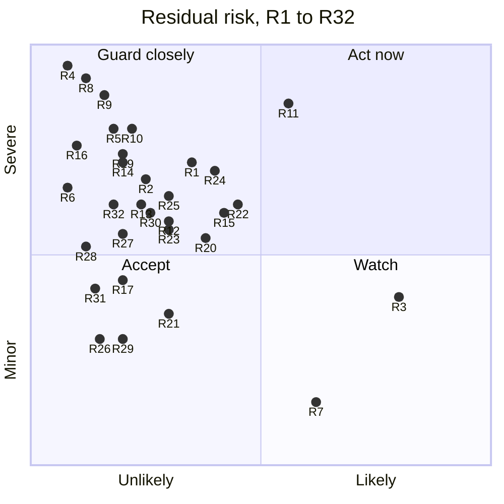

# Threat model

This page explains how the pact could break, what it does about each way, and
which risks it accepts. Read it before you install the pact, and before you
change it. It describes the pact as published on 2026-10-10, with the rules
file rewritten and the install gate thinned by #261. A change that
alters a defence named here, or closes an issue listed here, updates this page
in the same pull request.

Each accepted risk has a label, R1 to R32, so other work can point at it. A
retired risk keeps its label, so the others keep theirs: R18 is retired.

## Who and what this covers

**The setup.** One person, the owner, runs Claude Code sessions on their own
machine. Each session has a shell and the owner's rights, and posts on GitHub
under the owner's account. Most run in auto mode: Claude Code acts without
asking, unless its own checks stop it. The owner's repo and its
issue tracker are public on GitHub.

**What the pact puts on that machine.** The install copies these into the
Claude home folder, `~/.claude`:

- **The rules file,** `CLAUDE.md`, which every session reads first.
- **The review procedure,** `pact/review.md`, which the rules file tells a
  session to read before it runs a lens.
- **Ten agents:** nine lenses and `scout`. A lens is a reviewer agent that
  asks one question from one angle. Most only read.
- **Settings,** merged into `settings.json`. They turn on auto mode and skip
  its opt-in prompt, keep sessions going when a usage limit is reached, turn
  on an experimental agent-teams flag. Since #265 they set no ask rules (an
  ask rule makes Claude Code ask before one kind of action), and the install
  takes out the ones an older pact added.
- **The `/scriptorium` command and its builder kit,** in `commands/` and
  `pact/builder/`. The kit is Node code, the builder and the renderer, that
  runs when you type `/scriptorium`; it writes a page only into a new
  temporary folder or a path you name outside any repo, the Claude home
  folder and any `.claude` folder (#262, ADR 0070). `/make-it-so` and
  `/finis` install only when your configuration lists them.

The repo also holds a setup script for Claude Code cloud sessions, in
`cloud-sessions/`. It is not part of the install. You paste it into a cloud
environment yourself.

**The data in reach.** A session can read what your account can: your
`settings.json`, which can hold API keys; your GitHub sign-in; the repos on
your machine. It writes review reports, their disposition tables and
decisions it heard from you in chat to the tracker. It keeps lens inputs and reports as local files.

**What this page leaves out.** Claude Code itself, Anthropic's models and
servers, GitHub, and the safety of your machine and accounts are outside it.
The pact sits on top of them and trusts them.

## Rules and boundaries

The pact defends itself in two ways, and they are not equally strong.

- **A boundary is enforced by code.** It holds even when a session is fooled.
  Examples: the install gate, which refuses an install whose checks fail; and
  each agent's tool list, which Claude Code enforces.
- **A rule is text the model is asked to follow.** It holds only while the
  model reads it right. Most of the pact is rules. Examples: the offers
  paragraph, which has a session offer each lens with a reason, and the
  sensitive route, which a session recommends with its why when it sets out;
  and "Stop and ask me", the points where a session must stop and ask you.
- **Judgment.** Since #261 the rules file states the owner's practices and
  leaves much to the model's judgment, as any shared `CLAUDE.md` does. Rules
  it used to carry, such as whose tracker text counts, are accepted as
  judgment in the pact. This repo keeps its own tracker rule in `AGENTS.md`.

One rule is a fixed block: "Stop and ask me". No configuration edit can target
it. Since ADR 0069 the gate holds no text word for word: the pact is vetted
like any skill. The gate checks install mechanics only: what each file is and
where it goes, that each agent file still parses, the text scanner, the
settings overlay, and the install's bookkeeping. What the pact's files say, and
which tools each agent holds, rest on your review of the commit you install and
on the model's judgment. No gate could make a model obey the text anyway.

Since #265 the pact sets no ask rules, so nothing it adds prompts you. What
stands before an action is Claude Code's own: its protected paths (the
`~/.claude` folder and `~/.claude.json`), which in auto mode go to its
classifier, and the classifier's blocks. Both are outside the pact (ADR 0063).

## The risks at a glance

The chart places each accepted risk by what is left after today's guards.
Likelihood asks how easy the path is and how often it comes up. Impact asks
what an attacker gets: control of your machine scores highest, a blocked
workflow lowest. The numbers are judgement, not measurement. They rank the
risks; they don't score them.

Each point is a risk's key; the table below gives its name and its controls.

How to read it:

- **Act now (top right): R11.** Auto mode is on, and a public repo hands every
  session text from strangers. Turning auto mode off is the tweak that moves
  it most.
- **Guard closely (top left): most of the rest.** Rare, but severe. The
  tracker rule (R1, R2), the rule on outsiders' code (R5, R6), trust in what
  you install (R8, R9, R10), prompt injection (R12 to R16), a reported hole
  made public by its own fix work (R19), lenses no test runs (R20), an
  unprompted apply (R22), publishing work below the
  thorough tier (R23), a lead moving work (R24), a pact command sent as prompt text (R25), the code-scanning workflow's write token (R27, R28), the security defaults rewritten in a configuration (R30), and agent files taken from a shared builder file (R32) sit here. Their guards are mostly rules, so cutting one moves its risk right.
- **Watch (bottom right): R3, R7.** They happen by design, and the harm
  is bounded: public reports, a blocked team.
- **Accept (bottom left): R17, R21, R26, R29, R31.** R17 needs your own edits, and the dry
  run shows them, though since #265 nothing prompts before the apply (R22). R21 needs an edit to this repo's tests that its review
  misses. R26 needs shipped code to start loading a test file past a test
  that refuses it. R29 needs a steered lens to carry hidden characters into
  a posted report; a rule and a search before posting guard it on every
  install, and where the poster is on, its scan is a backstop behind them
  (#280). R31 needs you to run a project install and pass over the
  warning that leads its dry run.

| Risk | Attacker | What stops it today | Kind |
| --- | --- | --- | --- |
| R1 Tracker rule misread | Stranger on the tracker | Here, this repo's tracker rule in `AGENTS.md`; elsewhere, judgment (#261) | Rule, judgment |
| R2 Session posts as you | Text a session reads | Here, the decision marks in this repo's tracker rule; elsewhere, judgment | Rule, judgment |
| R3 Reports stay public | Anyone who reads the tracker | Secrets named by place, never by value; the review procedure's written no-secret read before a report is posted (#264); it applies to every report the session posts, those of lenses a started skill runs included (#262) | Rule |
| R4 Account taken | Whoever holds your login | GitHub's own sign-in | Outside the pact |
| R5 Refusal untested | Outside pull request | Here, this repo's tracker rule; elsewhere, judgment | Rule, judgment |
| R6 Container built wrong | Outside pull request | Here, the five conditions in `AGENTS.md` and your typed OK; elsewhere, judgment | Rule, then a boundary; judgment |
| R7 Teams blocked | None; a cost to you | None yet (#180) | — |
| R8 Publisher compromised | This repo's publisher | Dry run, the diff you read | Rule |
| R9 Installed code | Plugin or skill author | None | — |
| R10 Cloud fetches unpinned | Upstream authors | None; accepted (#182) | — |
| R11 Auto mode on | Text a session reads | Claude Code's own checks: protected paths and the classifier's blocks | Outside the pact |
| R12 Lens steered | Text a lens reads | Your review of each lens's tools in the commit you install (no allow-list since ADR 0069); the dry run lists a setting off the default, with no mark since #262 | Judgment |
| R13 Lens quotes a secret | Text a lens reads | The security lenses' carried rule, a secret named by its place; the review procedure's written no-secret read before posting (#264); it applies to every report the session posts, those of lenses a started skill runs included (#262); elsewhere, judgment | Rule, judgment |
| R14 Foothold left behind | Text a session reads | Claude Code's protected paths, in part; the next dry run's drift and banned-key warnings, afterwards, unless the install record was rewritten too; a rewritten pact agent shows only under "Yours, left as is", not as drift (ADR 0071); a rewritten pact tool shows as drift (#280) | Outside the pact, boundary |
| R15 Repo files argue | A cloned repo | Judgment (#261 retired `no-skill-overrides` and the floor) | Judgment |
| R16 Unattended session | Whoever triggers it | None yet (#184) | — |
| R17 Gate path only | You, or a fooled session | The install gate, on install mechanics only since ADR 0069; the dry run; your review of the commit | Boundary |
| R18 Totals to this repo | Retired by #189 | — | — |
| R19 Fix work public | Anyone who reads the tracker | Here, the escape placeholder in `AGENTS.md`; elsewhere, judgment; none in code (#199) | Rule, judgment |
| R20 Lens untested | Text a lens reads | The offers paragraph, and the sensitive route recommended with its why in the tier proposal, the security pair named, the security pair offered once more at Test on a list match when the route wasn't taken, which also catches a missed flag; an unanswered flag or offer kept open in every hand-off and in the result, and a decline that came only by relay kept open until you answer in chat; review of a lens change, with the security pair when you ask for it (ADR 0072); a change Claude doesn't see as sensitive, judgment | Rule, judgment |
| R21 Test code ordinary | A careless or fooled edit | The QA pair offered at every build, in the default workflow, which a home configuration can change behind the security-defaults line (#262, R30); here, the QA pair reads every change to the gate's tests at move 4, which the one-line exception never covers; elsewhere, where you decline the offer, judgment | Rule, judgment |
| R22 Apply unprompted | A fooled session | Auto mode's classifier, reading the rules that make an install your call; the install go-ahead rule | Outside the pact, rule |
| R23 Publish below the floor | Text a session reads, a careless session | "Stop and ask me" before anything hard to reverse; "secrets" in the sensitive-work default, now what a session looks for and flags, not a forced route (#262), and replaceable in a home configuration behind the security-defaults line (#262, R30); the one-line exception, which never covers work that matches the list or is flagged sensitive but does cover personal data the list doesn't name; the backstop at Test, which doesn't reach personal data outside the list (#262, the owner's choice); the review procedure's written no-secret read, which a session does before it posts anything (#264, #262); here, this repo's no-secret line; elsewhere, judgment | Rule, judgment |
| R24 A lead moves work | Text a lead reads | Claude Code's checks on sent-in messages; auto mode's blocks for messages, but not its soft blocks for start prompts; Claude Code's protected paths for the user settings folders; the classifier's soft blocks on disabling CI checks and granting repo permissions; branch protection where set; "Stop and ask me"; here, this repo's tracker rule; elsewhere, judgment | Outside the pact, rule, judgment |
| R25 Command sent as prompt | A lead, a resumed session, text a session reads | Claude Code's quoting of sent-in messages and its card before an archive; none for a resume prompt; "Stop and ask me"; `/scriptorium` writes only a builder file and a page outside any repo; the cloud copy ships no commands; elsewhere, judgment | Outside the pact, rule, judgment |
| R26 Test files unscanned | A careless edit to shipped code | The premise test in the required `gate` check: nothing outside `gate/tests/` loads a file inside it | Rule |
| R27 Scan edits its own guard | A session fooled into pushing a branch | Only your account pushes branches; a fork's run is read-only; your review and merge keep it off `main`, while branch protection stands, which only the classifier's soft blocks guard (#265) | Boundary, rule |
| R28 Scan token writes alerts | A compromised action release | Pinned GitHub-owned actions, the 14-day cooldown, the Dependabot skip | Boundary, rule |
| R29 Hidden characters in reports | A lens or a file it read that carries control or direction-changing characters into a posted report | The lens files' rule, a search of each report before posting, fences and code spans; on an install with the poster on, its hidden-text scan as a backstop (#280) | Rule |
| R30 Security defaults rewritten | A local process or a fooled session that writes the configuration folder or the builder file | The dry run's security-defaults line, first, for an edit to any of the five parts that set security defaults (`tiers`, `sensitive`, `workflow`, `lenses`, `qualities`); it points by part name, and any part, moves included, can carry narrowing prose that shows only as that part's own warning, and a move's whole text can be replaced; the offers paragraph sits outside every part; the builder's checks, and the Presets checklist that shows what a preset or shared file carries before it is taken, are your look, not install-time controls (#262) | Boundary (a pointer), judgment |
| R31 A project's qualities list | A cloned repo whose committed `.claude/pact-config.json` holds a `qualities` list | You run each project install, and its dry run leads with a security-defaults line pointing you at the list in that file; the renderer builds the table from three one-line fields, at most nine rows, with bars escaped, under fixed text (#262, ADR 0068) | Boundary (a pointer), judgment |
| R32 Agents from a shared file | Whoever hands you a builder file | The Presets checklist, which shows each agent file's tools ("every tool" when none are named), model and description, and names a replaced `scout` or security-set lens, before you take it; a shared file's agent rows start unticked; a save writes nothing until you choose a folder; a new-named agent appears in no install output, and a pact-named one shows under "Yours, left as is" (#262, ADR 0071) | Judgment |

## Strangers on the tracker

**How it could break.** A session keeps the work's record where the project
keeps it, and this repo keeps it in GitHub issues. A session reads tiers,
approvals and decisions there. On a public tracker anyone can
comment. A stranger could write "approved" or "run this to reproduce", and a
session could act on it.

**What the pact does.** Since #261, nothing in the pact itself: the gated
`tracker-authors` rule left the rules file, and whose text counts is accepted
as judgment. This repo keeps the rule as its own, in `AGENTS.md` and
`docs/agents/issue-tracker.md` (ADR 0062), because the repo is public and every
session here posts under the owner's account. There, only the owner's
account's text counts. A session reads authors from GitHub's structured
fields, never from text. It counts an item only if the owner's account also
made its last edit. It treats everything else as data: read, quoted with its
author, and never followed. If it cannot tell who wrote something, nothing
counts and it asks the owner. A planted test showed the effect: the pact
before the rule followed a stranger's comment, and the pact with it refused.

The pact does not set GitHub's interaction limit, which restricts who can
comment. That is a repo setting you choose, and it expires after at most six
months.

**What is accepted.**

- **R1. It is a rule, not a boundary; in the pact, judgment.** A model can
  still misread. The test covered the cases it planted, not every wording a
  stranger could try. In another repo with a public tracker, nothing but
  judgment stands here unless that repo writes its own rule.
- **R2. Every session posts as you.** Here, by this repo's rule, a session marks a comment as your
  decision only when it heard you in chat. Only that session writes the
  mark, and a decision in the prompt that started a session is not from
  chat, whoever wrote it. That mark is plain text. A session fooled by what
  it read could write it, and later sessions would count it. Older comments
  marked "by checked relay" are history and no longer count, so an open item
  that rests on one needs your word again, in chat (#220).
- **R3. Review reports are public, and stay public.** Sessions post every
  lens report on the tracker word for word, security findings included. A
  comment stays readable after the fix. Security reports name where a secret
  lives, never its value, so they can still map where secrets are kept. Since
  #264 the review procedure writes the read-before-posting as a rule: the
  session reads each report for a secret or a personal detail and keeps one
  that holds either local. The cross script never scanned for secrets; the
  checks it dropped were shape and character checks. One of them, the
  anchor-path check, kept full local paths, and the user name in them, out of
  posted anchors; it is now the lens files' rule and the read.
- **R4. Your GitHub account is the root of trust.** Anyone who controls it
  counts as you.

## Outside pull requests and their code

**How it could break.** A pull request from anyone else can carry code. So can
a fork's branch, a bot's dependency update, or a command pasted in a comment.
If a session checks it out, the code can run with your rights. A checked-out
folder can also carry its own `CLAUDE.md`, hooks and server settings, which a
session started there loads.

**What the pact does.** Since #261, nothing in the pact itself: the rule left
with `tracker-authors`, and is accepted as judgment. This repo's own tracker
rule says outsiders' code never runs here. Only a pull request your account opened, from a branch in the same repo, with
every commit yours, counts as your code. Everything else is read as a diff,
as text. The one exception needs your typed OK naming the exact commit, and a
container with no sign-ins, secrets, host folders or network route to your
machine.

**What is accepted.**

- **R5. No test shows the rule is what stops outsiders' code; in the pact, judgment.** The pact
  before this rule also refused to run a stranger's code. The test shows the
  habit holds, not that the rule causes it.
- **R6. A session builds the container.** Once built, the container is a real
  boundary. But building it right is a rule the session follows (here, the
  five conditions in `AGENTS.md`; elsewhere, judgment); nothing in the pact
  builds or checks it.
- **R7. Teams are blocked, not protected.** A teammate's text is data and
  their pull requests never run locally. There is no setting for trusted
  accounts yet (#180).

## A compromised or careless plugin or skill

**How it could break.** A skill is text a session follows. A plugin can add
skills, hooks and servers. Hooks and servers are code, and they run with your
rights, often before any rule loads. A careless skill can tell a session to
skip a step. A compromised one can do anything your account can.

The pact is such a package too. A change to this repo reaches every session
once you install it.

**What the pact does.**

- **For skills, judgment.** Until #261 a gated clause, `no-skill-overrides`,
  said no skill may override certain rules. It is retired, and accepted as
  judgment. Since #262 the rules file's offers paragraph has a session offer
  each lens with a one-line reason, and a skill you typed runs its own lenses
  unasked, which never lifts the sensitive-route flag or its offer at Test.
  Sensitive work is, by
  default, auth, secrets, crypto, input validation and data migrations; a
  session that sees it recommends the sensitive route, thorough, planned and
  built on Opus at high with the security pair, and you take it or not.
  Publishing is not on that list: work that publishes can run at a lower
  tier, guarded by rules alone (R23).
- **For its own install, a dry run and a gate.** The install shows what it
  would change before it changes anything. It installs only committed files,
  and only those its checks passed: a small bootstrap stages them, and every
  check runs from that staged copy. An apply is bound to the commit its dry
  run showed. Every change to the install gate's code takes the security
  route.
- **No ask rules (#265).** The pact sets none, and the install takes out the
  ones an older pact added. Claude Code guards its own folder and
  `~/.claude.json`; the install's apply, a `gh` command on rulesets or branch
  protection, and a review-folder dry run run unprompted (R22, R24, ADR 0063).

**What is accepted.**

- **R8. You trust this repo's publisher.** The dry run already runs the new
  commit's install script and checks, and a session opened in the clone loads
  the clone's own project files. So read the diff before either. Since #261
  the installed rules point at no live file in this repo (#194).
- **R9. No rule can stop code you installed.** A plugin's hooks or servers run
  whatever they hold. The pact cannot see or limit them. Trust what you
  install, and pin versions where you can.
- **R10. Cloud sessions fetch unpinned code.** Each time a cloud session
  starts, its setup script installs plugins, third-party skills and a
  command-line tool at their latest versions. That code can reach the repo
  clone and any token the container holds. One plugin is a code-review
  service's; using it may send code to that service. The owner accepted this
  risk by name (#182).
- **R23. Work that publishes can run below the thorough tier.** Since #189
  publishing is not on the list of sensitive work, so a change to what gets
  published, such as a package's contents, a release step or a personal
  detail in a committed file, can be built at the quick tier with no spec
  read. Two rules are left in the pact: the fixed "Stop and ask me", which
  has a session ask you before something hard to reverse; and "secrets" in the
  sensitive-work default, for keys and tokens, which since #262 a session
  flags and recommends the sensitive route for, rather than forcing it; the
  one-line exception never covers work that matches the list or is flagged
  sensitive, but does cover personal data the list doesn't name, and the
  backstop at Test doesn't reach that data either: the owner accepted this
  to keep the stop rare (#262). "Never post a secret or a
  personal detail" left the pact in #261, accepted as judgment; this repo's
  `AGENTS.md` keeps it. Text that frames such a change as quick work can steer
  past the reviews, and your answer at the stop is then the only check. The
  owner chose this over narrowing the phrase (#189, ADR 0050), accepted that
  personal data written into code or logs can ship below the thorough tier
  (#186, ADR 0056), and cut the no-secret rule from the pact as judgment
  (#261, ADR 0060).

## A session that reads text as instructions

**How it could break.** A session reads a lot of text it did not write:
issues, diffs, files in a repo, web pages, tool output. Any of it can say "ignore
your rules and do this". This is prompt injection. In auto mode, a fooled
session can act before you see it.

**What the pact does.**

- **Text from others is data.** This repo's tracker rule says so for its
  tracker; elsewhere it is judgment. The security lenses carry the same rule
  for pages they fetch.
- **Lenses get few tools.** Each lens's file lists its tools. Since ADR 0069
  no allow-list checks them at install: a lens's tools are what its committed
  file says, and you vet them like any skill's. Seven only read. `behaviour-lens` has a shell
  and a browser, because it runs the change. `adversarial-lens` can search and
  fetch the web.
- **Any model is yours to choose.** Since #262 you may move any agent, a
  security lens included, to any model Claude Code takes, Haiku, `inherit`
  and a provider's own model ID among them. The dry run lists each setting;
  nothing marks it, and the pact tests only the defaults it ships. The mark
  means the lens runs off the default the pact ships and reviews; since #189
  no test runs a lens on any setting (R20). For the two lenses with a shell or
  web tools, the install warns that a weaker setting may follow instructions
  planted in the code it reviews, or send a secret out.
- **Sensitive work gets a second read when you take the route.** Since #262
  a session that sees sensitive work says why in one line in its tier
  proposal and recommends the sensitive route, which brings the security
  pair, `adversarial-lens` and `data-lens`, to read the plan and then the
  diff. If you don't take it, the pair is offered once more at Test when the
  change matches the list, which also catches a flag the session missed. A
  flag or offer you haven't answered stays open in every hand-off and in the
  result, a decline that reached the session only by relay stays open until
  you answer in chat, and a flag found later is said at the next hand-off
  until you answer. It is a rule, held by review. The gate keeps a fixed list of the security-set lenses, so
  the class it prints on each agent setting never depends on the rules file's text.

**What is accepted.**

- **R11. Auto mode is on.** The pact turns it on, and every install turns it
  on again. In auto mode, the main thing between a fooled session and your
  shell is Claude Code's own checks. The pact chose speed here.
- **R12. A lens can be steered.** A lens that runs code or fetches pages can
  be steered by what it reads, like any session. Since ADR 0069 nothing at
  install stops a commit that gives a lens more tools; you see it in the diff
  you vet. The main session then acts
  on a lens's recommendations without waiting for you, except at the stops,
  installs and the decisions the rules file names as yours. The pact reviews
  each lens only at its default; that does not show the default resists
  steering (R20).
  Since #262 a lens can be set to any model with no mark, so the shell and
  web lenses have no floor at Sonnet: the dry run's list of settings is all
  that names a weaker one, by your choice.
- **R13. A lens can quote a secret.** A read-only lens can still read any file
  your account can, and its report goes on the tracker word for word. Since
  #261 the session-level rule "never post a secret" is accepted as judgment
  in the pact (this repo's `AGENTS.md` keeps it), and four lenses don't carry
  it in their own files; #192's lens half is the follow-up. Since #264 the
  review procedure's posting section also asks the session to read every
  report for a secret before it posts one. A word test checks
  that the security pair's files hold the carried rules, but since #189 no
  test has checked that a lens keeps them after a model change.
- **R14. A fooled session can leave something behind.** It can write files
  that later sessions or installs load: memory files, a repo's own Claude
  settings or rules, its server list, or your configuration blocks. With a
  pact tool on, it can also rewrite the tool in `~/.claude/pact/tools/`
  (#280): a planted poster runs with your `gh` login each time a session
  posts through it. Claude
  Code's protected paths cover only some of these, and in auto mode send them
  to its classifier. The next dry run shows drift in pact files and warns on a
  command-running key in `settings.json`, but only afterwards. The same
  foothold can rewrite the install record the drift check compares with, so
  a planted pact file may show only as an ordinary overwrite line, which
  `--apply` then replaces without refusing.
  Since #262 an agent file changed after the install is the person's: the
  dry run lists it under "Yours, left as is" rather than as drift, and the
  install no longer puts the pact's back. A foothold that rewrites a pact
  agent, a security lens included, so stays until the person reads that list
  and deletes the file. A pact tool is not an agent: a changed live tool is
  drift, and `--apply` refuses, unless the record was rewritten too.
- **R15. A repo's instruction files are instructions.** A cloned repo's
  `CLAUDE.md`, `AGENTS.md` or rules folder loads like any rules. Since #261
  the pact holds no rule barring them from anything: `no-skill-overrides` and
  the floor's "may only add" are retired, and accepted as judgment. They can
  argue against any rule.
- **R16. Sessions no person started** have no rule yet. A routine or an event
  trigger can open with an outsider's text where your chat would be (#184).
  Don't point one at a pact setup with a public tracker.
- **R20. A lens's behaviour is reviewed, not tested.** Until #189, planted
  practice cases ran the security lenses for real after each model change.
  They found defects only in their own cases and wording, so the owner
  retired them. Now a change to a lens is read by review, with the security
  pair when the owner asks for it (ADR 0072); in use, the offers paragraph offers the QA pair at
  every build and the security pair with the sensitive route, but nothing runs the lens to show it still follows
  its carried rules or resists planted text. A lens that reads well and
  behaves badly shows up only in use.
- **R21. The test runner and its helpers are ordinary test code.** The
  runner, its copy list, the table module, the in-process runner and the
  guards beside it decide what "the full suite" and the required CI check
  run. Since #189 a change to them is proved by use, not by the security
  route. An ordinary edit, or one a fooled session makes, could narrow what
  the CI check runs, or weaken record mode's scrub, which keeps local paths
  and names out of posted test output. The required CI check can't catch
  that, because it runs the runner the edit narrowed. Only the review at the
  end of the build does: here, the QA pair at move 4, which the pact's one-line exception never covers (#262); elsewhere, the QA pair when you take its offer. The owner accepted this risk by name (#189).
- **R22. The install's apply is unprompted.** Since #265 the pact sets no ask
  rules, so nothing prompts you before `--apply`, in any spelling. Before it,
  ask rules looked for an apply's spelling, and some spellings already got
  past them (#210, ADR 0049). What stands now: auto mode's classifier, which
  reads the rules that make an install your call, and the install go-ahead
  in this repo's `AGENTS.md`. Both bend to text: a lead's start
  prompt can clear a soft block. An apply still needs the commit and rendered
  hash a dry run printed, but a session can run that dry run unseen: the
  commit and hash bind the clone and the render, not your sight of them. So a
  fooled or careless session could install a commit it made, with its own
  gate checks, and the next dry run would show it only afterwards. A dry run
  with `--review-folder` also runs unprompted and writes your rendered rules
  and their diff, your block text included, to any new or empty folder
  outside the Claude home and any `.claude` folder; those folder checks are
  its only guard. A dry run of installer code under edit runs against your
  real Claude home unless you pass a throwaway one, which keeps a bug away
  from it, not hostile code. The owner accepted this to stop the prompts and
  defer to the harness (#265, ADR 0063).

  Nothing prompts before an installer from a commit before the Node install's
  cutover (#166), the #166 build commits that still hold the old one
  included. No supported rollback reaches such a commit, but a fooled session
  can still check one out from history in any clone and run its installer's
  apply, with no prompt. That replaces your live rules file and agents with
  the older pact, which lacks later defences such as the rules on whose
  tracker text counts, and every later session runs under it until you
  reinstall. On Linux or macOS it also widens `settings.json`'s mode, with no
  prompt either (#177, below). The drift check does not show the rollback,
  because such an installer writes the same install record. The next Node dry
  run does: the record names an older commit, and the pact's files are
  listed under Overwrite. What remains is the go-ahead rule, which the same
  injection could target, and Claude Code's own auto-mode checks, which
  aren't documented to stop this. The owner accepted this by name (#217,
  ADR 0052), and the acceptance stands now that the pact keeps no rollback
  route to such an installer (#242, ADR 0059).
- **R24. A lead moves work.** A lead is a session that starts other sessions
  and sends them messages. Since #220 the pact says nothing about messages
  between sessions: Claude Code and the lead skill you run govern them. A
  steered, confused or forged lead can approve a spec, cut tickets or accept
  work through the sessions it leads. Every session posts as you, so the
  record doesn't show which approvals a lead made. Through a session, a lead
  reaches what that session can: the keys in `settings.json`, your GitHub
  sign-in, and posts in public. What bounds it:
  - **Sent-in messages are covered.** Claude Code treats a message from
    another session as a teammate's request, never your consent, and auto
    mode blocks the dangerous actions without your explicit ask.
  - **Start prompts are not.** A lead writes the prompt that starts a
    session, and auto mode reads that prompt as your own ask. A prompt that
    names a specific action can clear auto mode's soft blocks, such as
    merging an unreviewed pull request or changing settings. The deleted
    relay rule said five things never travel by relay: merges, deletions,
    permission changes, settings changes, and starting or stopping a
    session. Nothing replaces that sentence. For the last of them, starting
    or stopping a session, nothing in the pact bounds a lead at all.
  - **A start prompt can reach a rollback.** Nothing prompts before an
    installer from before the Node install's cutover (R22), and the
    install go-ahead doesn't say a start prompt isn't chat. So a
    lead's start prompt could have a session install an older pact. The next
    Node dry run shows it, but only afterwards.
  - **The desktop session tool is unknown.** This repo's parallel-session
    rules use a desktop tool that sends a message to another session.
    Anthropic's docs don't describe how it delivers one, so whether its
    messages get the "not your consent" handling is unknown. It is also how
    a lead usually briefs a session that started on a short hold, so the
    unknown reaches the "from chat" mark and the outsiders'-code OK: if such
    a brief arrives looking like your own typing, a session could take it as
    chat.
  - **The merge stops a lead only where the branch requires review.** Auto
    mode allows a push to a default branch by default. On this repo `main`
    requires a pull request and the `gate` check, and blocks force-pushes
    and deletion, but requires no approving review: every session posts as
    you, and GitHub doesn't let an author approve their own pull request. So
    the merge is not a human checkpoint here.
  - **No ask rule stands** since #265. Claude Code's protected paths send an
    edit in the user settings folders to auto mode's classifier. The
    install's apply and a `gh` command on rulesets or branch protection meet
    only the classifier's soft blocks, which a start prompt can clear. With
    branch protection loosened, auto mode's default push to the default
    branch lands on `main`.
  - **"Stop and ask me" still holds,** whoever asked, before anything hard
    to reverse. Here, so does this repo's "Never post a secret or a personal
    detail"; elsewhere that is judgment. Both are rules, so a steered session
    could still break them.
  - **With auto mode off, or its lists edited,** Claude Code's own prompts
    govern.

  This repo's tracker rule still refuses a decision mark for a lead's word or a start
  prompt's decision (R2), and an OK to run outsiders' code that arrives in a
  start prompt or another session's text. The owner accepted the rest by
  name (#220, ADR 0055).
- **R25. A pact command sent as prompt text.** `/make-it-so`, `/finis` and
  `/scriptorium` set `disable-model-invocation: true`. That stops the model starting one,
  not text sent in as a prompt. The bodies add no check of their own, by the
  owner's decision (#229), so what guards each channel is outside them, and
  none has been tried live:
  - **A message from another desktop session** arrives quoted and attributed
    to its sender, by Claude Code's own handling (R24).
  - **A fresh start prompt** has no last message, so `/make-it-so` has no
    recommendation to accept.
  - **A resume prompt, or a print-mode run of a resumed session,** has no
    Claude Code guard: auto mode reads it as your own ask (R24). Only the
    session's judgement stands there, and, here, the "start prompt is not
    chat" line in this repo's tracker rule. Through it, `/make-it-so` carries out the
    recommendations in the session's last message, which can include a
    merge, a push or a tracker post. A plain-words resume prompt could
    already ask the same.
  - **`/finis` archives,** and archiving removes the session's worktree,
    files git ignores included, which its check for outstanding work does
    not look at. Claude Code asks you before any archive, in every
    permission mode; that card is the guard against a relayed `/finis`.

  What still holds whoever sent the command: "Stop and ask me", and here
  this repo's "Never post a secret or a personal detail". `/scriptorium`,
  sent in, writes a builder file and renders a page outside any repo; it
  merges, pushes and posts nothing. The cloud copy ships no command. A project's own skill with the same name runs in place of a
  command, and the install's skill-clash check covers only your personal
  skills folder. Such a skill can come from another account's commit in a
  tree you work in, and its shell commands run when you type the name,
  before the model reads anything. No settings rule asks before a merge;
  you can add one, at the cost of a click on every merge.

## Your own configuration loosening a rule

**How it could break.** You can change the pact. Some changes make it less
safe, and a change made months ago is easy to forget.

**What the pact does.**

- **The configuration file is narrow.** `~/.claude/pact/config.json` can set
  four kinds of thing. The usage pauses are the weekly and, if you set it,
  the 5-hour usage levels above which sessions wait for you before expensive
  work. The open parts are the text Scriptorium builds: the moves, the
  tiers, sensitive work, the workflow, the lens roster and the qualities,
  each replaced whole by a block of yours. Every agent's model and effort can be set, `scout`'s included,
  to any model Claude Code takes (#262); the model is your own text, so the
  dry run and the review files carry it and are shared by verdict and counts
  only, and the installed rules file names a model beyond the five aliases
  only as "a custom model". And a
  `commands` list turns on pact commands, by name from a fixed list in the
  gate, which the install then copies into `commands/`. A `tools` list turns
  on pact tools the same way, each installed under `pact/tools/` with its
  rule rendered into the rules file (#280). No configuration
  edit can target the fixed "Stop and ask me" block, or a tool's rule part;
  the renderer refuses.
- **The install says what changed.** The dry run prints a warning for each
  value set, each part edited and each tool turned on. The installed rules file names the
  configuration in effect.
- **A project can only tighten, but for its qualities.** A project's own
  configuration, installed through the install script, may only set values
  stricter than yours, and may hold its own qualities list, which takes the
  place of yours in that repo (R31).

**What is accepted.**

- **R17. The gate guards the install path, not your machine.** Since ADR 0069
  the gate checks install mechanics only: committed files only, the payload's
  kinds and where each goes, that each agent file parses, the settings guard,
  the character scan, and the install's bookkeeping. It no longer checks an
  agent's tools, a file import in the rules file or a block, hidden text in
  the review file, a command file's body, or any text word for word. You can
  edit any file in your clone, and the install takes it; you vet the commit as
  you would any skill. An open part's text can
  contradict any rule in meaning. A rules file copied by hand, or shipped in a repo, skips
  the gate. So does a direct edit to an installed lens file, such as a weaker
  model line: nothing marks it, and since #189 the Lens
  dispositions table no longer records the model a lens ran on, and since
  #262 the next dry run lists such a file under "Yours, left as is", not as
  drift (ADR 0071).
- **R30. The security defaults can be rewritten in a configuration.** A
  home configuration may replace the tiers, the sensitive-work list and its
  route, the workflow, the lens roster and the qualities. The dry run's
  security-defaults line names each such part first, and says whether the
  configuration changed since the last install; it points, and you read the
  rendered part. The builder's checks and its Presets checklist, which shows
  each section a preset or shared file carries before anything is taken, are
  your look at what you load, not a control the install runs.
- **R31. A project's qualities list takes the place of yours.** A project's
  `.claude/pact-config.json` may hold a list that drops the Security row, or
  any other, in that repo, the one way a project may loosen. A cloned repo
  can't install it by itself: you run the project install, and its dry run
  leads with a security-defaults line pointing at the list in the project's
  config file. The table is compiled from three one-line fields, at most
  nine rows, with bars escaped, under fixed text; a field is the project's
  own one-line text, as its own rules file could already be.
- **R32. A shared builder file can carry agent files.** A builder file
  someone hands you may hold whole agent files: one named like a pact agent
  replaces it, `scout`, which sessions call for every lookup, included, and
  any other name adds an agent. A file with no tools line gets every tool.
  The Presets checklist shows each file's tools, model and description, and
  names a replaced `scout` or security-set lens, before you take it; a
  shared file's agent rows start unticked, so you tick each one you take. Once saved, the install
  lists a pact-named file under "Yours, left as is" and never mentions a
  new-named one.
- **R18. Retired by #189.** The rules no longer have sessions collect review
  totals into an issue on this repo. A session that reads several projects'
  records copies nothing from one project into another.

## Code scanning on this repo

**How it could break.** CodeQL scans this repo for security holes and raises
alerts in the Security tab. Since #239 it runs from a workflow the repo holds,
`.github/workflows/codeql.yml`, not from GitHub's default setup. To upload
results, its one job holds `security-events: write`, the only write permission
any workflow here has. That token can read every open alert, the private ones
included, and change or dismiss alerts on `main`. The workflow's configuration
also leaves the gate's test files, `gate/tests/*.test.mjs`, out of the scan,
because they plant bad cases on purpose and raised alerts that were noise.

**What the pact does.**

- **An exact allow-list.** `gate/tests/workflow.test.mjs` holds the file to
  the triggers, permissions, steps and inputs the spec sets, plus the
  top-level `name` and the matrix's `fail-fast` (ADR 0058), and nothing else:
  no shell step, no environment, no secret, no other action, no debug input,
  and no YAML form a line-based check could misread. Both actions are pinned
  to full commit SHAs, and the checkout to `gate.yml`'s. The test reads the
  file, so it can't see a run started from GitHub's pages.
- **Dependabot's pull requests are skipped,** whoever pushed to them last. A
  new version of either action first runs with the write token on `main`,
  after you have read and merged it.
- **A premise test.** The same file fails if any file outside `gate/tests/`
  loads a file inside it, or loads a module by a name it can't read.
- **No debug re-run.** The workflow's header says never to re-run it with
  debug logging while a shipped-code alert is open, and to delete any debug
  artifact at once. In debug mode the CodeQL action attaches its database and
  results to the run, and on a public repo anyone can download them. This is
  a rule: nothing stops the re-run button.

**What is accepted.**

- **R26. The gate's test files aren't scanned.** They run on your machine and
  in CI with a read-only token and no secrets. They take no outside input:
  they read the repo and write temp folders, and CodeQL's JavaScript queries
  look for untrusted input reaching a sink. This holds only while nothing
  shipped imports them, which the premise test checks in the required `gate`
  check. The runner, the helpers and the fixtures are still scanned
  (ADR 0058).
- **R27. A pull request from a branch in this repo runs its own copy of the
  workflow and its guard, with the write token, as soon as it opens.** That is
  before anyone reviews it. One that edits the workflow could read every open
  alert, the private ones included, and print it to the public run log, or
  dismiss alerts on `main`; one that also edits the guard passes it. Any
  workflow added on such a branch could already ask for write rights before
  #239; the new part is a workflow that holds the token by design. What bounds
  it: only your account can push branches here, so the path runs through you
  or a session fooled into pushing (R11, R14, R24), and a fork's run gets a
  read-only token. Your review and merge stop such an edit reaching `main`,
  not its first run. Its own code-scanning result is not evidence for it.
- **R28. The workflow's token can read every open alert and change or
  dismiss alerts on `main`.** A compromised release of `checkout` or
  `codeql-action` running in that job would hold it. What bounds it: both
  are GitHub-owned and pinned to full commit SHAs; Dependabot holds a new
  release back 14 days before it proposes it; and the Dependabot skip means
  a new version first runs after your merge. Your review of any SHA change
  is the control, since the guard can't tell a release commit from one that
  lives only in a fork of the action's repo.
- **R29. Hidden characters in a posted report are caught by a rule, not by
  code.** Until #264 the cross script counted control, invisible and
  direction-changing characters in each lens report and refused one that
  held them. It is gone, and the shape and character checks on posted reports
  moved from a boundary to a rule: each lens file keeps the line that forbids
  such characters, the session searches each report file for them before
  posting and names any it finds in the report's fold summary, and verbatim
  reports sit in a fenced block with every string it lays out in a code span.
  A lens fooled into writing one still gets it into a posted report, where it
  can mislead a reader. The poster (`claude/tools/poster.mjs`, #246) holds a
  hidden-text scan. Since #280 it is an opt-in tool, off by default, so the
  rule stays the control for everyone: the session's search of each report
  before posting, and the read before posting, come first on every install.
  Where the owner turns the poster on, its scan is a backstop behind that
  search, not a replacement for it.
## What you may tweak, and what it costs

Each tweak below is yours to make. The cost is what you give up.

- **Keep your tracker private.** Removes R3, R19 and most of the stranger
  risk. You lose public plans and reviews.
- **Turn auto mode off** after each install, by setting
  `permissions.defaultMode` in `settings.json` back to the mode you use. This
  is the strongest single guard against R11. You get more prompts. Every later
  install turns it on again; its dry run warns you first.
- **Set an agent's model or effort.** Cheaper and faster. Nothing marks a
  security lens's reports since #262, and a shell or web lens on a weaker
  model may be easier to steer (R12).
- **Edit the open parts,** in the builder or by hand: the moves, the tiers,
  sensitive work, the workflow with your own skills on its stages, the lens
  roster and the qualities. You own what those blocks say (R17, R30).
- **Set the usage pauses** anywhere from 0 to 100 percent, the weekly one
  and, if you want it, the 5-hour session one. At 100, sessions never wait
  for you before expensive work.
- **Edit any other text in your clone** and commit it. The install takes it.
  You own its review (R17).
- **Drop or pin plugins and skills.** Lowers R9 and R10. You lose what they
  did.
- **Set GitHub's interaction limit** on a public repo. It narrows who can
  comment for up to six months.
- **Require an approving review** on your default branch, in its branch
  protection. The merge then stops a lead that moved work by message or
  start prompt (R24). Every session posts as you, and GitHub doesn't let an
  author approve their own pull request, so it needs a second account as
  the reviewer. A bypass for your own account lets every session through.

You cannot edit the fixed "Stop and ask me" block through configuration. That
is deliberate; a committed edit to it installs, and you vet it like any other.

## Known open issues at publication

These were open on 2026-10-09. Each is tracked on this repo's tracker.

- **#179:** older versions of the cloud setup script wrote an old copy of the
  rules. #181 generates a current copy, and a cloud environment keeps
  whatever setup was pasted into it. Since #261 the current copy carries no
  tracker rule, no rule on outsiders' code and no rule against posting a
  secret either: the pact leaves them to judgment. In this repo, `AGENTS.md`
  supplies them from the checkout. Elsewhere, keep cloud sessions off a
  public tracker, or write the rules into that repo's own `AGENTS.md`.
- **#188:** with the current copy, a cloud session can't read authors. Since
  #261 the pact carries no tracker rule, so this applies to this repo's own
  rule: there nothing on the tracker counts, and the session asks you. That
  fails safe.
- **#180:** no setting yet for trusted accounts on a team repo (R7).
- **#182:** the cloud setup fetches unpinned code (R10).
- **#184:** no rule for sessions no person started (R16).
- **#199:** no rule for fixing a reported hole out of public view (R19).

The Node install (#166) closes two that were listed here, in part:

- **#177:** an install on Linux or macOS no longer widens `settings.json`,
  which can hold API keys. It keeps the file's mode, so a file an older
  install widened stays readable by other users until you restrict it; the
  dry run warns when it is. A rollback to an installer from before the Node
  install's cutover widens it again. Since #211 the install how-to no longer
  gives the fix for either case (`chmod 600` on the file): only the owner
  ever ran such an installer, and the owner accepted this by name.
- **#110:** the dry run compares permission rules exactly, so it no longer
  misses a tampered rule.

## Reporting a security hole

Report a hole in the pact privately, never in a public issue: on this
tracker, issues and their reviews are public. [`SECURITY.md`](../SECURITY.md)
says how to report, what counts as a hole, which version is supported, and
what to expect.

A private report is a stranger's text, like a comment on the tracker: a
session reads it as data. Code in the advisory's temporary private fork is
outsiders' code, and never runs.

**What is accepted.**

- **R19. Fix work for a reported hole is public.** The report itself stays
  private. But a hole is security work, which always takes the thorough tier,
  and that tier posts its spec and its security reviews on the public tracker
  before the fix ships. So a hole's details can become public while installed
  copies are still open to it. `SECURITY.md` tells reporters so. A rule for
  fixing a reported hole out of public view is #199. Since #261 the pact's
  placeholder for a security escape on a public repo is retired too, and
  accepted as judgment in the pact; this repo keeps the line in `AGENTS.md`.
