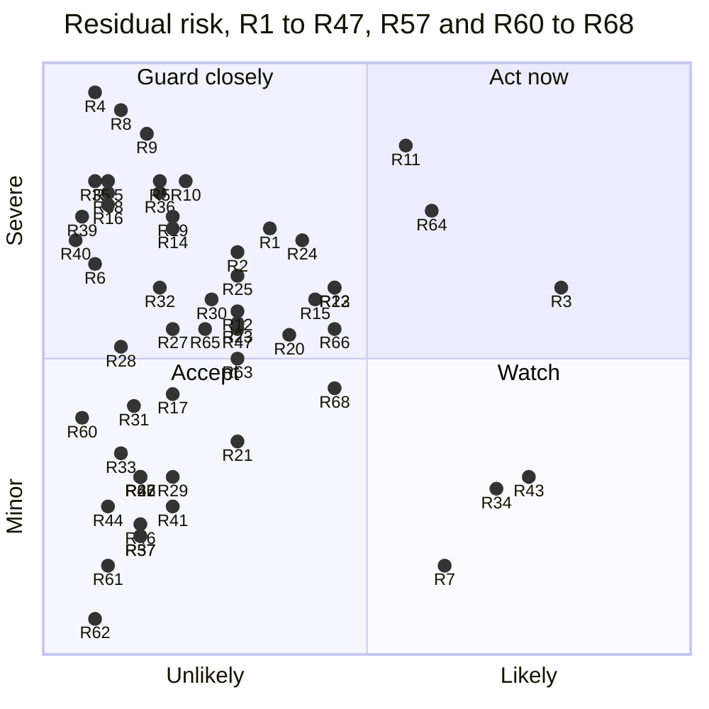

# Threat model

This page explains how the pact could break, what it does about each way, and
which risks it accepts. Read it before you install the pact, and before you
change it. It describes the pact as published on 2026-10-10, with the rules
file rewritten and the install gate thinned by #261. A change that
alters a defence named here, or closes an issue listed here, updates this page
in the same pull request.

Each accepted risk has a label, R1 to R47, R57 and R60 to R68, so other work can point at it. A
retired risk keeps its label, so the others keep theirs: R18 is retired. Two
are accepted without a label, in Crypto and data migrations here: the
SHA-1 collision residuals of the cloud setup's pins and of CI's action pins.

## Who and what this covers

**The setup.** One person, the owner, runs Claude Code sessions on their own
machine. Each session has a shell and the owner's rights, and posts on GitHub
under the owner's account. Most run in auto mode: Claude Code acts without
asking, unless its own checks stop it. The owner's repo and its
issue tracker are public on GitHub.

**What the pact puts on that machine.** The install copies these into the
Claude home folder, `~/.claude`:

- **The rules file,** `CLAUDE.md`, which every session reads first.
- **The review procedure,** `pact/review.md`, which the rules file tells a
  session to read before it runs a lens.
- **Nine agents:** eight lenses and `scout`. A lens is a reviewer agent that
  asks one question from one angle. Most only read.
- **Settings,** merged into `settings.json`. They turn on auto mode and skip
  its opt-in prompt, keep sessions going when a usage limit is reached, turn
  on an experimental agent-teams flag. Since #265 they set no ask rules (an
  ask rule makes Claude Code ask before one kind of action), and the install
  takes out the ones an older pact added.
- **The `/scriptorium` command and its builder kit,** in `commands/` and
  `pact/builder/`. The kit is Node code, the builder and the renderer, that
  runs when you type `/scriptorium`; it writes a page only into a new
  temporary folder or a path you name outside any repo, the Claude home
  folder and any `.claude` folder (#262, ADR 0070). It also reads your own presets from `pact/presets/`, a folder the install never writes, lists or deletes, and carries each one into the page in plain text, as it carries the builder file. `/make-it-so` and
  `/finis` install only when your configuration lists them.
- **The cleaner, where you turn it on** (#438): `pact/tools/cleaner.mjs`,
  which removes leftover worktrees under `.claude/worktrees/` and their
  local branches with fixed git commands, and, while it is on, sixteen deny
  rules on raw removal commands merged into `settings.json` (The cleaner's
  own checks).
- **Backups,** in `pact/backups/`: before each apply writes, a dated copy of
  each file it replaces, with a manifest. They hold copies of `settings.json`
  (R47).

The repo also holds a setup script for Claude Code cloud sessions, in
`cloud-sessions/`. It is not part of the install. You paste it into a cloud
environment yourself.

**The data in reach.** A session can read what your account can: your
`settings.json`, which can hold API keys, and the older copies of it in the
install's backups (R47); your GitHub sign-in; the repos on
your machine. It writes review reports, their disposition tables and
decisions it heard from you in chat to the tracker. It keeps lens inputs and reports as local files.

**What this page leaves out.** Claude Code itself, Anthropic's models and
servers, GitHub, and the safety of your machine and accounts are outside it.
The pact sits on top of them and trusts them.

## Rules and boundaries

The pact defends itself in two ways, and they are not equally strong.

- **A boundary is enforced by code.** It holds even when a session is fooled.
  Examples: the install gate, which refuses an install whose checks fail; and
  each agent's tool list, which Claude Code enforces.
- **A rule is text the model is asked to follow.** It holds only while the
  model reads it right. Most of the pact is rules. Examples: the offers
  paragraph, which has a session offer each lens with a reason, and the
  sensitive route, which a session recommends with its why when it sets out;
  and "Stop and ask me", the points where a session must stop and ask you.
- **Judgment.** Since #261 the rules file states the owner's practices and
  leaves much to the model's judgment, as any shared `CLAUDE.md` does. Rules
  it used to carry, such as whose tracker text counts, are accepted as
  judgment in the pact. This repo keeps its own tracker rule in `docs/agents/issue-tracker.md`,
  reached by a pointer in `AGENTS.md`.

One rule is a fixed block: "Stop and ask me". No configuration edit can target
it. Since ADR 0069 the gate holds no text word for word: the pact is vetted
like any skill. The gate checks install mechanics only: what each file is and
where it goes, that each agent file still parses, the text scanner, the
settings overlay, and the install's bookkeeping. What the pact's files say, and
which tools each agent holds, rest on your review of the commit you install and
on the model's judgment. No gate could make a model obey the text anyway.

Since #265 the pact sets no ask rules, so nothing it adds prompts you. What
stands before an action is Claude Code's own: its protected paths (the
`~/.claude` folder and `~/.claude.json`), which in auto mode go to its
classifier, and the classifier's blocks. Both are outside the pact (ADR 0063).

## Crypto and data migrations here

**Crypto.** The pact encrypts nothing. Since #272 its install keeps copies of
a file that can hold keys, in its backups (R47). The backup manifest's SHA-256
only detects a damaged copy; it never authenticates one. The pact holds two
public keys, in `cloud-sessions/keys/`, used only at a pin bump to check the
signatures on Node's and mise's checksum files (ADR 0088). It uses hashes
only to detect change, never to authenticate, apart from the builder page's
policy hashes and the cloud setup's pins. It uses them in four main places. Git's SHA-1
object ids: the install checks that the commit and each file it reads are the
commit's own bytes, and an apply is bound to that commit. SHA-256 checks: the
install record holds each file's hash to find drift, the cloud setup script
checks each file it writes, and its generator checks what it takes from the
install. The cloud setup also checks the mise download and the installed
Node binary against pinned SHA-256 hashes, and mise checks the Node archive
against a third pin in its lockfile; `gen.mjs` refuses a pin out of its
shape before it reaches the root-run script (R35). The cloud setup's third-party fetches are tied to their pins by git's object ids, SHA-1 with collision detection, below the hash strength ASVS asks of integrity checks; `gen.mjs` refuses a repo pin out of its shape (R45). The residual is a collision prepared by an upstream author who wrote both commits; accepted by the owner on 2026-10-18, in chat, from #183 T3's hand-off. The apply binding: when a configuration applies, an apply is also
bound to the rendered hash its dry run printed. A session that can write the
files can write the install record too (R14), and the binding holds the clone
and the render, not your sight of them (R22). The builder page's policy
hashes: its content security policy names the SHA-256 of its inline script
and style, and the browser runs only those. Others, among them the install's
internal hand-offs, the project install's rules file and record, and CI's
actions, in every workflow, the gate workflow's two jobs included, pinned to full commit ids, use hashes the same way. CI's action pins are git's object ids too, SHA-1 with collision detection, below the hash strength ASVS asks of integrity checks. The residual is a collision prepared by the author of a pinned action who wrote both commits; accepted by the owner on 2026-10-19, in chat, relayed by the head chef, from adversarial-lens's F5 in #351's Test review. The cleaner's tag, the first 10 hex of a SHA-256
over a worktree's facts, only detects a change between its name-back and its
removal; it never authenticates who said yes (#438). The atomic writer takes random bytes only to
name a temporary file. Transport is git's and GitHub's, outside this page. A
change that adds a secret, key, signature or encryption step is new scope;
a signature or encryption step is crypto, sensitive work under the default,
and since #441 a secret or key alone is not.

**Data migrations.** The pact keeps no database. What it migrates is the state
an install leaves behind: in the Claude home folder, and a project install's
rules file and record. That is the install record, the settings it merged, and
files an older pact installed. The dry run shows that state's drift before
anything changes. The install deletes any unchanged file its record lists
that the pact no longer ships; with no record, a first install deletes only
the retired builder agents (#262); a retired lens's file that isn't the pact's
own copy draws a warning and stays (#302); and the install takes out the ask
rules an older pact set (#265). Since #438 it adds the cleaner's deny rules to
`settings.json` while the cleaner is on, records the ones it added under
`cleanerDeny` in the install record, and removes only those when the cleaner
is off; an older installer ignores the key and leaves the rules. Since #272 an install also prunes its own old
backups, by the rules `docs/install.md` sets out; a pruned backup can't be
recovered. After a rollback to an older installer, which never prunes, the
backups are deleted by hand, as the rollback lines in `docs/agents/install.md`
say. A change to the install record's format, the
configuration's format, the settings overlay, or what an install removes is a
data migration, sensitive work under the default; the rollback checks in
`docs/agents/install.md` are its recovery. Since #183 T4a, `skills` joins the configuration's format, and an install with no configuration of yours renders the pact's default configuration (Level 3 · Full) in place of the pact's plain text: the first dry run after the upgrade shows a `workflow` change and a security-defaults line, and the apply needs the rendered hash (ADR 0094). A cloud snapshot taken before
#183 T3 keeps its `claude-plugins-official` marketplace and
`@claude-plugins-official` plugins, its `enabledPlugins` entries and any
skill folder no longer listed (`resolving-merge-conflicts`). The setup names
an official marketplace still configured in its Result; it removes nothing.
The live run (C9) checks for clashes.

## Input validation here

The pact's code reads outside input in five places. Each check is set out
in full in its own section; this one gathers them, so the sensitive-list
check can read them in one place. It adds no control and accepts no risk.

- **The install.** It installs only the named commit's own bytes, and checks a
  configuration or builder file against the renderer's fixed fields and
  limits before it renders (R17, R30, R31). For its behind warning it also
  reads git's list of that commit's history, each line held to a commit id
  and the commit itself listed, and the install record's commit, printed
  only when it is a commit id (#407, ADR 0118). Whoever can write the clone
  or the record can hide or force that warning; the warning itself never
  changes what is installed (R14, R61).
- **The cloud setup.** `gen.mjs` refuses a pin out of its shape; the setup
  reads upstream catalogs and the GitHub API's answers as data and keeps
  only what passes its shape checks (R10, R45; A compromised or careless
  plugin or skill).
- **The poster.** Where the owner turns it on, its input rules, strict file
  reads, content scans and table check (The poster's own checks). The table
  check reads the text after a Finding cell's lead state word as written and
  on each normalised copy the content scan reads (#394), so a form the page
  folds into "withheld" is read as the word, and so is a word the page hides
  in a comment or tag; each copy with its links folded to their text and
  without emphasis and code span marks catches the word split by them (#392),
  a link address with one level of parentheses or a quoted title included
  (#396). An edit's `--reason` and
  `--signed` follow the same input rules, and the item it reads back from
  GitHub before it writes is checked for its shape, its author, its place
  and its text (The edit checks, #413).
- **The tracker author checker.** Its fixed input shape, stops and escaped
  output (The tracker author checker's own checks).
- **The cleaner.** Where the owner turns it on: its arguments, held to a
  fixed command, folder names and tags by shape; git's NUL-separated output,
  read as data and printed only as escaped relative names; and Claude Code's
  session status files, where any file that doesn't read stops the run (The
  cleaner's own checks).

The rest is covered by the accepted risks those sections name: R41 for the
table check's pairing of a state word with a Disposition word, R57 for a
withheld row's state in a form or cell the table check does not read or
fold, such as a look-alike letter from another script, R13 for an
environment secret's value the content scans miss, R14 for a rewritten tool, R2 for an edit's text in a form the edit
checks don't fold, R60 for an item changed between the poster's read and
its edit, R62 for a body that slows the poster's page copy, R63 for the
cleaner's removals, and R12 and
R15 for text a lens or a cloned repo hands a session, which no check in
code reads.
Prose a session reads is not validated in code; the rules and judgment in
A session that reads text as instructions stand there.

## The risks at a glance

The chart places each accepted risk by what is left after today's guards.
Likelihood asks how easy the path is and how often it comes up. Impact asks
what an attacker gets: control of your machine scores highest, a blocked
workflow lowest. The numbers are judgement, not measurement. They rank the
risks; they don't score them.

Each point is a risk's key; the table below gives its name and its controls.

How to read it:

- **Act now (top right): R3, R11, R64.** Auto mode is on, and a public repo hands every
  session text from strangers. Turning auto mode off is the tweak that moves
  it most. Since #441 nothing reads a report for a secret before it is
  posted, and a posted credential can be your GitHub sign-in (R4); keeping
  the tracker private moves R3 and R64 most.
- **Guard closely (top left): most of the rest.** Rare, but severe. The
  tracker rule (R1, R2), a foreign token taken as the owner (R38), the checker's origin check (R40), the rule on outsiders' code (R5, R6), commits credited by email (R39), trust in what
  you install (R8, R9, R10, R35, R45), a project's mise config marked trusted (R36), prompt injection (R12 to R16), a reported hole
  made public by its own fix work (R19), lenses no test runs (R20), an
  unprompted apply (R22), publishing work below the
  thorough tier (R23), a lead moving work (R24), a pact command sent as prompt text (R25), the code-scanning workflow's write token (R27, R28), the security defaults rewritten in a configuration (R30), agent files taken from a shared builder file (R32), the install's backups on disk (R47), and a lens sending a secret out or quoting a reviewed product's data (R65, R66) sit here. Their guards are mostly rules, so cutting one moves its risk right.
- **Watch (bottom right): R7, R34, R43.** They happen by design, and the harm
  is bounded: a blocked team, a path that names you in a post, since #441
  read by nothing, and a posted security row's state word showing whether
  the item sits in published code.
- **Accept (bottom left): R17, R21, R26, R29, R31, R33, R37, R41, R42, R44, R46, R57, R60, R61, R62, R63, R67, R68.** R17 needs your own edits, and the dry
  run shows them, though since #265 nothing prompts before the apply (R22). R21 needs an edit to this repo's tests that its review
  misses. R26 needs shipped code to start loading a test file past a test
  that refuses it. R29 needs a steered lens to carry hidden characters into
  a posted report; a rule and a search before posting guard it on every
  install, and where the poster is on, its scan is a backstop behind them
  (#280). R31 needs you to run a project install and pass over the
  warning that leads its dry run. R33 needs another local account that can read the system's temporary folder.
  R37 costs a broken `node` command until the next setup, or tells mise's
  vendor which versions a session runs. R41, R42 and R57 need a session to break
  the review procedure's own rule on a table row or on the base it hands a
  lens. R44 needs another reader of the session's disk before the kept-local
  reports are deleted. R46 costs a cloud session skipped plugins or skills,
  a Result that overstates what is missing, or a stale plugin catalog, until
  the next setup. R60 needs your own account to change an item in the moment
  between the poster's read and its edit. R61 costs only a wrong behind
  warning; what is installed doesn't change. R62 costs a slow post, refused
  or sent, never a leak. R63 needs a session to remove worktrees without your
  yes: through the cleaner it costs at most what git and the cleaner's keeps
  let go; past the deny rules, only the classifier stands in the way.
  R67 needs a key or a name typed into a builder file that is then shared.
  R68 needs credential work that is neither auth nor crypto, with no threat
  model to catch its leak.

| Risk | Attacker | What stops it today | Kind |
| --- | --- | --- | --- |
| R1 Tracker rule misread | Stranger on the tracker | Here, this repo's tracker rule in `docs/agents/issue-tracker.md`, one link from the loaded `AGENTS.md`, and where GraphQL is refused a checker in code whose verdict a session follows by rule (ADR 0089); elsewhere, judgment (#261) | Rule, judgment |
| R2 Session posts as you | Text a session reads | Here, the decision marks in this repo's tracker rule; elsewhere, judgment. Since #413, an edit through the poster: its refusals of records, decision marks, unsigned text, hidden characters and a live environment secret's value, and its append-only reason lines, as a backstop | Rule, judgment |
| R3 Reports stay public | Anyone who reads the tracker | Since #441, nothing for a secret or a personal detail but this: on an install with the poster on, its refusal of a live environment secret's value (#280, #441) | None; a boundary where the poster is on |
| R4 Account taken | Whoever holds your login | GitHub's own sign-in | Outside the pact |
| R5 Refusal untested | Outside pull request | Here, this repo's tracker rule; elsewhere, judgment | Rule, judgment |
| R6 Container built wrong | Outside pull request | Here, the five conditions in `docs/agents/issue-tracker.md` and your typed OK; elsewhere, judgment | Rule, then a boundary; judgment |
| R7 Teams blocked | None; a cost to you | None yet (#180) | — |
| R8 Publisher compromised | This repo's publisher | Dry run, the diff you read | Rule |
| R9 Installed code | Plugin or skill author | None | — |
| R10 Cloud fetches | Upstream authors, or the pin bump | Skill repos and the plugin marketplace pinned by commit; each installed plugin's catalog entry checked, before it replaces the kept copy, for a pinned source and no declared or undeclared dependencies, servers, monitors or settings, and path-source plugins for links; every third-party command run token-free and timed (ADR 0091). mise and Node are pinned since #183 (R35). Not pinned: the image's `claude` CLI, what claude.ai syncs, security-guidance's SDK install (#340) | Boundary, rule |
| R11 Auto mode on | Text a session reads | Claude Code's own checks: protected paths and the classifier's blocks | Outside the pact |
| R12 Lens steered | Text a lens reads | Your review of each lens's tools in the commit you install (no allow-list since ADR 0069); the dry run lists a setting off the default, with no mark since #262 | Judgment |
| R13 Lens quotes a secret | Text a lens reads | Since #441, nothing but this: on an install with the poster on, its refusal of a live environment secret's value, which sees no other secret (#280, #441) | None; a boundary where the poster is on |
| R14 Foothold left behind | Text a session reads | Claude Code's protected paths, in part; the next dry run's drift and banned-key warnings, afterwards, unless the install record was rewritten too; a rewritten pact agent shows only under "Yours, left as is", not as drift (ADR 0071); a live agent file at agents/<name>.md for an agent the pact retired draws a fixed line on every dry run, and the install leaves it as is; the check reads that file name only, not an agent's own name line or a subfolder (#302); a rewritten pact tool shows as drift (#280) | Outside the pact, boundary |
| R15 Repo files argue | A cloned repo | Judgment (#261 retired `no-skill-overrides` and the floor). A skill source is pinned by full commit, and the checks refuse an owner or segment that could pass an option to git; a look-alike repo name is caught only by the reader of the dry run's `skills:` block and by ADR 0091's read before a pin is committed (#183 T4a). A repo's skill named like one the default lists is the one a session uses at home; the dry run's `skills:` block says so (#183 T4a) | Judgment |
| R16 Unattended session | Whoever triggers it | None yet (#184) | — |
| R17 Gate path only | You, or a fooled session | The install gate, on install mechanics only since ADR 0069; the dry run; your review of the commit | Boundary |
| R18 Totals to this repo | Retired by #189 | — | — |
| R19 Fix work public | Anyone who reads the tracker | Here, the escape placeholder in `AGENTS.md`; elsewhere, judgment; none in code (#199) | Rule, judgment |
| R20 Lens untested | Text a lens reads | The offers paragraph, and the sensitive route recommended with its why in the tier proposal, the security pair named, the security pair offered once more at Test on a list match when the route wasn't taken, which also catches a missed flag; an unanswered flag or offer kept open in every hand-off and in the result, and a decline that came only by relay kept open until you answer in chat; review of a lens change, with the security pair when you ask for it (ADR 0072); a change Claude doesn't see as sensitive, judgment | Rule, judgment |
| R21 Test code ordinary | A careless or fooled edit | The QA pair offered at every build, in the default workflow, which a home configuration can change behind the security-defaults line (#262, R30); here, the QA pair reads every change to the gate's tests at Test, which the one-line exception never covers; elsewhere, where you decline the offer, judgment | Rule, judgment |
| R22 Apply unprompted | A fooled session | Auto mode's classifier, reading the rules that make an install your call; the install go-ahead rule | Outside the pact, rule |
| R23 Publish below the floor | Text a session reads, a careless session | "Stop and ask me" before anything hard to reverse; the sensitive-work default, now what a session looks for and flags, not a forced route (#262), replaceable in a home configuration behind the security-defaults line (#262, R30), and since #441 without "secrets"; the one-line exception, which never covers work that matches the list or is flagged sensitive but does cover secrets and personal data the list doesn't name; the backstop at Test, which doesn't reach them either (#262, #441, the owner's choice); here, this repo's no-secret line, the read of every commit before a push, and, when the security pair is due or offered, the wait for your answer to its offer and, when it runs, for its read of the commit pushed (#351); elsewhere, judgment | Rule, judgment |
| R24 A lead moves work | Text a lead reads | Claude Code's checks on sent-in messages; auto mode's blocks for messages, but not its soft blocks for start prompts; Claude Code's protected paths for the user settings folders; the classifier's soft blocks on disabling CI checks and granting repo permissions; branch protection where set; "Stop and ask me"; here, this repo's tracker rule; elsewhere, judgment | Outside the pact, rule, judgment |
| R25 Command sent as prompt | A lead, a resumed session, text a session reads | Claude Code's quoting of sent-in messages and its card before an archive; none for a resume prompt; "Stop and ask me"; `/scriptorium` writes only a builder file and a page outside any repo; the cloud copy ships no commands; elsewhere, judgment | Outside the pact, rule, judgment |
| R26 Test files unscanned | A careless edit to shipped code | The premise test in the required `gate` check and in `gate-windows`: nothing outside `gate/tests/` loads a file inside it | Rule |
| R27 Scan edits its own guard | A session fooled into pushing a branch | Only your account pushes branches; a diff touching `.github/` or the lockdown test waits for the security pair's read or your word before any push (#351); a fork's run is read-only; your review and merge keep it off `main`, while branch protection stands, which only the classifier's soft blocks guard (#265) | Boundary, rule |
| R28 Scan token writes alerts | A compromised action release | Pinned GitHub-owned actions, the 14-day cooldown, the Dependabot skip | Boundary, rule |
| R29 Hidden characters in reports | A lens or a file it read that carries control or direction-changing characters into a posted report | The lens files' rule, a search of each report before posting, fences and code spans; on an install with the poster on, its hidden-text scan as a backstop (#280) | Rule |
| R30 Security defaults rewritten | A local process or a fooled session that writes the configuration folder, the builder file or a preset in `pact/presets/` | The dry run's security-defaults line, first, for an edit to any of the six parts that set security defaults (`tiers`, `sensitive`, `workflow`, `lenses`, `qualities`, `cost-limits`); it points by part name, and any part, moves included, can carry narrowing prose that shows only as that part's own warning, and a move's whole text can be replaced; the offers paragraph sits outside every part; the builder's checks, and the Presets checklist that shows what a preset or shared file carries before it is taken, are your look, not install-time controls (#262) | Boundary (a pointer), judgment |
| R31 A project's qualities list and Cost limits | A cloned repo whose committed `.claude/pact-config.json` holds a `qualities` list, or a `costLimits` list with it | You run each project install, and its dry run leads with a security-defaults line pointing you at the lists in that file, with a note when the qualities have no Cost limits, and a note for cost rows no quality names, which limit the review itself there (ADR 0101); the renderer builds each table from one-line fields, at most nine rows, under fixed text, with bars escaped in qualities and refused in Cost limits, and a middle dot refused in an Enough level and a cost name (#262, #278, ADR 0068) | Boundary (a pointer), judgment |
| R32 Agents from a shared file | Whoever hands you a builder file | The Presets checklist, which shows each agent file's tools ("every tool" when none are named), model and description, and names a replaced `scout` or security-set lens, before you take it; a shared file's agent rows start unticked, as do a preset's from your own `pact/presets/` folder, since a file there may be one someone handed you; a save writes nothing until you choose a folder; a new-named agent appears in no install output, and a pact-named one shows under "Yours, left as is", while the page takes a retired agent's file out of a loaded or shared file, with a note, and a file at agents/<name>.md for a retired agent draws a fixed dry-run line (#262, #302, ADR 0071) | Judgment |
| R33 A written page stays on disk | Another local account that can read the system's temporary folder | The builder writes the page only into a new folder under the temporary folder or a path you name outside any repo, the kit, the Claude home folder and any `.claude` folder, never over a file; its closing note and the session's hand-over ask you to delete the folder | Judgment |
| R34 A revealing path in a post | Anyone who reads the tracker | None since #441: the read before posting no longer looks for your user name or host name, and the poster checks no path as such (#326, #364, #368, #441) | None |
| R35 Cloud Node pins | Upstream release, or the pin bump | Pinned hashes checked before use; signatures checked against committed keys at each bump; a weekly advisory routine (ADR 0088) | Boundary, rule |
| R36 Trusted mise config | A cloned repo, text a session reads | `paranoid` on in mise's global config, so mise refuses an untrusted project config; the `node`, `npm` and `npx` wrappers bypass mise's shims; here, the mise section in `AGENTS.md`; elsewhere, judgment (#183) | Boundary, rule, judgment |
| R37 Cloud Node block hardening | None; a cost to you | The setup's Result section runs the `node` wrapper by path and marks the setup `INCOMPLETE` when it fails; mise's version lookup is off (`use_versions_host = false`) (#183) | Boundary |
| R38 Foreign token taken as the owner | Whoever's token a session is given | The session announces its login in its first message, and stops if you object (ADR 0089) | Rule |
| R39 Commits credited by email | Whoever's commits reach a branch of this repo in a pull request you opened | Only accounts with write rights push branches here; the insiders' check reads each commit's author and committer account (ADR 0089) | Outside the pact, rule |
| R40 Checker origin read by path | Whoever sets a clone's origin | The run step checks that `origin` ends in this repo's account and name (ADR 0089) | Rule |
| R41 Table state unpaired | A careless or fooled session | The review procedure's sorting rule; the poster refuses a missing state word, and pairs a Disposition only on a withheld row (#336) | Rule |
| R42 Lens takes the base on trust | A fooled session, text a session reads | The session checks the base with git at every round before it hands it, and a base that fails is a stop; a read-only lens can't check it (#336). Since #389 also the revision diff, head, scope and scoped label, and the approved spec; the push read and closing read stay full | Rule |
| R43 Posted state shows base debt | Anyone who reads the tracker | None beyond R19's; a report kept local keeps its finding's state off the record (#336) | Rule, judgment |
| R44 Kept-local reports on disk | Another reader of the session's disk | Kept-local reports and place lines are named for deletion at every hand-off, and deleted on your word; a cloud container is reclaimed (#336) | Judgment |
| R45 Cloud repo pins | Upstream authors, or the pin bump | Commits pinned in `gen.mjs`; each bump confirms the commit on its upstream and reads its diff; a weekly watch reports commits behind and advisory ids (ADR 0091). The default's `addyosmani/agent-skills` pin lives in `builder/presets/level-3-full.json`, and a person's own pins in their configuration; ADR 0091's bump procedure covers both, and each send a bump's read names goes to you before the bump is committed (#183 T4a) | Rule |
| R46 Cloud plugins and skills step gaps | None; a cost to you | The Result names what was skipped or refused; the next setup retries (ADR 0091) | Boundary |
| R47 Backups on disk | Readers of the Claude home folder | Unix modes; the prune's bound; on Windows, the Claude home folder's own access list, which the install leaves as it is (#272) | Boundary, outside the pact, rule |
| R61 Git folder steers the behind warning | A session that can write the clone | None; the warning never changes what is installed (ADR 0118) | — |
| R62 Unclosed openers slow the poster's page copy | A careless or fooled session, on its own post | The body's size bound; nothing is sent while it runs (ADR 0122) | Boundary |
| R57 Withheld state in an unread form | A careless or fooled session | The review procedure's rule for a withheld finding; the poster's table check as a backstop, on the text after the state word as written, on each normalised copy and on each copy folded (#392, #396, #394) | Rule |
| R63 The cleaner's removals rest on a rule | A fooled or careless session, where the cleaner is on | The rules-file part binds the yes to you in chat, and a removal through the cleaner is bounded by git's refusals and its keeps; the deny rules on raw removal commands are a speed bump, with only the classifier behind them (#438, ADR 0124) | Rule, boundary |
| R64 A session posts a secret or a personal detail | Text a session reads, a careless session | On an install with the poster on, its exact-match refusal of a live environment secret's value; elsewhere none (#441) | None; a boundary where the poster is on |
| R65 A lens sends a secret out | Text a lens reads | None of its own since #441; a lens fetches only to check an advisory, and treats what it reads as data | Rule, judgment |
| R66 A lens report carries a product's secrets or users' data | Text a lens reads, a careless lens | None since #441; a product's leak is Hardening, offered as an accepted-risk candidate (decision 378) | None |
| R67 A builder file keeps keys or names | Whoever hands you a builder file or preset | None since #441; the page is written outside any repo, and its content policy is unchanged | Judgment |
| R68 Credential work off the sensitive route | A careless or fooled session | Only when the work is also auth or crypto; with a threat model, its attacker clause | Rule, judgment |
| R60 A change between the poster's read and its edit | Your own account, in the browser or another session | None: the poster reads the item, then writes it, with no conditional write; a session drafting from an earlier read widens the window to its drafting time (#413, #419) | — |

## Strangers on the tracker

**How it could break.** A session keeps the work's record where the project
keeps it, and this repo keeps it in GitHub issues. A session reads tiers,
approvals and decisions there. On a public tracker anyone can
comment. A stranger could write "approved" or "run this to reproduce", and a
session could act on it.

**What the pact does.** Since #261, nothing in the pact itself: the gated
`tracker-authors` rule left the rules file, and whose text counts is accepted
as judgment. This repo keeps the rule as its own, in
`docs/agents/issue-tracker.md`, behind a pointer line in `AGENTS.md` (ADR 0062,
amended by ADR 0075), because the repo is public and every
session here posts under the owner's account. There, only the owner's
account's text counts. A session reads authors from GitHub's structured
fields, never from text. It counts an item only if the owner's account also
made its last edit. It treats everything else as data: read, quoted with its
author, and never followed. If it cannot tell who wrote something, nothing
counts and it asks the owner. With a token set, a session announces its
login and goes on rather than waiting for you to confirm it (R38). Where
GraphQL is refused, as in a cloud thread, it reads authors through the
tracker author checker, which uses REST. REST shows no editor, so there an
edited comment, and every issue, pull request or review body, never counts.
A planted test showed the effect: the pact
before the rule followed a stranger's comment, and the pact with it refused.

The pact does not set GitHub's interaction limit, which restricts who can
comment. That is a repo setting you choose, and it expires after at most six
months.

**What is accepted.**

- **R1. It is a rule, not a boundary; in the pact, judgment.** A model can
  still misread. The test covered the cases it planted, not every wording a
  stranger could try. In another repo with a public tracker, nothing but
  judgment stands here unless that repo writes its own rule. Where GraphQL is
  refused, the tracker author checker decides in code, but a session still
  follows its verdict by rule, and the checker trusts the `gh` and the
  environment it is given (R10, R14). It is not a boundary.
- **R2. Every session posts as you.** Here, by this repo's rule, a session marks a comment as your
  decision only when it heard you in chat. Only that session writes the
  mark, and a decision in the prompt that started a session is not from
  chat, whoever wrote it. That mark is plain text. A session fooled by what
  it read could write it, and later sessions would count it. Older comments
  marked "by checked relay" are history and no longer count, so an open item
  that rests on one needs your word again, in chat (#220).
  Since #413 a session can also edit, through the poster, text a session
  posted and signed: any kind of session text that counts, by any session,
  since the label is plain text and bound to none. The edited item keeps
  counting, because your account made the last edit. The poster refuses an
  edit of a review record, of a decision mark, of text with no signature
  line and of text holding hidden characters or a live environment secret's
  value, and keeps every earlier reason line in
  plain sight; forms its checks don't read pass, such as an older record
  layout or a look-alike letter outside its set. The visible, append-only
  reason lines and GitHub's edit history are the control. Widened by the owner on 2026-10-25, in the lead's chat ("accept",
  then "q5 a"), relayed by head-chef-field-test, from S10 q2 and q5 of the
  spec on #413. Two cases within it are accepted by name. A comment you
  typed that holds a session's signature line, pasted in, can be edited by
  any session and keeps counting: accepted by the owner on 2026-10-25, in the
  lead's chat ("2 a"), relayed by head-chef-field-test, from adversarial-lens
  F1 of the third Test round on #413. The best-effort checks' gaps, by the
  classes `docs/poster.md` names, let such forms through: accepted by the
  owner on 2026-10-25, in the lead's chat ("5 a"), relayed by
  head-chef-field-test, from adversarial-lens F4 to F6 of the third Test
  round on #413; #419 tracks them.
- **R3. Review reports are public, and stay public.** Sessions post every
  lens report on the tracker word for word, security findings included. A
  comment stays readable after the fix. Since #441 the pact has no rule on a
  secret or a personal detail in a report: a security report may quote a
  secret's value, and a session posts a report as written, with no read for
  either first. From #264 to #441 the review procedure's read before posting
  looked for both, and the lens files named a secret by its place. Where the
  poster is on (`docs/poster.md`), it refuses a post holding a live
  environment secret's value or hidden characters, and checks the shape of a
  Lens dispositions table, before anything is sent; it sees no other secret
  and no personal detail. The leak classes this opens are accepted as R64
  to R68.
- **R4. Your GitHub account is the root of trust.** Anyone who controls it
  counts as you.
- **R38. A session takes whatever account its token belongs to as the
  owner.** With a token set, a session announces its login and goes on;
  nothing checks that the login is yours. Run with another account's token,
  it would count that account's text as yours, and pass that account's pull
  requests from this repo as insiders' code, which a checkout runs. Anything
  it does before you object stands. The announcement is the only safeguard.
  Accepted by the owner on 2026-10-18, in chat, at the Design review of #183
  T2 (ADR 0089).
- **R40. The checker's run step trusts `origin` by its path.** The step runs
  the checker from `origin/main` after checking that `origin` ends in this
  repo's account and name. It reads the path, not the host, so a clone whose
  `origin` points at the same path on another host would run that host's
  copy. It needs someone to have set the clone's `origin`. A cloud session's
  `origin` is a local proxy address, so a host pin would break that form.
  Accepted by the owner on 2026-10-18, in chat on a decision card, from the
  Test review of #183 T2 (behaviour-lens, third round, F2).

## Outside pull requests and their code

**How it could break.** A pull request from anyone else can carry code. So can
a fork's branch, a bot's dependency update, or a command pasted in a comment.
If a session checks it out, the code can run with your rights. A checked-out
folder can also carry its own `CLAUDE.md`, hooks and server settings, which a
session started there loads.

**What the pact does.** Since #261, nothing in the pact itself: the rule left
with `tracker-authors`, and is accepted as judgment. This repo's own tracker
rule says outsiders' code never runs here. Only a pull request your account opened, from a branch in the same repo, with
every commit yours, counts as your code. Everything else is read as a diff,
as text. The one exception needs your typed OK naming the exact commit, and a
container with no sign-ins, secrets, host folders or network route to your
machine. This repo's own tracked hook (#383), `.claude/settings.json` running
the script in `.claude/hooks/`, runs in every session opened here, before
the permission check: it nudges a session to run the gate's tests through
athanor and is no defence. A checkout, pull, merge or rebase that changes the
script or the settings file takes effect on the next shell call of every
session open in that folder,
so the checkout rule names it, `AGENTS.md` has every change to it read
closely, as for `cloud-sessions/`, and a push that touches it waits for the
security pair's read or your word. The settings file is the one
`settings.json` let out of the ignore that keeps keys out of the repo; a gate
test holds it to the `hooks` key, and local settings go in
`.claude/settings.local.json`.

**What is accepted.**

- **R5. No test shows the rule is what stops outsiders' code; in the pact, judgment.** The pact
  before this rule also refused to run a stranger's code. The test shows the
  habit holds, not that the rule causes it.
- **R6. A session builds the container.** Once built, the container is a real
  boundary. But building it right is a rule the session follows (here, the
  five conditions in `docs/agents/issue-tracker.md`; elsewhere, judgment); nothing in the pact
  builds or checks it. Since #270 the conditions sit one link from the loaded
  `AGENTS.md`, not in it: a session that skips the pointer line has only Claude
  Code's own defaults.
- **R39. A commit is credited to an account by the email it carries.**
  GitHub links an unsigned commit to whichever account owns its email, and
  both the GraphQL read and the tracker author checker take that link as the
  author. Someone else's commits that reach a branch of this repo, in a pull
  request you opened, can read as yours, so the pull request passes as
  insiders' code. It needs write rights to the repo. Requiring signed commits
  would close it, but your own commits are unsigned, so every pull request
  of yours would read as outsiders' code. Accepted by the owner on
  2026-10-18, in chat on a decision card, from the Test review of #183 T2
  (adversarial-lens F3).
- **R7. Teams are blocked, not protected.** A teammate's text is data and
  their pull requests never run locally. There is no setting for trusted
  accounts yet (#180).

## A compromised or careless plugin or skill

**How it could break.** A skill is text a session follows. A plugin can add
skills, hooks and servers. Hooks and servers are code, and they run with your
rights, often before any rule loads. A careless skill can tell a session to
skip a step. A compromised one can do anything your account can.

The pact is such a package too. A change to this repo reaches every session
once you install it.

**What the pact does.**

- **For skills, judgment.** Until #261 a gated clause, `no-skill-overrides`,
  said no skill may override certain rules. It is retired, and accepted as
  judgment. Since #262 the rules file's offers paragraph has a session offer
  each lens with a one-line reason, and a skill you typed runs its own lenses
  unasked, which never lifts the sensitive-route flag or its offer at Test.
  Sensitive work is, by
  default, auth, crypto, input validation and data migrations (secrets left
  the list in #441); a
  session that sees it recommends the sensitive route, thorough, planned and
  built on Opus at high with the security pair, and you take it or not.
  Publishing is not on that list: work that publishes can run at a lower
  tier, guarded by rules alone (R23).
- **For its own install, a dry run and a gate.** The install shows what it
  would change before it changes anything. It installs only committed files,
  and only those its checks passed: a small bootstrap stages them, and every
  check runs from that staged copy. An apply is bound to the commit its dry
  run showed. A change to the install gate's code takes the pact's tiers
  and sensitive route like any work, and each check it adds needs a bad case
  it is seen to catch (ADR 0072).
- **No ask rules (#265).** The pact sets none, and the install takes out the
  ones an older pact added. Claude Code guards its own folder and
  `~/.claude.json`; the install's apply, a `gh` command on rulesets or branch
  protection, and a review-folder dry run run unprompted (R22, R24, ADR 0063).
- **For the cloud setup's fetches, input checks (#183 T3).** `gen.mjs`
  refuses a repo pin out of its shape and any write to `REPO_PIN` in the
  templates (`cloud/pin`); the setup's source check reads the upstream
  catalog as data and keeps only entries with a pinned source and no
  declared or undeclared servers, monitors, settings or dependencies, and
  only a checked tree replaces the kept one; skills holding a link or a
  `.claude-plugin/` entry are not copied; `PROXY_LINE_PROGRAM` reads the
  GitHub API's answer as data and prints only a login of GitHub's shape,
  `anonymous` or `unexpected` (R10, R45).

**What is accepted.**

- **R8. You trust this repo's publisher.** The dry run already runs the new
  commit's install script and checks, and a session opened in the clone loads
  the clone's own project files. So read the diff before either. Since #261
  the installed rules point at no live file in this repo (#194).
- **R9. No rule can stop code you installed.** A plugin's hooks or servers run
  whatever they hold. The pact cannot see or limit them. Trust what you
  install, and pin versions where you can.
- **R10. Cloud sessions run code the setup can't fully pin.** Since #183 T3
  the setup fetches each skill repo and the plugin marketplace at a commit
  pinned in `gen.mjs`, checks each plugin's catalog entry for a pinned source
  and for declared or undeclared dependencies, servers and monitors, and
  checks path-source plugins for links (ADR 0091). External plugin sources
  are checked for a pinned `sha` only, and read at each bump. What stays
  unpinned: the image's own `claude` CLI; what claude.ai syncs into a
  session, outside the pact's reach; and security-guidance's session-start
  hook, which installs its SDK from PyPI unpinned until #340 ships (owner's
  card, 2026-10-18). A pin is only as good as its bump. Some pinned plugins
  send data off the machine by design: coderabbit's review skill sends code
  diffs to CodeRabbit's service; security-guidance's review sends diffs, and
  files its reviewer chooses to read, to the Anthropic API; superpowers'
  brainstorm page loads a logo from its author's site, sending the viewer's
  address and the plugin version, unless telemetry is turned off. Some pinned
  skills send data when used: one audit to TypeSafe or OpenRouter, one to
  Cloudflare's API, one writes GitHub repo secrets, and one page loads two
  CDN scripts. The owner accepted the unpinned remainder by name (#182), and
  approved each of those sends by name on 2026-10-18, in chat, from #183 T3's
  hand-off. The default's six skills from `addyosmani/agent-skills` make no send of session data (first-pin read, 2026-10-19, at `aeac41d4d005999432bb7312f7ff06383a91d59d`); two suggest package-registry audits that send a dependency list, approved by the owner in chat on 2026-10-19 (#183 T4a).
  Pinning fixes which code runs, not what it can reach. Under the cloud
  proxy, any process in a session, pinned plugins' hooks included, reaches
  GitHub as the owner whatever the token variables hold. In one session, repo
  API reads were limited to the session's attached repos; writes, other
  endpoints and the proxy during setup were not observed. After T3 the setup
  runs no third-party code itself: the CLI's own install of the pinned
  plugins runs none of their code. The exposure is in sessions.
- **R35. The cloud setup trusts its Node pins.** The setup runs mise and Node
  as root on the strength of three pinned hashes. A pin is only as good as the
  bump that set it. The bump checks the signatures on Node's and mise's
  checksum files against keys committed here, which were checked once against
  a second source. A key compromised upstream, or a bump that skips its
  checks, would pass. A security fix in the pinned Node or mise reaches
  sessions only after a bump. Accepted by the owner on 2026-10-18, in chat,
  from #183 T1's hand-off (ADR 0088).
- **R36. A project's mise config, once marked trusted, runs as root.** mise
  stays on the cloud session's PATH so Node can be switched, with `paranoid`
  on, which refuses a project's mise config until it is marked trusted. Once
  it is, by any of the means mise offers, that config can fetch tools and run
  hooks as root with the session's secrets in reach. Here, the mise section in
  `AGENTS.md` keeps every such means for the owner's word in chat; in other
  repos' cloud sessions, nothing but judgment does. Accepted by the owner on
  2026-10-18, in chat, from the Test review of #183 T1 (adversarial-lens F1,
  data-lens F2).
- **R37. Two hardening gaps in the cloud Node block.** The setup writes each
  wrapper in place, so a setup cut off mid-write can leave a broken `node`
  command until the next setup; the Result section then marks the setup
  `INCOMPLETE`. And mise may contact its vendor beyond the two pinned
  downloads, telling it which versions a session runs; its version lookup is
  off. Neither is a security finding, and the Hardening limit is 0. Accepted
  by the owner on 2026-10-18, in chat, from #183's Design review
  (adversarial-lens and data-lens trade-offs).
- **R45. The cloud setup trusts its repo pins.** No signature or advisory
  feed backs these pins; the reviewed diff at each bump is the only check. A
  bump that skips its reads, or a commit an upstream author prepared, would
  pass. A fix upstream reaches sessions only after a bump. Accepted by the owner on 2026-10-18, in chat, from #183 T3's hand-off (ADR 0091).
- **R46. Four gaps in the cloud setup's plugins and skills steps.** The Node
  block spends from the same 270-second budget as the plugins and skills, so
  a slow Node download leaves less time for them; the Result names whatever
  was skipped, and the next snapshot retries. If setup ends early, its step
  log stays in a private temporary folder. When the plugin step is refused,
  the Result names all seven plugins under "not installed" while the older
  checked copies stay installed. And without jq, one plugin that stops
  passing keeps the marketplace at its last checked tree on every run. None
  is a security finding, and the Hardening limit is 0. Accepted by the owner on 2026-10-18, in chat, from #183 T3's hand-off (Design and
  Test review trade-offs, the step log from data-lens; ADR 0091).
- **R23. Work that publishes can run below the thorough tier.** Since #189
  publishing is not on the list of sensitive work, so a change to what gets
  published, such as a package's contents, a release step or a personal
  detail in a committed file, can be built at the quick tier with no spec
  read. Two rules are left in the pact: the fixed "Stop and ask me", which
  has a session ask you before something hard to reverse; and the
  sensitive-work default, which since #262 a session flags and recommends the
  sensitive route for, rather than forcing it; the one-line exception never
  covers work that matches the list or is flagged sensitive, but does cover
  personal data the list doesn't name, and the backstop at Test doesn't reach
  that data either: the owner accepted this to keep the stop rare (#262).
  Since #441 "secrets" is off the default too, so a change that handles keys
  and tokens is flagged only when it is also auth or crypto work. "Never post a secret or a
  personal detail" left the pact in #261, accepted as judgment; this repo's
  `docs/agents/issue-tracker.md` keeps it. Text that frames such a change as quick work can steer
  past the reviews, and your answer at the stop is then the only check. The
  owner chose this over narrowing the phrase (#189, ADR 0050), accepted that
  personal data written into code or logs can ship below the thorough tier
  (#186, ADR 0056), and cut the no-secret rule from the pact as judgment
  (#261, ADR 0060). Since #351 a branch here is pushed before Test, so the
  push is its first publish: before any push a session reads every commit it
  publishes for a secret, a personal detail or this machine's paths and
  names, and a change the security pair is due on or offered for waits for
  your answer to the offer and, when the pair runs, for its read of the
  branch squashed to one commit (2026-10-19, the owner's q4 on #351, relayed
  by the head chef from the owner's chat). The push publishes the commit the
  pair read, and a later push that changes it waits for a follow-up read (a
  full read, never a scoped follow-up) or your word (2026-10-19, the owner's
  q7 on #351, in chat; the bracket added 2026-10-24 from the Test review of
  #389, adversarial-lens and data-lens, on the owner's word relayed by the
  head chef).

## A session that reads text as instructions

**How it could break.** A session reads a lot of text it did not write:
issues, diffs, files in a repo, web pages, tool output. Any of it can say "ignore
your rules and do this". This is prompt injection. In auto mode, a fooled
session can act before you see it.

**What the pact does.**

- **Text from others is data.** This repo's tracker rule says so for its
  tracker; elsewhere it is judgment. The security lenses carry the same rule
  for pages they fetch.
- **Lenses get few tools.** Each lens's file lists its tools. Since ADR 0069
  no allow-list checks them at install: a lens's tools are what its committed
  file says, and you vet them like any skill's. Seven only read. `behaviour-lens` has a shell
  and a browser, because it runs the change. `adversarial-lens` can search and
  fetch the web.
- **Any model is yours to choose.** Since #262 you may move any agent, a
  security lens included, to any model Claude Code takes, Haiku, `inherit`
  and a provider's own model ID among them. The dry run lists each setting;
  nothing marks it, and the pact tests only the defaults it ships. The mark
  means the lens runs off the default the pact ships and reviews; since #189
  no test runs a lens on any setting (R20). For the two lenses with a shell or
  web tools, the install warns that a weaker setting may follow instructions
  planted in the code it reviews, or send a secret out.
- **Sensitive work gets a second read when you take the route.** Since #262
  a session that sees sensitive work says why in one line in its tier
  proposal and recommends the sensitive route, which brings the security
  pair, `adversarial-lens` and `data-lens`, to read the plan and then the
  diff. If you don't take it, the pair is offered once more at Test when the
  change matches the list, which also catches a flag the session missed. A
  flag or offer you haven't answered stays open in every hand-off and in the
  result, a decline that reached the session only by relay stays open until
  you answer in chat, and a flag found later is said at the next hand-off
  until you answer. It is a rule, held by review. The gate keeps a fixed list of the security-set lenses, so
  the class it prints on each agent setting never depends on the rules file's text.

**What is accepted.**

- **R11. Auto mode is on.** The pact turns it on, and every install turns it
  on again. In auto mode, the main thing between a fooled session and your
  shell is Claude Code's own checks. The pact chose speed here. From #283 to
  #441 the `/scriptorium` session also read the text of each preset in your
  presets folder for secrets, in auto mode; a preset may be a file someone
  handed you (R32), so the command treated that text as data. This was
  accepted as a widening of this entry on 2026-10-17 from #283
  (adversarial-lens), on the owner's word, relayed by the head chef session
  (#283, issuecomment-6243605644). Since #441 it no longer reads them.
- **R12. A lens can be steered.** A lens that runs code or fetches pages can
  be steered by what it reads, like any session. Since ADR 0069 nothing at
  install stops a commit that gives a lens more tools; you see it in the diff
  you vet. The main session then acts
  on a lens's recommendations without waiting for you, except at the stops,
  installs and the decisions the rules file names as yours. The pact reviews
  each lens only at its default; that does not show the default resists
  steering (R20).
  Since #262 a lens can be set to any model with no mark, so the shell and
  web lenses have no floor at Sonnet: the dry run's list of settings is all
  that names a weaker one, by your choice.
- **R13. A lens can quote a secret.** A read-only lens can still read any file
  your account can, and its report goes on the tracker word for word. Since
  #441 no lens carries a rule on naming a secret, and the review procedure no
  longer reads a report for one before it posts: a quoted secret is posted.
  This repo's `docs/agents/issue-tracker.md` keeps its own line, one link
  from the loaded `AGENTS.md`, until the issue on this repo's own rules
  lands. Where the poster is on, its scan refuses a report holding a live
  environment secret's value, 8 characters or more, under a secret-like name
  in the poster's own environment, and the session keeps that report local
  rather than editing it to get past the scan. It sees no credential `gh`
  keeps in a credential store and no key in a file, and on the default
  install, where the poster is off, nothing stops a quoted secret. Until
  #441 the scan also refused known credential shapes, and the classes below
  were accepted for those shapes; they now hold for the environment secret's
  value alone.
  Since #394 the scan's copies follow GitHub's page more closely, and three
  classes of known-shape secret it still misses are accepted, in the owner's
  words "look-alike letters, other renderers, the remaining combined tricks":
  one written with look-alike letters from another script, one a renderer
  other than GitHub's comments shows whole, and one split by two tricks at
  once that no single copy reads together. Accepted by the owner's own word, relayed by
  the lead, on 2026-10-26, from the Design review of #394 (data-lens and
  adversarial-lens, rounds 1 and 2). A fourth class is accepted too: a
  known-shape secret split by a raw-HTML or markdown structure that the page
  copy reads differently from GitHub's page. Accepted by the owner's own
  word, relayed by the lead, on 2026-10-27 (q13 on #394), from the security
  pair's follow-up read of the first build of #394 (adversarial-lens and
  data-lens), relayed by the lead; a further parser difference between the
  page copy and the page falls under it, and the follow-up that scans GitHub's
  rendered output in place of modelling its parsers is filed as #429.
  A letter written against a key shape whose match it switched off was open
  as #428; with the shapes gone in #441, #428 and #429 are to close as not
  planned once it merges.
- **R14. A fooled session can leave something behind.** It can write files
  that later sessions or installs load: memory files, a repo's own Claude
  settings or rules, its server list, or your configuration blocks. With a
  pact tool on, it can also rewrite the tool in `~/.claude/pact/tools/`
  (#280): a planted poster runs with your `gh` login each time a session
  posts through it. Claude
  Code's protected paths cover only some of these, and in auto mode send them
  to its classifier. The next dry run shows drift in pact files and warns on a
  command-running key in `settings.json`, but only afterwards. The same
  foothold can rewrite the install record the drift check compares with, so
  a planted pact file may show only as an ordinary overwrite line, which
  `--apply` then replaces without refusing.
  Since #262 an agent file changed after the install is the person's: the
  dry run lists it under "Yours, left as is" rather than as drift, and the
  install no longer puts the pact's back. A foothold that rewrites a pact
  agent, a security lens included, so stays until the person reads that list
  and deletes the file. A pact tool is not an agent: a changed live tool is
  drift, and `--apply` refuses, unless the record was rewritten too. Nothing
  checks the live poster before a session runs it, so a rewrite runs with
  your `gh` login until the next dry run shows the drift. That is accepted as
  this risk's residual (#284): whatever can rewrite the poster can also
  rewrite the rules file and the install record beside it.
  The install's backups in `~/.claude/pact/backups/` are such a place too.
  Their manifest hashes catch a damaged copy, which the undo steps check, but
  not a planted one. A fooled session that writes a backup's files and its
  manifest together, the install record among them, can do any of these:

  - make a copy-back restore its files, which the restored record then hides
    from the next drift check;
  - list one of the person's own files as added by the apply, so that an undo
    deletes it, which the undo steps' record check narrows but can't close;
  - plant backups named between the last real one and the next apply, so the
    prune pushes out real ones;
  - race the clean-up and prune walks between their link check and their use.

  A file changed while an apply runs, after its copy was taken, is
  overwritten with no copy of the change. Whatever can do any of these can
  already write `settings.json` and the rules file beside them (#272).
- **R15. A repo's instruction files are instructions.** A cloned repo's
  `CLAUDE.md`, `AGENTS.md` or rules folder loads like any rules. Since #261
  the pact holds no rule barring them from anything: `no-skill-overrides` and
  the floor's "may only add" are retired, and accepted as judgment. They can
  argue against any rule. A repo's skills are a route too: since #183 T4a
  the pact's default names six skills in its workflow, and at home, where
  the install fetches none, a repo carrying a skill of one of those names
  supplies the one a session uses. The dry run's `skills:` block and
  [install](install.md) say so; installing those skills yourself, or a
  configuration of your own, keeps a repo's skill out of that slot.
  Accepted by the owner on 2026-10-19, in chat, from #183 T4a's Safety
  review.
- **R16. Sessions no person started** have no rule yet. A routine or an event
  trigger can open with an outsider's text where your chat would be (#184).
  Don't point one at a pact setup with a public tracker.
- **R20. A lens's behaviour is reviewed, not tested.** Until #189, planted
  practice cases ran the security lenses for real after each model change.
  They found defects only in their own cases and wording, so the owner
  retired them. Now a change to a lens is read by review, with the security
  pair when the owner asks for it (ADR 0072); in use, the offers paragraph offers the QA pair at
  every build and the security pair with the sensitive route, but nothing runs the lens to show it still follows
  its carried rules or resists planted text. A lens that reads well and
  behaves badly shows up only in use.
- **R21. The test runner, its helpers and the gate's tests are ordinary test code.** The
  runner, its copy list, the gate's tests (written as plain `test()` loops
  since #272; the registration guard that went with the table module is
  gone, and the QA pair's read of every change to the gate's tests stands in
  for it), the in-process runner and the guards beside it decide what "the full suite" and CI's two checks,
  `gate` and `gate-windows`, run. Since #189 a change to them is proved by use, not by the security
  route. An ordinary edit, or one a fooled session makes, could narrow what
  the CI checks run, or weaken record mode's scrub, which keeps local paths
  and names out of posted test output. Neither CI check can catch
  that, because both run the runner the edit narrowed. Only the review at the
  end of the build does: here, the QA pair at Test, which the pact's one-line exception never covers (#262); elsewhere, the QA pair when you take its offer. The owner accepted this risk by name (#189).
  A run with `--skips` that is killed partway can leave its junit report, with
  test names and this machine's test-file paths, in the configured temp
  folder, exposed as the suite's other test folders there are; it never
  leaves the machine (accepted 2026-10-19 by the owner, from data-lens's T1
  and D10 on #351: q8 in chat, then q9 relayed by the head chef).
- **R22. The install's apply is unprompted.** Since #265 the pact sets no ask
  rules, so nothing prompts you before `--apply`, in any spelling. Before it,
  ask rules looked for an apply's spelling, and some spellings already got
  past them (#210, ADR 0049). What stands now: auto mode's classifier, which
  reads the rules that make an install your call, and the install go-ahead
  in this repo's `AGENTS.md`. Both bend to text: a lead's start
  prompt can clear a soft block. An apply still needs the commit and rendered
  hash a dry run printed, but a session can run that dry run unseen: the
  commit and hash bind the clone and the render, not your sight of them. So a
  fooled or careless session could install a commit it made, with its own
  gate checks, and the next dry run would show it only afterwards. Since
  #407 a dry run warns when the last install's commit is outside the
  checkout's history, so an apply would roll back from it; the warning goes
  to whoever runs the dry run, so it guards an honest stale checkout and
  gives nothing against that fooled or careless session, and it shows only
  when the checked-out commit's runner carries it (ADR 0118). A dry run
  with `--review-folder` also runs unprompted and writes your rendered rules
  and their diff, your block text included, to any new or empty folder
  outside the Claude home and any `.claude` folder; those folder checks are
  its only guard. A dry run of installer code under edit runs against your
  real Claude home unless you pass a throwaway one, which keeps a bug away
  from it, not hostile code. The owner accepted this to stop the prompts and
  defer to the harness (#265, ADR 0063).

  Nothing prompts before an installer from a commit before the Node install's
  cutover (#166), the #166 build commits that still hold the old one
  included. No supported rollback reaches such a commit, but a fooled session
  can still check one out from history in any clone and run its installer's
  apply, with no prompt. That replaces your live rules file and agents with
  the older pact, which lacks later defences such as the rules on whose
  tracker text counts, and every later session runs under it until you
  reinstall. On Linux or macOS it also widens `settings.json`'s mode, with no
  prompt either (#177, below). The drift check does not show the rollback,
  because such an installer writes the same install record. The next Node dry
  run does: the record names an older commit, and the pact's files are
  listed under Overwrite. What remains is the go-ahead rule, which the same
  injection could target, and Claude Code's own auto-mode checks, which
  aren't documented to stop this. The owner accepted this by name (#217,
  ADR 0052), and the acceptance stands now that the pact keeps no rollback
  route to such an installer (#242, ADR 0059).
- **R61. The clone's git folder can steer the behind warning.** The dry
  run's warning that the checkout is behind the last install reads git's
  view of the commit's history (#407, ADR 0118). A session that can write
  the clone's git folder can change that view, so the warning hides or
  shows when it shouldn't. It never changes what is installed: the stage is
  still checked blob by blob against the commit object, and that foothold
  can already move HEAD. Accepted 2026-10-25 by the owner, from
  adversarial-lens's F3 at Test on #407: relayed by head-chef-field-test,
  then given in chat to the building session.
- **R62. Unclosed openers slow the poster's page copy.** The page copy and
  the wide copy read raw HTML with patterns whose comment,
  processing-instruction, declaration and CDATA branches scan from each
  unclosed opener to the end of a block, and in the wide copy to the end of
  the text, so a body made of them takes time that grows with the square of
  its length: at most about 650 ms per reader on the owner's host for a body
  at the 65,536-character limit (#394, ADR 0122). It slows only the post
  that holds it, nothing is sent while it runs, and no secret or personal
  detail is involved. Accepted 2026-10-27 on the owner's standing word, in
  their words "during this level-3 trial accept risks on my standing word",
  relayed by the lead (q12 on #394), from adversarial-lens's F2 at Test on
  #394.
- **R63. The cleaner's removals rest on a rule.** Where you turn the
  cleaner on, two gaps stay open by design (#438, ADR 0124). Its deny rules
  stop the common spellings of raw worktree and branch removals, not every
  spelling, so a session can still remove one another way past them, with
  only the classifier behind. And the cleaner can't tell whose yes it got:
  only the rules file ties the yes to you, so a session that skips it can
  run the name-back and the removal itself. The two are bounded
  differently. A removal through the cleaner without your yes takes at most
  what git and the cleaner let go: git refuses changed, untracked or locked
  worktrees and unmerged branches, the cleaner keeps worktrees in use or
  holding commits found nowhere else, and a clean worktree's ignored files
  go with it. A removal past the deny rules can force or delete the folder
  outright, with only the classifier in the way, as before the cleaner.
  Accepted because a complete reader of shell text can't be built (grimoire
  PR 470 closed on new gaps after two review rounds) and a typed yes is
  unprobed. Accepted 2026-10-31 by the owner, decision 314, relayed by the
  lead, from the Design round 2 review on #438: the findings on the deny
  rules' gaps and on the yes the cleaner can't attribute.
- **R64. A session can post a secret or a personal detail.** Since #441 the
  pact has no rule on a secret or a personal detail in a session's own text,
  and nothing reads a post for one: a fooled or careless session can post or
  quote a live token, a key, a user or host name in a path, or another
  personal detail on a tracker, a public one included, and a token in
  `gh`'s error line is shown. A posted secret stays in GitHub's edit
  history, so rotating it rests on you noticing; for your GitHub sign-in that
  is the account (R4). One control is left: where the poster is on, its
  exact-match refusal of a value held in the poster's own environment under a
  secret-like name, 8 characters or more (`secret/env`). It sees no
  credential `gh` keeps in a credential store and no key in a file, and on
  the default install, where the poster is off, nothing stops it. Accepted
  because the rules cost more friction than they caught. Accepted by the owner on 2026-10-31, in chat, relayed by the lead: the class in decision 388 on #441, and again in decision 418 ("a", after seeing the risk to their GitHub account), from the
  security pair's Design review of #441 and its first Test round
  (adversarial-lens F1, F5, F6; data-lens F1, F2, F9).
- **R65. A lens can send a secret to a third party.** No lens carries a rule
  on a secret's value since #441, so a lens with web, shell or browser tools
  can put a secret it read into a search, a fetched address, a browser action
  or a command; its rules to fetch only for an advisory and to treat what it
  reads as data cover this in part. Accepted by the owner on 2026-10-31, in chat, relayed by the lead: the class in decision 388 on #441, and again in decision 418 ("a", after seeing the risk to their GitHub account), from the same reviews
  (adversarial-lens F3; data-lens F5).
- **R66. A lens report can carry a reviewed product's secrets or its users'
  personal data.** A security lens reports a product's leaks as found, and its
  report goes on that project's tracker word for word, a read of a commit not
  yet pushed included; the data may not be yours. The data-lens still reports
  each leak point; its fix is Hardening, offered as an accepted-risk
  candidate (decision 378). Accepted by the owner on 2026-10-31, in chat, relayed by the lead: the class in decision 388 on #441, and again in decision 418 ("a", after seeing the risk to their GitHub account), from the same reviews (adversarial-lens
  F2; data-lens F3).
- **R67. A builder file or page can keep keys or names.** `/scriptorium` no
  longer reads a builder file or a preset for keys, tokens, internal
  addresses or names before it saves or renders, so the saved file and the
  page it renders keep whatever text they were given (R32, R33). Accepted by the owner on 2026-10-31, in chat, relayed by the lead: the class in decision 388 on #441, and again in decision 418 ("a", after seeing the risk to their GitHub account),
  from the same reviews (adversarial-lens F7; data-lens F6).
- **R68. Work that handles keys and tokens draws no sensitive route by
  default, and a product's leaked secret is not a security finding by that
  alone.** Since #441 "secrets" is off the sensitive-work default and the
  security-finding definition has no exposure clause. Work that adds or moves
  a credential is flagged only when it is also auth or crypto work, so on an
  install with no configuration the security pair is neither recommended nor
  offered at Test for it. With no threat model, a lens's finding that a
  product leaks a key or its users' data is Hardening, limit 0: offered as an
  accepted-risk candidate, never built unasked, never blocking (decision
  378). Accepted by the owner on 2026-10-31, in chat, relayed by the lead
  (decision 418 on #441, "a"), from #441's first Test round
  (adversarial-lens F4; data-lens F7, F8).
- **R24. A lead moves work.** A lead is a session that starts other sessions
  and sends them messages. Since #220 the pact says nothing about messages
  between sessions: Claude Code and the lead skill you run govern them. A
  steered, confused or forged lead can approve a spec, cut tickets or accept
  work through the sessions it leads. Every session posts as you, so the
  record doesn't show which approvals a lead made. Through a session, a lead
  reaches what that session can: the keys in `settings.json`, your GitHub
  sign-in, and posts in public. What bounds it:
  - **Sent-in messages are covered.** Claude Code treats a message from
    another session as a teammate's request, never your consent, and auto
    mode blocks the dangerous actions without your explicit ask.
  - **Start prompts are not.** A lead writes the prompt that starts a
    session, and auto mode reads that prompt as your own ask. A prompt that
    names a specific action can clear auto mode's soft blocks, such as
    merging an unreviewed pull request or changing settings. The deleted
    relay rule said five things never travel by relay: merges, deletions,
    permission changes, settings changes, and starting or stopping a
    session. Nothing replaces that sentence. For the last of them, starting
    or stopping a session, nothing in the pact bounds a lead at all.
  - **A start prompt can reach a rollback.** Nothing prompts before an
    installer from before the Node install's cutover (R22), and the
    install go-ahead doesn't say a start prompt isn't chat. So a
    lead's start prompt could have a session install an older pact. The next
    Node dry run shows it, but only afterwards.
  - **The desktop session tool is unknown.** This repo's parallel-session
    rules use a desktop tool that sends a message to another session.
    Anthropic's docs don't describe how it delivers one, so whether its
    messages get the "not your consent" handling is unknown. It is also how
    a lead usually briefs a session that started on a short hold, so the
    unknown reaches the "from chat" mark and the outsiders'-code OK: if such
    a brief arrives looking like your own typing, a session could take it as
    chat.
  - **The merge stops a lead only where the branch requires review.** Auto
    mode allows a push to a default branch by default. On this repo `main`
    requires a pull request and the `gate` check, and blocks force-pushes
    and deletion, but requires no approving review: every session posts as
    you, and GitHub doesn't let an author approve their own pull request. So
    the merge is not a human checkpoint here.
  - **No ask rule stands** since #265. Claude Code's protected paths send an
    edit in the user settings folders to auto mode's classifier. The
    install's apply and a `gh` command on rulesets or branch protection meet
    only the classifier's soft blocks, which a start prompt can clear. With
    branch protection loosened, auto mode's default push to the default
    branch lands on `main`.
  - **"Stop and ask me" still holds,** whoever asked, before anything hard
    to reverse. Here, so does this repo's "Never post a secret or a personal
    detail" (one link from the loaded `AGENTS.md`, since #270); elsewhere that is judgment. Both are rules, so a steered session
    could still break them.
  - **With auto mode off, or its lists edited,** Claude Code's own prompts
    govern.

  This repo's tracker rule still refuses a decision mark for a lead's word or a start
  prompt's decision (R2), and an OK to run outsiders' code that arrives in a
  start prompt or another session's text. The owner accepted the rest by
  name (#220, ADR 0055).
- **R25. A pact command sent as prompt text.** `/make-it-so`, `/finis` and
  `/scriptorium` set `disable-model-invocation: true`. That stops the model starting one,
  not text sent in as a prompt. The bodies add no check of their own, by the
  owner's decision (#229), so what guards each channel is outside them, and
  none has been tried live:
  - **A message from another desktop session** arrives quoted and attributed
    to its sender, by Claude Code's own handling (R24).
  - **A fresh start prompt** has no last message, so `/make-it-so` has no
    recommendation to accept.
  - **A resume prompt, or a print-mode run of a resumed session,** has no
    Claude Code guard: auto mode reads it as your own ask (R24). Only the
    session's judgement stands there, and, here, the "start prompt is not
    chat" line in this repo's tracker rule. Through it, `/make-it-so` carries out the
    recommendations in the session's last message, which can include a
    merge, a push or a tracker post. A plain-words resume prompt could
    already ask the same.
  - **`/finis` archives,** and archiving removes the session's worktree,
    files git ignores included, which its check for outstanding work does
    not look at. Claude Code asks you before any archive, in every
    permission mode; that card is the guard against a relayed `/finis`.

  What still holds whoever sent the command: "Stop and ask me", and here
  this repo's "Never post a secret or a personal detail" (one link from the loaded `AGENTS.md`, since #270). `/scriptorium`,
  sent in, writes a builder file and renders a page outside any repo; it
  merges, pushes and posts nothing. The cloud copy ships no command. A project's own skill with the same name runs in place of a
  command, and the install's skill-clash check covers only your personal
  skills folder. Such a skill can come from another account's commit in a
  tree you work in, and its shell commands run when you type the name,
  before the model reads anything. No settings rule asks before a merge;
  you can add one, at the cost of a click on every merge.
- **R42. A read-only lens takes the session's word on the base.** A lens
  that can't run git is told the base and that everything outside the diff
  is as it was there. The session checks the base with git at every round,
  but a fooled session could hand a wrong one, and the lens would judge
  against it. Accepted by the owner on 2026-10-18, in chat ("Proceed as
  recommended", after the merge of #339), from the Test review of #336
  (adversarial-lens, a Hardening trade-off, ADR 0090). Since #389 a scoped
  follow-up also takes the revision diff, the head, the scope and its scoped
  label on the session's word, and a closing read takes the approved spec
  revision on it too; the read that releases a push and the closing read
  stay full. Widened on 2026-10-24 from the Test review of #389
  (adversarial-lens and data-lens, ADR 0108), on the owner's word relayed by
  the head chef.
- **R47. The install's backups are plain copies on disk.** Before each apply
  writes, the install copies the files it will replace into
  `~/.claude/pact/backups/`. Among them are the person's own files and
  `settings.json`, which can hold API keys. The copies are unencrypted on
  every platform. They are kept for as long as the prune keeps them:

  - the ten newest backups;
  - each backup taken with no install record before it;
  - any entry named later than the newest run;
  - any entry the prune doesn't recognise as a backup;
  - a leftover staging folder.

  Each stays until the person deletes it. There is no bound at all after a
  rollback to an installer older than #272. The backups get the same access
  as the Claude home folder they sit in, so they reach no reader the
  `settings.json` and rules file beside them don't. They hold older copies,
  though: a key rotated or removed from the live file stays in them until
  they are pruned or deleted, and a session that reads a copy in the backups
  folder takes those keys into its context; a manifest holds none. This entry makes no claim that the
  folder is readable only by the person. On Linux and macOS the install sets
  owner-only modes on each backup. On Windows it sets
  no access list of its own, so a backup inherits from `~/.claude` through the
  `pact` folder it sits in. Encrypting the copies would need a key in reach of
  the same account, so it is not built. Full-disk encryption, outside the
  pact, covers a lost or imaged disk. Accepted on the owner's word, relayed by
  the head chef, 2026-10-18 (#272, q2 and q9), and reworded on the owner's
  word, relayed by the head chef, 2026-10-19, from the Design review of #272
  (data-lens and adversarial-lens).

## Your own configuration loosening a rule

**How it could break.** You can change the pact. Some changes make it less
safe, and a change made months ago is easy to forget.

**What the pact does.**

- **The configuration file is narrow.** `~/.claude/pact/config.json` can set
  five kinds of thing. The usage pauses are the weekly and, if you set it,
  the 5-hour usage levels above which sessions wait for you before expensive
  work. The open parts are the text Scriptorium builds: the moves, the
  tiers, sensitive work, the workflow, the lens roster and the qualities,
  each replaced whole by a block of yours. Every agent's model and effort can be set, `scout`'s included,
  to any model Claude Code takes (#262); the model is your own text, so the
  dry run and the review files carry it and are shared by verdict and counts
  only, and the installed rules file names a model beyond the five aliases
  only as "a custom model". And a
  `commands` list turns on pact commands, by name from a fixed list in the
  gate, which the install then copies into `commands/`. A `tools` list turns
  on pact tools the same way, each installed under `pact/tools/` with its
  rule rendered into the rules file (#280). A `skills` list names skill folders by repo, full commit and path, for the cloud setup to fetch (#183 T4b); the install checks its shape, prints a `skills:` block and fetches nothing. The repos and paths are your own text, so the dry run that names them is shared by verdict and counts only, like a custom model. No configuration
  edit can target the fixed "Stop and ask me" block, or a tool's rule part;
  the renderer refuses.
- **The pact's default can loosen a rule too.** With no file of yours,
  `builder/default-config/` renders. A change to it, its preset, its
  generator or the installer's choice of it takes the sensitive route
  with the security pair (AGENTS.md, ADR 0094), and the dry run's
  security-defaults line names each part it edits and says whether the
  default changed since the last install.
- **The install says what changed.** The dry run prints a warning for each
  value set, each part edited and each tool turned on. The installed rules file names the
  configuration in effect.
- **A project can only tighten, but for its qualities and Cost limits.** A
  project's own configuration, installed through the install script, may
  only set values stricter than yours, and may hold its own qualities list
  and Cost limits list, which take the place of yours in that repo (R31).

**What is accepted.**

- **R17. The gate guards the install path, not your machine.** Since ADR 0069
  the gate checks install mechanics only: committed files only, the payload's
  kinds and where each goes, that each agent file parses, the settings guard,
  the character scan, and the install's bookkeeping. It no longer checks an
  agent's tools, a file import in the rules file or a block, hidden text in
  the review file, a command file's body, or any text word for word. You can
  edit any file in your clone, and the install takes it; you vet the commit as
  you would any skill. An open part's text can
  contradict any rule in meaning. A rules file copied by hand, or shipped in a repo, skips
  the gate. So does a direct edit to an installed lens file, such as a weaker
  model line: nothing marks it, and since #189 the Lens
  dispositions table no longer records the model a lens ran on, and since
  #262 the next dry run lists such a file under "Yours, left as is", not as
  drift (ADR 0071).
- **R30. The security defaults can be rewritten in a configuration.** A
  home configuration may replace the tiers, the sensitive-work list and its
  route, the workflow, the lens roster, the qualities and the cost limits.
  The cost limits also bound what the lenses they reach may raise: a cost
  can route a finding but never remove it, and which lenses a cost reaches
  follows the Enough cells, and a cost no Enough names limits the review
  itself (ADR 0101), so a Qualities edit that drops the Enough column turns
  every shipped cost row into a limit on the review, which the dry run
  notes; none of them holds back the security pair, a lens the repo's own
  rules require, or the lenses of a skill you typed. After a rollback to a pact from before #278, a home Enough column
  stays as text that names costs no part defines, and old lenses read it with
  no one rule and no security bar. The dry run's
  security-defaults line names each such part first, and says whether the
  configuration changed since the last install; it points, and you read the
  rendered part. The builder's checks and its Presets checklist, which shows
  each section a preset or shared file carries before anything is taken, are
  your look at what you load, not a control the install runs. The rules
  file's Cost limits part also defines what counts as security for every
  lens, and no cost row narrows it: an attacker in scope in the threat model
  as it stood before the change, or an item on the sensitive-work list; since
  #441 a secret or personal data exposed is not a security finding by that
  alone. The lenses read the
  threat model and the line that names it as they stood at the base
  of the change; the change's own edit to either is a finding for you, and
  the session brings every such edit to you at hand-off, whichever lenses
  ran. A threat model is committed text, and may be public: an accepted-risk
  entry, or a candidate for one, names the class of path and why it is
  accepted, never the steps to use it. These additions to R30 were accepted
  by the owner on 2026-10-17, relayed by the head chef session (#289). A preset
  in your own `pact/presets/` folder was added to this entry's attackers on
  2026-10-17 from #283, on the owner's word, relayed by the head chef session
  (#283, issuecomment-6243104977). The sentence on a Qualities edit with no
  Enough column was changed 2026-10-24 from the #377 Test review's
  conventions-lens finding, on the owner's word in the lead session's chat,
  relayed by head-chef-field-test.
- **R31. A project's qualities list and Cost limits take the place of
  yours.** A project's `.claude/pact-config.json` may hold a list that drops
  the Security row, or any other, in that repo, and a Cost limits list that
  sets its own limits there, with an empty limit or a looser one than yours.
  These are the ways a project may loosen: an allowance that is not tighter.
  A cloned repo's committed file is not your own text, and can't install
  itself: you run the project install, and its dry run leads with a
  security-defaults line pointing at the lists in the project's config file,
  with a note when it keeps its own qualities and no Cost limits, and a
  note naming each Cost limits row that no quality's Enough cell names, by
  its level or an enoughCosts name, by position: such a row limits the
  review itself in that repo (#299, #318, ADR 0101). So a project can cap
  how many lens pairs a review round runs there; it can never hold back the
  security pair, a lens the repo's own rules require or the lenses of a
  skill you typed, and each pair a cap holds back comes to you as a
  trade-off, never dropped silently. A cell can still read as naming a cost row by text the render
  does not split on the joining dot, such as a lookalike dot, other wording in
  the level, or a home cost's name in a project with no Cost limits; the
  note does not count those. Each table
  is compiled from one-line fields, at most nine rows, under fixed text that
  is the home part's own, so the one rule and the security bar win over any
  row there as at home. A field is the project's own one-line text, as its
  own rules file could already be; a bar in a Cost limits field is refused, and a middle dot in a cost name, since it joins the Enough cell.
  The configuration file has no accepted-risks key: accepted risks live only
  in a threat model. A cloned repo's own committed threat model is another
  matter: it can list an accepted risk, undated ones included, but a lens
  never goes silent on a risk a threat model lists. It reports the finding
  as one line marked accepted by the threat model, naming the entry, so a
  planted or undated entry can label a finding, never hide it or its
  severity. That
  sentence was added 2026-10-17 from #300, on the owner's direction, and
  accepted by the owner the same day, both relayed by the head chef session
  (#289); the #288 review did not accept it.
  Accepted 2026-10-17, from the
  security review of #288 (adversarial-lens, widening of R31), on the owner's
  word, relayed by the head chef session. Accepted the same day, same
  source and arrival, from that review's data-lens: a project's cost fields
  are not screened for a web address or a file import, which reaches no
  further than R17 and this entry already allow.
  The dry run's line for a cost row no quality names was added to this entry
  2026-10-17 from #299, on the owner's word, relayed by the head chef session
  (#299, issuecomment-6240769507).
  The middle-dot refusal and the Enough-cell count were added to this entry
  2026-10-17 from #318, and the cases it leaves accepted the same day, on the
  owner's word, relayed by the head chef session (#318,
  issuecomment-6242141657).
  Accepted 2026-10-24, from the #377 Test review's conventions-lens finding
  that the change turns the dry run's warning for such a row into a note:
  a project's committed configuration can now narrow the review in that
  repo, short of the lenses that are never held back, and each pair it holds
  back still reaches you as a trade-off. On the owner's word in the lead
  session's chat, relayed by head-chef-field-test.
- **R32. A shared builder file can carry agent files.** A builder file
  someone hands you may hold whole agent files: one named like a pact agent
  replaces it, `scout`, which sessions call for every lookup, included, and
  any other name adds an agent. A file with no tools line gets every tool.
  The Presets checklist shows each file's tools, model and description, and
  names a replaced `scout` or security-set lens, before you take it; a
  shared file's agent rows start unticked, as do a preset's from your own
  `pact/presets/` folder, since a file there may be one someone handed you, so
  you tick each one you take. Once saved, the install
  lists a pact-named file under "Yours, left as is" and never mentions a
  new-named one. The personal presets folder was added to this entry and to
  R30 on 2026-10-17 from #283, on the owner's word, relayed by the head chef
  session (#283, issuecomment-6243104977).
- **R33. A written page stays on disk.** The page `/scriptorium` writes holds
  your lists, your agent files and every preset from your presets folder in
  plain text, in a new folder under the system's temporary folder or at a path
  you name. The builder never deletes it; its closing note and the session's
  hand-over ask you to. On a machine whose temporary folder other local
  accounts can read, they could read the page. The pact accepts this: the page
  is local and holds your own data, and the system's access rules govern the
  folder. The class of path is a local page left in a shared temporary folder.
  This was accepted on 2026-10-17 from #283 (data-lens, the page outliving its
  use), on the owner's word, relayed by the head chef session (#283,
  issuecomment-6243605644).
- **R18. Retired by #189.** The rules no longer have sessions collect review
  totals into an issue on this repo. A session that reads several projects'
  records copies nothing from one project into another.
- **R44. Kept-local reports sit unencrypted on the session's disk.** A
  report kept local, a follow-up report handed a withheld row, and the
  session's place lines stay on disk until you say to delete them, which the
  session asks at every hand-off. Another reader of that disk could read
  them; a cloud container is reclaimed when the session ends. Accepted by
  the owner on 2026-10-18, in chat ("Proceed as recommended", after the
  merge of #339), from the Test review of #336 (data-lens, ADR 0090).

## Code scanning on this repo

**How it could break.** CodeQL scans this repo for security holes and raises
alerts in the Security tab. Since #239 it runs from a workflow the repo holds,
`.github/workflows/codeql.yml`, not from GitHub's default setup. To upload
results, its one job holds `security-events: write`, the only write permission
any workflow here has. That token can read every open alert, the private ones
included, and change or dismiss alerts on `main`. The workflow's configuration
also leaves the gate's test files, `gate/tests/*.test.mjs`, out of the scan,
because they plant bad cases on purpose and raised alerts that were noise.

**What the pact does.**

- **An exact allow-list.** `gate/tests/workflow.test.mjs` holds the file to
  the triggers, permissions, steps and inputs the spec sets, plus the
  top-level `name` and the matrix's `fail-fast` (ADR 0058), and nothing else:
  no shell step, no environment, no secret, no other action, no debug input,
  and no YAML form a line-based check could misread. Both actions are pinned
  to full commit SHAs, and the checkout to `gate.yml`'s. The test reads the
  file, so it can't see a run started from GitHub's pages.
- **Dependabot's pull requests are skipped,** whoever pushed to them last. A
  new version of either action first runs with the write token on `main`,
  after you have read and merged it.
- **A premise test.** The same file fails if any file outside `gate/tests/`
  loads a file inside it, or loads a module by a name it can't read.
- **No debug re-run.** The workflow's header says never to re-run it with
  debug logging while a shipped-code alert is open, and to delete any debug
  artifact at once. In debug mode the CodeQL action attaches its database and
  results to the run, and on a public repo anyone can download them. This is
  a rule: nothing stops the re-run button.

**What is accepted.**

- **R26. The gate's test files aren't scanned.** They run on your machine and
  in CI's two jobs, `gate` on Linux and `gate-windows` on Windows, each with a
  read-only token and no secrets. They take no outside input:
  they read the repo and write temp folders, and CodeQL's JavaScript queries
  look for untrusted input reaching a sink. This holds only while nothing
  shipped imports them, which the premise test checks in the required `gate`
  check and in `gate-windows`. The runner, the helpers and the fixtures are still scanned
  (ADR 0058).
- **R27. A pull request from a branch in this repo runs its own copy of the
  workflow and its guard, with the write token, as soon as it opens.** That is
  before anyone reviews it. One that edits the workflow could read every open
  alert, the private ones included, and print it to the public run log, or
  dismiss alerts on `main`; one that also edits the guard passes it. Any
  workflow added on such a branch could already ask for write rights before
  #239; the new part is a workflow that holds the token by design. What bounds
  it: only your account can push branches here, so the path runs through you
  or a session fooled into pushing (R11, R14, R24), and a fork's run gets a
  read-only token. Your review and merge stop such an edit reaching `main`,
  not its first run. Its own code-scanning result is not evidence for it.
  Since #351 sessions here push and open a draft pull request before Test,
  without asking you off the sensitive route, but a diff that touches
  `.github/` or the gate workflow's lockdown test waits for the security
  pair's read or your word before any push, so the bound above still holds
  for an edit to a workflow or its guard (2026-10-19, the owner's q4 on #351,
  relayed by the head chef from the owner's chat).
- **R28. The workflow's token can read every open alert and change or
  dismiss alerts on `main`.** A compromised release of `checkout` or
  `codeql-action` running in that job would hold it. What bounds it: both
  are GitHub-owned and pinned to full commit SHAs; Dependabot holds a new
  release back 14 days before it proposes it; and the Dependabot skip means
  a new version first runs after your merge. Your review of any SHA change
  is the control, since the guard can't tell a release commit from one that
  lives only in a fork of the action's repo.
- **R29. Hidden characters in a posted report are caught by a rule, not by
  code.** Until #264 the cross script counted control, invisible and
  direction-changing characters in each lens report and refused one that
  held them. It is gone, and the shape and character checks on posted reports
  moved from a boundary to a rule: each lens file keeps the line that forbids
  such characters, the session searches each report file for them before
  posting and names any it finds in the report's fold summary, and verbatim
  reports sit in a fenced block with every string it lays out in a code span.
  A lens fooled into writing one still gets it into a posted report, where it
  can mislead a reader. The poster (`claude/tools/poster.mjs`, #246) holds a
  hidden-text scan. Since #280 it is an opt-in tool, off by default, so the
  rule stays the control for everyone: the session's search of each report
  before posting, and the read before posting, come first on every install.
  Where the owner turns the poster on, its scan is a backstop behind that
  search, not a replacement for it.
- **R34. A local path that says something about you can reach the public
  record.** Examples are your home folder, which holds your user name, your
  host name, or a project kept under a folder whose name says something about
  you. Until #326 the poster's `path/local` rule refused any text shaped like
  a local path; it refused far more harmless text than it caught,
  withholding whole lens reports, so it went. Until #364 `path/machine`
  refused this machine's home and temp folders, user name and host name; with
  the temp folder moved to a folder that names nobody, it refused ordinary
  scratch paths, so it went too. Until #368 the read before posting also
  looked for a home or temp folder path; it held back whole lens reports over
  paths that named nobody, so it went. Until #441 the read still looked for
  a user name and a host name, in a path or not; since then nothing does.
  Accepted by the
  owner on 2026-10-17, in [#326's body](https://github.com/mephistopheles4/the-pact/issues/326)
  and in chat, relayed by the lead session; the tier and the declined sensitive route are in
  [issuecomment-6243713061](https://github.com/mephistopheles4/the-pact/issues/326#issuecomment-6243713061) (ADR 0086).
  Widened by the owner on 2026-10-22, in chat, from #364's finding that the
  rule refused scratch paths (ADR 0097). Widened again by the owner on
  2026-10-23, in chat, choosing to drop paths from the read before posting
  and keep the user name, host name, email and secrets (ADR 0098).

## The poster's own checks

Where the owner turns the poster on (`claude/tools/poster.mjs`,
`docs/poster.md`), it posts under the owner's `gh` login, so its checks on
the login, the repo's owner and its own input are a boundary in code. They
bear on R2, R4 and R11 to R16 without changing what those entries accept:
they hold only for posts sent through the poster, only on an install with it
on, and not against a rewritten poster (R14). Each refusal sends nothing.

- **The login check.** Before it sends, the poster reads the login `gh` is
  signed in as and stops, with nothing sent, when that read fails or returns
  no login. When a token is set in the environment it refuses unless `--as`
  names the expected login, and it refuses when `--as` differs from the login
  `gh` returns (`as/missing`, `as/differs`). It checks who is posting; it
  cannot tell a taken account from yours (R4).
- **The owner checks.** The repo's owner must be the `gh` login twice: by the
  name given in `--repo` (`owner/repo`), and by the owner GitHub returns for
  that repo, which follows a rename or a transfer (`owner/github`). A pull
  request's `--head` may name only the repo's own owner (`owner/head`). So a
  post through the poster lands only in a repo the login owns.
- **The input rules.** The repo, login, numbers, branch names and labels
  must each match a fixed shape (`input/*`); options are checked per surface
  (`usage/*`); the body and title files are read strictly: a regular file,
  not a link, size-bounded, valid UTF-8 (`file/*`), with the body and title bounded in length and the
  title one line (`text/body-length`, `text/title-lines`,
  `text/title-length`). The content
  scans and the table check that follow are the backstop R3, R13 and R29
  name. Since #394 they, and the edit checks, read each text as written and
  as one set of normalised copies: the floor, built as before #394, so no form
  refused then passes; a page copy, with block-quote markers stripped and the
  source's raw HTML removed once, block by block, as GitHub's grammar and tag
  filter read it and as its HTML parser ends a processing instruction or
  CDATA section, escapes and code spans kept, then every HTML5 named
  reference (the semicolon-less legacy names by longest prefix) and numeric
  references of any length decoded, invisible and control characters
  stripped and NFKC applied; a bare copy, decoded and stripped with nothing
  removed; a wide copy, the page copy as the first build of #394 read it,
  over the whole text with any Unicode spacing in a tag; and, for the
  content scan, the page copy with its markdown marks folded. Three body checks, `fence/unclosed`, `text/hard-wrap` and
  `link/relative`, keep a post from landing broken; they are not a security
  control.
- **The edit checks** (#413). An edit replaces only a body, with one `PATCH`.
  Before it sends, the poster reads the item and refuses it unless the `gh`
  login wrote it and it sits where the options say (`edit/author`,
  `edit/target`), and an item another account wrote is read no further
  (#394, its C27); the item and the new body must each carry a signature line
  for `--signed` and no other (`edit/unsigned`), and neither may be a review
  record (`edit/record`) or hold a decision mark (`edit/decision`), each read
  on several views of the text; an item holding what the content scan refuses,
  hidden characters or a live environment secret's value, is never edited (`edit/leak`), since its history
  keeps the old text; the new body must keep every earlier reason line, with
  no other line shaped like one and nothing above them left open to hide them
  (`edit/reasons`). The record and decision checks, and the reason lines' "in
  plain sight" part, are best effort: they read the source text, not the
  rendered page, and their gaps are named in `docs/poster.md`. These are a
  backstop on R2, which they don't close: the label is plain text, and forms
  the views don't fold pass.
- **R60. A change between the read and the edit is overwritten unseen.** The
  poster reads the item, checks it, then writes it with no conditional write,
  so a change your own account makes in that moment, such as a decision mark
  added in the browser, is replaced without being checked. Both writers are
  your account and the window is one round trip. Accepted by the owner on
  2026-10-25, in the lead's chat ("q6 a"), relayed by head-chef-field-test,
  from S10 q6 of the spec on #413 (adversarial-lens, Design round, F6).
  When a session drafts from its own earlier read, the window is the
  drafting time, and the change overwritten can be a personal detail you
  removed, which comes back on the page. Accepted for now by the owner on
  2026-10-25, in the lead's chat ("4 a"), relayed by head-chef-field-test,
  from data-lens F1 of the third Test round on #413; the fix that closes it,
  a refusal when the item changed since the session's read, comes first on
  #419.
- **R41. The poster doesn't pair a state word with a Disposition word.** It
  refuses a Lens dispositions row with no state word, and a withheld row
  whose Disposition isn't one bare word, but it lets `new` stand beside
  `noted`, or `unchanged` beside a missing `security:` mark. The review
  procedure's sorting is the rule; the table check is only a backstop.
  Accepted by the owner on 2026-10-18, in chat ("Proceed as recommended",
  after the merge of #339), from the Test review of #336 (adversarial-lens,
  a Hardening trade-off, ADR 0090).
- **R57. The table check doesn't read every form of a withheld row's state.**
  A state word beside a withheld row, written with a look-alike letter from
  another script, or in a cell or wording the check doesn't read, or in
  markup it doesn't fold, passes it. The review
  procedure's rule for a withheld finding is the control; the check is only
  a backstop. Accepted by the owner on 2026-10-24, relayed by the lead, from
  the Test review of #391 and #392 (adversarial-lens and data-lens). "Or in
  markup it doesn't fold" added on the owner's word, relayed by the lead, on
  2026-10-24, from #395's last Test read (q11, #396). "A named character
  reference outside the poster's list" dropped on 2026-10-26, since the
  check reads every HTML5 named reference (#394, its C10), on the lead's call
  under the owner's goal words, relayed.

## The cleaner's own checks

The cleaner (`claude/tools/cleaner.mjs`, #438, ADR 0124), where the owner
turns it on, removes worktrees and local branches, so what it guards is local
data. [cleaner.md](cleaner.md) has the detail.

- **Bound to what it named.** `remove` reads everything again and takes a
  worktree only when the tag over its fresh facts is one `show` printed.
- **git's refusals stand.** It never forces, deletes a remote branch, prunes
  or touches a stash. It keeps a worktree in use by a session, or holding
  commits found nowhere else, and the default branch.
- **git runs fixed.** By an absolute path, no shell, from an empty folder,
  with an empty hooks folder, no optional locks, no fsmonitor, and without
  the variables that point git elsewhere. A linked `.claude` or
  `.claude/worktrees` stops the run, and a linked worktree folder is kept;
  a link is found as the installer finds one, by lstat and by a real path
  that differs.
- **What it reads.** Claude Code's session status files, which hold session
  ids and working folders, for their `cwd` only; it keeps nothing else from
  them. It resolves each `cwd` on disk to its real path, to compare it, but
  never one that is remote: two leading separators (a device prefix before a
  drive letter counts as local), `/net` on macOS, or a path that reaches
  either through a link. A linked worktree folder is kept before anything
  resolves it. It never reads the contents of a worktree's files.
- **Output.** Fixed words and escaped relative names, file names in quotes
  and worktree folder names held to a fixed set, so no name passes for the
  cleaner's own words; never an absolute path, a session id, file contents,
  a stash subject, or git's or Node's own output. The rules-file part asks
  for the name-back in a fenced code block, and no output line starts with a
  fence character, so no name can restyle what you say yes to.
- **The deny rules** are a speed bump with the classifier behind them, not a
  gate; and the cleaner can't tell whose yes it got: the rules file binds the
  yes to the owner. Both are accepted as R63.

## The tracker author checker's own checks

Where GraphQL is refused, a session reads who wrote what through
`gate/tracker-authors.mjs`, run as it stands on `main`. Its checks bear on R1
without changing what R1 accepts: a session follows its verdict by rule, and
it trusts the `gh` and environment it is given (R10, R14).

- **The input.** Only `issue <n>` or `pr <n>`, with `<n>` 1 to 9 digits and
  no leading zero, on this repo; anything else exits 2 before any call.
- **The stops.** A failed, empty or misshapen read, an id read twice, more
  commits or reviews than the read can see, or a count that differs from the
  parent's stops with one fixed line naming the check, and nothing it read.
- **The runner.** gh runs with the host pinned, its debug variables removed,
  from a new empty folder, with no shell. Of the `user` record only the login
  is kept, gh's error output is never printed, and only parsed records reach
  the output.
- **The output.** Every body is an escaped JSON string, with control,
  separator and format characters escaped, so no body can start a line. The
  verdict is taken only from the SUMMARY line, which names an insiders' pull
  request with the head commit it was judged at, the one to check out; a
  head that isn't 40 hex digits stops the read. The
  owner's unsubmitted review is left out.
- **What it can't see.** An edit in the same second as its comment. Whether a
  review or review comment is hidden: REST carries no flag for them, so the
  checker says `null`, and the session summarises them. Whether the label
  events list is whole: it has no count to check against. Commit logins come
  from the commit's email (R39). A pull request with more than 100 reviews
  always stops, so anyone who can review it can block its read for good;
  the read fails safe.

## What you may tweak, and what it costs

Each tweak below is yours to make. The cost is what you give up.

- **Keep your tracker private.** Removes R3, R19 and most of the stranger
  risk. You lose public plans and reviews.
- **Turn auto mode off** after each install, by setting
  `permissions.defaultMode` in `settings.json` back to the mode you use. This
  is the strongest single guard against R11. You get more prompts. Every later
  install turns it on again; its dry run warns you first.
- **Set an agent's model or effort.** Cheaper and faster. Nothing marks a
  security lens's reports since #262, and a shell or web lens on a weaker
  model may be easier to steer (R12).
- **Edit the open parts,** in the builder or by hand: the moves, the tiers,
  sensitive work, the workflow with your own skills on its stages, the lens
  roster and the qualities. You own what those blocks say (R17, R30).
- **Set the usage pauses** anywhere from 0 to 100 percent, the weekly one
  and, if you want it, the 5-hour session one. At 100, sessions never wait
  for you before expensive work.
- **Edit any other text in your clone** and commit it. The install takes it.
  You own its review (R17).
- **Drop or pin plugins and skills.** Lowers R9 and R10. You lose what they
  did.
- **Set GitHub's interaction limit** on a public repo. It narrows who can
  comment for up to six months.
- **Require an approving review** on your default branch, in its branch
  protection. The merge then stops a lead that moved work by message or
  start prompt (R24). Every session posts as you, and GitHub doesn't let an
  author approve their own pull request, so it needs a second account as
  the reviewer. A bypass for your own account lets every session through.

You cannot edit the fixed "Stop and ask me" block through configuration. That
is deliberate; a committed edit to it installs, and you vet it like any other.

## Known open issues at publication

These were open on 2026-10-09. Each is tracked on this repo's tracker.

- **#179:** older versions of the cloud setup script wrote an old copy of the
  rules. #181 generates a current copy, and a cloud environment keeps
  whatever setup was pasted into it. Since #261 the current copy carries no
  tracker rule, no rule on outsiders' code and no rule against posting a
  secret either: the pact leaves them to judgment. In this repo, `AGENTS.md`
  points to them, in `docs/agents/issue-tracker.md`, from the checkout. Elsewhere, keep cloud sessions off a
  public tracker, or write the rules into that repo's own `AGENTS.md`.
- **#188:** a cloud session couldn't read authors, because the proxy refuses
  GraphQL. Since #183 T2 it reads them through the tracker author checker
  (ADR 0089). The line goes when the issue closes.
- **#180:** no setting yet for trusted accounts on a team repo (R7).
- **#182:** the cloud setup fetched unpinned code; since #183 T3 it pins the skill repos and the plugin marketplace (R10, R45).
- **#184:** no rule for sessions no person started (R16).
- **#199:** no rule for fixing a reported hole out of public view (R19).

The Node install (#166) closes two that were listed here, in part:

- **#177:** an install on Linux or macOS no longer widens `settings.json`,
  which can hold API keys. It keeps the file's mode, so a file an older
  install widened stays readable by other users until you restrict it; the
  dry run warns when it is. A rollback to an installer from before the Node
  install's cutover widens it again. Since #211 the install how-to no longer
  gives the fix for either case (`chmod 600` on the file): only the owner
  ever ran such an installer, and the owner accepted this by name.
- **#110:** the dry run compares permission rules exactly, so it no longer
  misses a tampered rule.

## Reporting a security hole

Report a hole in the pact privately, never in a public issue: on this
tracker, issues and their reviews are public. [`SECURITY.md`](../SECURITY.md)
says how to report, what counts as a hole, which version is supported, and
what to expect.

A private report is a stranger's text, like a comment on the tracker: a
session reads it as data. Code in the advisory's temporary private fork is
outsiders' code, and never runs.

**What is accepted.**

- **R19. Fix work for a reported hole is public.** The report itself stays
  private. But a hole is security work, which always takes the thorough tier,
  and that tier posts its spec and its security reviews on the public tracker
  before the fix ships. So a hole's details can become public while installed
  copies are still open to it. `SECURITY.md` tells reporters so. A rule for
  fixing a reported hole out of public view is #199. Since #261 the pact's
  placeholder for a security escape on a public repo is retired too, and
  accepted as judgment in the pact; this repo keeps the line in `AGENTS.md`.
- **R43. A posted security row shows whether its item sits in published
  code.** Its state word says whether a security finding was already at the
  base, which is the published code, or came with the work. Delta gating
  needs the state, and fix work is public anyway (R19). A report kept local
  keeps its finding's state off the record. Accepted by the owner on
  2026-10-18, in chat ("Proceed as recommended", after the merge of #339),
  from the Test review of #336 (data-lens, ADR 0090).
